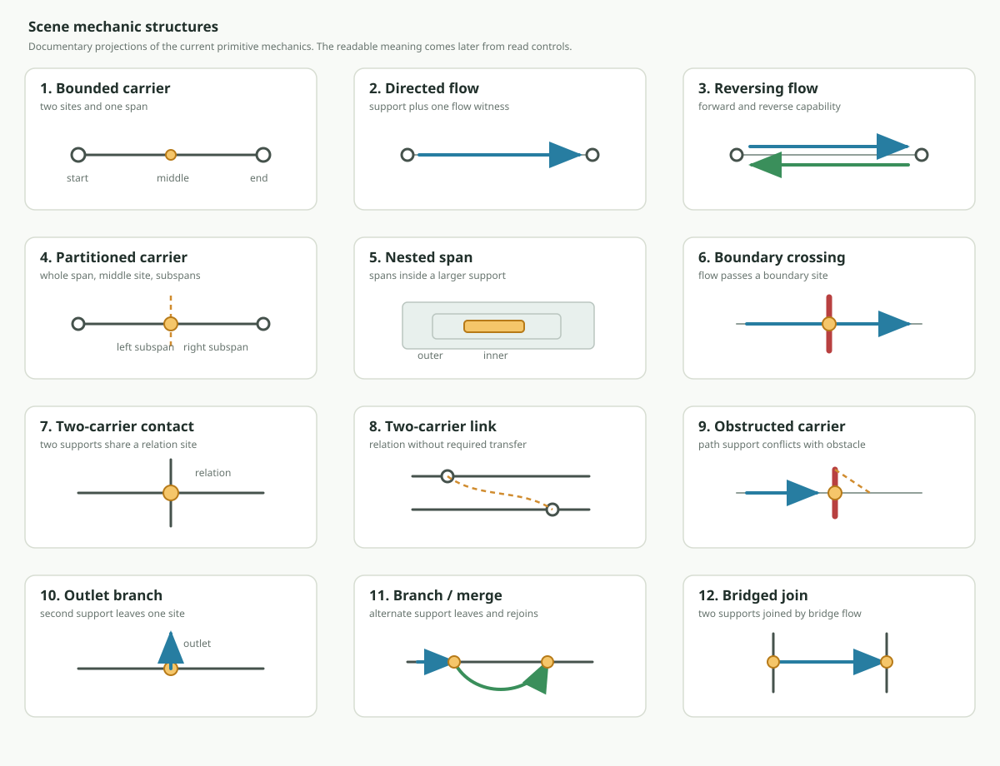
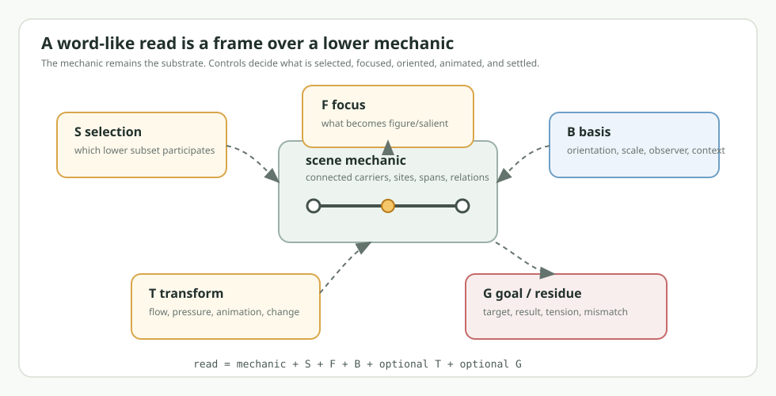

# Scene Mechanic Read Controls

Design status: pre-code working note.

This note sits one layer above `SceneMechanics.md`. Scene mechanics are the
small lower structures: bounded carrier, directed flow, contact, obstruction,
branch, bridge, and similar physical shapes. A read control is the extra
structure that lets one mechanic read as many words without turning those words
into a giant ontology.

The working bet is:

```text
word-like read
  scene mechanic
  selected subset
  focused part
  basis or perspective
  optional flow or transform
  optional goal, tension, result, or residue
```





These images are documentary projections. They are meant to make the structures
easy to inspect in this note; they are not the source of the mechanics or the
word reads. The source remains the connected Gojo carriers, points, spans,
relations, flows, and later read witnesses.

The words are not stored as the source of meaning. They are labels for stable
read recipes that can later be attached to language, UI, training examples, or
domain-specific contexts. If the same recipe is attached to English `near`,
French `pres`, or a CAD clearance hint, the lower read shape should still be
inspectable without the lexical label.

## Five Read Controls

These five controls are provisional. They may split, merge, or become lower
Gojo structures as the encoding layer matures.

| Control | Short | What it does | Typical lower evidence |
| --- | --- | --- | --- |
| Selection | `S` | Chooses the subset of the mechanic used by the read. | carrier, span, endpoint, relation, branch, obstacle, bridge |
| Focus | `F` | Makes one selected part figure-like or salient. | focused site, shared relation, center area, conflict region |
| Basis | `B` | Supplies orientation, scale, observer, domain, or comparison frame. | ordered carrier, inside/outside, layer, sensory link, route basis |
| Transform | `T` | Supplies movement, flow, pressure, animation, or state change. | directed segment, reverse flow, repetition, force, crossing |
| Goal or residue | `G` | Supplies target, constraint, expected result, tension, or settled outcome. | target site, blocked route, fit/mismatch, arrival, continuity |

Several things the user named can probably collapse into these controls:

- Observer perspective is usually `B` plus `F`.
- Goal perspective is usually `G` plus target `F`.
- "Focus on the transform" is usually `T` selected by `S` and made salient by
  `F`.
- Context such as physical, temporal, social, or CAD space is usually a `B`
  until the context itself becomes inspectable structure.

## Compact Recipe Table

Tiny entries below are not final encoding keys. They are a readable shorthand
for the control usage.

| Mechanic | Word/read | S | F | B | T | G |
| --- | --- | --- | --- | --- | --- | --- |
| Bounded carrier | interval | whole span | span | measure |  |  |
| Bounded carrier | endpoint | boundary site | boundary | span |  |  |
| Bounded carrier | start | boundary site | source side | orientation |  |  |
| Bounded carrier | end | boundary site | target side | orientation |  |  |
| Bounded carrier | middle | center region | center | resolution |  |  |
| Bounded carrier | source | start site | source role | direction | implied | release |
| Bounded carrier | target | end site | target role | direction | implied | settlement |
| Bounded carrier | near | figure + reference | low distance | scale |  | comparison |
| Bounded carrier | far | figure + reference | high distance | scale |  | comparison |
| Bounded carrier | before | figure + reference | earlier side | ordered basis |  | comparison |
| Bounded carrier | after | figure + reference | later side | ordered basis |  | comparison |
| Bounded carrier | between | interior | bounded interior | two endpoints |  |  |
| Bounded carrier | adjacent | neighbor site | closeness | ordered basis |  | local fit |
| Bounded carrier | beyond | exterior side | past boundary | ordered basis | optional pass | limit exceeded |
| Directed flow | move | path | flow | direction | active |  |
| Directed flow | send | source to target | outbound flow | route | active | target |
| Directed flow | carry | figure + path | coupled figure | route | active | preserve cargo |
| Directed flow | push | contact side | source force | force basis | active pressure | tension |
| Directed flow | pull | target side | target force | force basis | active draw | tension |
| Directed flow | transmit | conduit path | carried signal | route | active | received evidence |
| Directed flow | deliver | source + path + target | arrival | route | active | target settlement |
| Directed flow | approach | figure + reference | decreasing distance | observer/reference | active |  |
| Directed flow | depart | figure + reference | increasing distance | observer/reference | active | source left |
| Directed flow | proceed | path | continuing flow | direction | active |  |
| Directed flow | advance | path | preferred direction | rank/front basis | active | progress |
| Directed flow | retreat | path | reverse from threat | threat/front basis | active | safety/distance |
| Directed flow | guide | path + figure | route control | intended route | active | kept on path |
| Directed flow | steer | path + alternatives | direction change | control basis | active | chosen route |
| Directed flow | follow | path trace | alignment | predecessor basis | active | maintained relation |
| Reversing flow | return | same path | back direction | prior site | reverse flow | home/prior state |
| Reversing flow | reverse | flow witness | direction flip | prior direction | reverse flow |  |
| Reversing flow | undo | prior transform | cancellation | history | reverse flow | prior state |
| Reversing flow | restore | damaged state | recovery | history | reverse flow | settled prior form |
| Reversing flow | repeat | action span | recurrence | timing | repeated | pattern reused |
| Reversing flow | oscillate | cycle span | alternation | timing/range | repeated reverse | stable cycle |
| Reversing flow | alternate | two states | switching | choice/timing | repeated switch | pattern |
| Reversing flow | reciprocate | two roles | mirrored response | role basis | back/forth | balance |
| Reversing flow | exchange | two roles | traded flow | role swap | back/forth | swapped values |
| Reversing flow | answer | return path | response | prior signal | return flow | response result |
| Reversing flow | echo | return path | copy response | prior signal | return flow | resemblance |
| Reversing flow | shuttle | endpoints | transport cycle | route | repeated travel | repeated delivery |
| Reversing flow | bounce | contact + return | rebound | boundary/contact | reverse after contact | residue |
| Reversing flow | cycle | loop span | repeated loop | sequence | repeated | closed pattern |
| Partitioned carrier | split | whole + parts | partition | span basis | optional cut | subspans |
| Partitioned carrier | divide | whole + parts | partition ratio | span basis | optional cut | counted parts |
| Partitioned carrier | cut | boundary | separating action | support basis | active cut | discontinuity |
| Partitioned carrier | separate | parts | gap | support basis | separating | distance/result |
| Partitioned carrier | halve | two subspans | equality | center basis | optional split | equal parts |
| Partitioned carrier | center | midpoint | center site | span basis |  |  |
| Partitioned carrier | cross | partition + path | crossing mark | side basis | flow through | side change |
| Partitioned carrier | before | left/upstream side | earlier region | ordered basis |  | comparison |
| Partitioned carrier | after | right/downstream side | later region | ordered basis |  | comparison |
| Partitioned carrier | enter | boundary + side | inward crossing | inside/outside | flow | inside result |
| Partitioned carrier | exit | boundary + side | outward crossing | inside/outside | flow | outside result |
| Partitioned carrier | repair | broken partition | restored join | prior whole | joining | continuity |
| Partitioned carrier | fork | partition + outlets | route split | route basis | flow split | alternatives |
| Partitioned carrier | border | partition mark | boundary | side basis |  |  |
| Nested span | contain | inner + outer | interior relation | container |  | fit |
| Nested span | cover | outer + inner | overlay | layer/area |  | hidden/protected |
| Nested span | include | inner + outer | membership | set/container |  | accepted part |
| Nested span | surround | outer span | enclosure | area/multi-side |  | held inside |
| Nested span | overlap | shared region | intersection | two spans |  | shared area |
| Nested span | occupy | filled region | presence | capacity |  | occupied amount |
| Nested span | inside | inner | interior | container |  | fit |
| Nested span | within | inner | bounded interior | tolerance/frame |  | allowed range |
| Nested span | under | nested/layered span | lower layer | vertical/layer |  | covered/support |
| Nested span | over | nested/layered span | upper layer | vertical/layer | optional span | cover/exceed |
| Nested span | full | capacity span | filled amount | capacity |  | saturation |
| Nested span | empty | capacity span | absence | capacity |  | no occupancy |
| Nested span | hide | covered region | invisibility | observer/layer |  | concealed |
| Nested span | reveal | covered region | visibility | observer/layer | uncovering | visible |
| Nested span | wrap | outer span | enclosure surface | area/layer | surrounding | protected |
| Boundary crossing | cross | boundary + path | crossing | side basis | flow through | side change |
| Boundary crossing | enter | boundary + side | inward crossing | inside/outside | flow | inside |
| Boundary crossing | exit | boundary + side | outward crossing | inside/outside | flow | outside |
| Boundary crossing | pass | path + boundary | traversal | route | flow through | continued |
| Boundary crossing | pierce | boundary point | forced crossing | surface | force through | residue |
| Boundary crossing | penetrate | boundary + interior | deep crossing | surface/interior | force through | inside reached |
| Boundary crossing | emerge | far side | visibility/result | observer side | flow out | revealed |
| Boundary crossing | leave | source side | departure | inside/outside | flow out | outside/source left |
| Boundary crossing | threshold | boundary | decision surface | state basis | optional cross | limit |
| Boundary crossing | transition | states + boundary | state change | before/after state | crossing | new state |
| Boundary crossing | arrive | target side | settlement | route | flow | goal reached |
| Boundary crossing | depart | source side | release | route | flow | source left |
| Boundary crossing | admit | boundary gate | allowed entry | rule/inside | flow | permitted inside |
| Boundary crossing | reject | boundary gate | refused entry | rule/inside | blocked flow | outside/tension |
| Two-carrier contact | contact | relation site | shared site | two supports | optional pressure |  |
| Two-carrier contact | touch | relation site | light contact | two supports | minimal pressure |  |
| Two-carrier contact | intersect | relation site | shared crossing | orthogonal support |  | shared point |
| Two-carrier contact | cross | both carriers | crossing/continue | orthogonal support | flow through | continued route |
| Two-carrier contact | meet | relation site | arrival | converging paths | approach | shared site |
| Two-carrier contact | collide | relation site | impact | incompatible paths | force into contact | residue/tension |
| Two-carrier contact | corner | endpoint relation | turn site | support geometry | optional turn | route option |
| Two-carrier contact | T-contact | endpoint + interior | T shape | support geometry | optional merge | route option |
| Two-carrier contact | left | outgoing side | left option | observer direction | turn | chosen side |
| Two-carrier contact | right | outgoing side | right option | observer direction | turn | chosen side |
| Two-carrier contact | continue | through path | no turn | route basis | flow through | preserved route |
| Two-carrier contact | stop | relation site | termination | route basis | halted flow | stopped result |
| Two-carrier contact | press | contact site | pressure | contact normal | sustained force | tension |
| Two-carrier contact | strike | contact site | impact | path basis | forceful contact | residue |
| Two-carrier contact | slide | contact span | moving contact | support tangent | flow along contact | friction/residue |
| Two-carrier link | see | observer + target | visual link | visual basis | signal implied | evidence |
| Two-carrier link | hear | observer + target | auditory link | auditory basis | signal implied | evidence |
| Two-carrier link | sense | observer + target | perception | sensory basis | signal implied | evidence |
| Two-carrier link | notice | target subset | selected target | observer | attention | salience |
| Two-carrier link | inspect | target detail | resolving focus | observer/resolution | attention scan | detail |
| Two-carrier link | contact | two sides | communication link | social/comm basis | optional signal | relation |
| Two-carrier link | reference | pointer + target | pointer relation | symbolic basis |  | aboutness |
| Two-carrier link | attend | target | held focus | observer | attention | maintained focus |
| Two-carrier link | depend | linked supports | requirement | settlement basis |  | dependency |
| Two-carrier link | know | target pattern | stable match | memory/context |  | identified |
| Two-carrier link | recognize | target pattern | match event | memory/context | compare | identified |
| Two-carrier link | ignore | possible target | excluded focus | observer |  | non-selection |
| Two-carrier link | signal | source + target | transmitted evidence | channel basis | signal | received/available |
| Two-carrier link | point | pointer + target | directed reference | symbolic/spatial |  | target indicated |
| Obstructed carrier | block | path + obstacle | blocked region | path basis | interrupted | no route |
| Obstructed carrier | stop | moving figure | halt point | path basis | interrupted | stopped |
| Obstructed carrier | obstruct | path + obstacle | conflict | path basis | interrupted | blocked route |
| Obstructed carrier | resist | obstacle + flow | force conflict | path/obstacle | pressure | tension |
| Obstructed carrier | prevent | goal path | failed settlement | goal basis | blocked | impossible now |
| Obstructed carrier | delay | goal path | slowed settlement | timing/goal | slowed | later result |
| Obstructed carrier | jam | conflict region | stuck tension | path/obstacle | pressure | unresolved |
| Obstructed carrier | collide | moving figure + obstacle | impact | path basis | flow into obstacle | residue |
| Obstructed carrier | avoid | obstacle + route | rejected span | goal basis | reroute | goal preserved |
| Obstructed carrier | detour | alternate path | reroute | route basis | alternate flow | goal preserved |
| Obstructed carrier | clear | obstacle relation | removal/opening | constraint basis | release | route open |
| Obstructed carrier | permit | path + rule | allowed route | rule basis | release | flow allowed |
| Obstructed carrier | constrain | path + rule | narrowed options | constraint basis | limited flow | allowed subset |
| Obstructed carrier | forbid | path + rule | denied route | rule basis | blocked | prohibited |
| Outlet branch | branch | attach site + outlet | divergence | primary support | optional flow | new route |
| Outlet branch | leave | primary + outlet | departure | source/primary | outward flow | source left |
| Outlet branch | exit | boundary + outlet | outward route | inside/outside | outward flow | outside |
| Outlet branch | emit | source + outlet | release | source basis | outward flow | emitted figure |
| Outlet branch | escape | constraint + outlet | freed route | container/threat | outward flow | freedom/outside |
| Outlet branch | diverge | primary + branch | separation | path basis | flow apart | alternative |
| Outlet branch | rise | outlet path | upward change | vertical/layer | upward flow | higher layer |
| Outlet branch | descend | outlet path | downward change | vertical/layer | downward flow | lower layer |
| Outlet branch | lift | figure + outlet | raised figure | vertical/layer | upward force | higher support |
| Outlet branch | drop | figure + outlet | lowered figure | vertical/layer | downward flow | lower support |
| Outlet branch | launch | source + outlet | energetic release | source basis | outward force | sent away |
| Outlet branch | split | primary + outlet | branching | route basis | flow split | multiple routes |
| Outlet branch | vent | source + outlet | release channel | pressure basis | outward flow | pressure lowered |
| Outlet branch | pour | source + outlet | continuous release | container basis | outward flow | transferred amount |
| Branch/merge | avoid | rejected span + branch | alternate route | goal/path | reroute | goal preserved |
| Branch/merge | bypass | rejected span + branch | path around | route basis | alternate flow | obstacle skipped |
| Branch/merge | detour | branch path | reroute | route basis | alternate flow | goal preserved |
| Branch/merge | route | selected path | chosen route | routing basis | flow | required path |
| Branch/merge | go-around | obstacle span + branch | around path | obstacle basis | alternate flow | obstacle skipped |
| Branch/merge | bridge | branch span | connector | gap/obstacle basis | optional flow | continuity |
| Branch/merge | over | branch span | higher route | layer basis | flow | crossing |
| Branch/merge | under | branch span | lower route | layer basis | flow | crossing |
| Branch/merge | via | intermediate path | required middle | route basis | flow | through waypoint |
| Branch/merge | return | merge site | back to primary | primary basis | flow back | rejoined |
| Branch/merge | rejoin | merge site | reconnection | primary basis | flow into primary | continuity |
| Branch/merge | repair | broken primary + branch | restored path | prior whole | joining | continuity |
| Branch/merge | divert | primary + branch | redirected flow | route/control | flow to branch | new route |
| Branch/merge | reconnect | separated path + branch | restored connection | prior whole | joining | connected |
| Bridged join | join | two supports + bridge | relation through bridge | support basis | optional flow | continuity |
| Bridged join | attach | bridge endpoint | attachment | host/support | settling | stable contact |
| Bridged join | bridge | bridge carrier | connector | gap basis | optional flow | gap crossed |
| Bridged join | glue | bridge material | bonding support | material basis | settling | stable bond |
| Bridged join | connect | two supports + bridge | connection | support basis | optional flow | continuity |
| Bridged join | fasten | attachment sites | secured relation | material/tool basis | settling | stable bond |
| Bridged join | repair | gap + bridge | restored path | prior whole | joining | continuity |
| Bridged join | conduct | bridge carrier | flow path | conduit basis | active flow | signal/energy passed |
| Bridged join | transmit | bridge carrier | carried signal | conduit basis | active flow | received signal |
| Bridged join | span | bridge carrier | length across gap | gap basis | optional flow | gap covered |
| Bridged join | link | bridge relation | connection | support/symbolic | optional signal | related supports |
| Bridged join | assemble | parts + bridge | constructed whole | build context | joining | larger structure |
| Bridged join | solder | bridge material | conductive bond | material/electrical | settling + conduct | stable conduction |
| Bridged join | weld | bridge/joint material | fused bond | material/force | heat/settle | continuous support |
| Bridged join | couple | two supports + bridge | linked behavior | system basis | optional flow | shared response |

## Word Notes By Mechanic

### Bounded Carrier

The bounded carrier is mostly static. The read controls should not smuggle
motion into it. Words such as `interval`, `endpoint`, `start`, `end`, `middle`,
`between`, `near`, `far`, `before`, and `after` come from selecting sites or
subspans and reading them against a basis.

`near` and `far` are comparison reads, not stored distance words. A reference
site and a selected figure site are compared at some resolution. `Before` and
`after` are the same kind of read over an ordered basis instead of a distance
basis. `Source` and `target` are endpoints read through an implied route or
goal; they become stronger when flow evidence is also present.

Useful added nuance:

```text
adjacent
  near plus ordered neighbor evidence

beyond
  after plus a boundary or limit that has been exceeded
```

### Directed Flow

Directed flow adds energy or animation over a support. The same support can be
read as `move`, `send`, `carry`, `push`, `pull`, `transmit`, or `deliver`
depending on which subset is focused.

`Move` focuses the flow itself. `Send` focuses source-side release. `Deliver`
adds target settlement. `Carry` adds a coupled figure that remains with the
flow. `Push` and `pull` introduce a force basis: pressure from behind or
attraction from ahead. `Approach` and `depart` require observer/reference basis,
because the important fact is changing distance relative to something.

Useful added nuance:

```text
guide
  flow plus route constraint

steer
  flow plus route alternatives and a chosen direction

follow
  flow aligned to a prior trace or leading participant
```

### Reversing Flow

Reversing flow is directed flow plus a remembered or available opposite. The
read often needs a time/history basis. `Return`, `reverse`, `undo`, `restore`,
`repeat`, `oscillate`, `alternate`, `reciprocate`, `exchange`, `answer`, `echo`,
and `shuttle` all select different parts of the same back-and-forth capability.

`Undo` and `restore` are not just reverse motion. They need a prior state as
goal. `Reciprocate`, `exchange`, and `answer` need role basis. `Oscillate`,
`alternate`, `repeat`, and `cycle` need repeated samples over time.

Useful added nuance:

```text
bounce
  contact plus reverse flow after impact

cycle
  repeated return through a closed or remembered sequence
```

### Partitioned Carrier

A partitioned carrier exposes a whole, a dividing site, and subspans. Words such
as `split`, `divide`, `cut`, `separate`, `halve`, `center`, `cross`, `enter`,
`exit`, and `repair` are different reads over that exposed middle.

`Split` and `divide` focus the subspans. `Cut` focuses an active separating
transform. `Separate` focuses the resulting gap or independence. `Halve` uses an
equality or center basis. `Enter` and `exit` happen when the partition is read
as a boundary and the selected flow changes side. `Repair` reads a damaged or
separated span through a goal of restored continuity.

Useful added nuance:

```text
fork
  partition becomes route alternatives

border
  partition is read as a stable side-separating boundary
```

### Nested Span

Nested span is the static structure behind many area, containment, and layer
words. `Contain`, `include`, `inside`, and `within` focus the inner/outer
relation. `Cover`, `surround`, `under`, and `over` need a layer or perspective
basis. `Overlap` focuses the shared region. `Full` and `empty` require a
capacity basis.

The important control is often basis. The same lower nesting can be physical
area, time interval, membership, tolerance, social context, or CAD enclosure.

Useful added nuance:

```text
hide
  cover plus observer basis where target is not visible

reveal
  removal or change of cover that makes target visible

wrap
  surrounding cover read as a protective or enclosing surface
```

### Boundary Crossing

Boundary crossing is partition plus flow. `Cross`, `pass`, `enter`, `exit`,
`leave`, `pierce`, `penetrate`, `emerge`, `threshold`, `transition`, `arrive`,
and `depart` all depend on side basis and flow.

`Enter` and `exit` differ by perspective: which side is inside, and which side
the figure occupies after crossing. `Pierce` and `penetrate` add resistance or
surface pressure. `Threshold` focuses the boundary as a decision surface.
`Transition` focuses the state change rather than the geometry.

Useful added nuance:

```text
admit
  crossing allowed by a gate, rule, or compatibility basis

reject
  crossing blocked by a gate, rule, or incompatibility basis
```

### Two-Carrier Contact

Two-carrier contact is a relation between independently readable supports.
`Contact`, `touch`, `intersect`, `cross`, `meet`, `collide`, `corner`,
`T-contact`, `left`, `right`, `continue`, and `stop` are not separate mechanics.
They are reads over the relation site, the attachment ticks, and possible flow.

`Intersect` can be static. `Cross` usually adds flow through the relation.
`Meet` adds converging movement. `Collide` adds incompatible motion and residue.
`Corner` and `T-contact` come from where the relation attaches along the two
carriers: endpoint/endpoint, endpoint/interior, middle/middle, and so on.
`Left`, `right`, `continue`, and `stop` need an observer direction and route
choice.

Useful added nuance:

```text
press
  contact plus sustained pressure

strike
  contact plus energetic impact

slide
  contact relation persists while the focused site moves along a support
```

### Two-Carrier Link

Two-carrier link is contact without requiring physical touch or transfer. It is
the natural lower mechanic for observer-target, sign-target, and dependency
relations.

`See`, `hear`, and `sense` add sensory basis. `Notice`, `inspect`, and `attend`
add observer focus and resolution. `Reference` and `point` add symbolic or
indexing basis. `Depend` adds settlement requirement. `Know` and `recognize`
add memory/context match. `Ignore` is a real read: it selects the observer and
available target but leaves the target outside focus.

Useful added nuance:

```text
signal
  link plus evidence that can travel or be received

point
  directed reference toward a target
```

### Obstructed Carrier

Obstruction adds a second support that conflicts with a selected path region.
`Block`, `obstruct`, `stop`, `resist`, `prevent`, `delay`, `jam`, `collide`,
`avoid`, `detour`, `clear`, and `permit` differ mainly in goal and residue.

`Block` and `obstruct` focus the incompatible region. `Stop` focuses the
halted figure. `Resist` and `jam` preserve unresolved pressure as tension.
`Prevent` and `delay` need a goal basis. `Avoid` and `detour` preserve the goal
but change the route. `Clear` and `permit` remove or relax the blocking
constraint.

Useful added nuance:

```text
constrain
  obstacle/rule narrows possible routes without necessarily blocking all routes

forbid
  rule basis blocks the route even if physical flow might be possible
```

### Outlet Branch

Outlet branch has a primary support and a secondary support leaving a site.
`Branch`, `leave`, `exit`, `emit`, `escape`, `diverge`, `rise`, `descend`,
`lift`, `drop`, `launch`, and `split` are different focuses over departure,
release, and layer change.

`Emit`, `vent`, and `pour` focus source-side release. `Escape` adds constraint
or threat. `Rise`, `descend`, `lift`, and `drop` require vertical or layer
basis. `Split` and `diverge` focus the new route rather than the source.

Useful added nuance:

```text
vent
  outlet releases pressure or accumulated participation

pour
  continuous amount leaves a container through an outlet
```

### Branch And Merge

Branch/merge is the alternate-route mechanic. It is especially important for
distributed problem solving because it can retain the original goal while
changing the lower route.

`Avoid`, `bypass`, `detour`, and `go-around` focus a rejected span and an
alternate support. `Route` and `via` focus the chosen path. `Over` and `under`
add layer basis. `Return` and `rejoin` focus the merge back into primary
support. `Repair` reads the branch as restored continuity.

Useful added nuance:

```text
divert
  flow leaves the primary route because of a control, conflict, or choice

reconnect
  separated supports regain continuity through an alternate path
```

### Bridged Join

Bridged join has two independent supports and a third readable connector. In
the current fixture the bridge carrier carries directed flow, but the same
mechanic can also support static material bridge reads.

`Join`, `connect`, and `link` focus the relation through the bridge. `Attach`,
`fasten`, `glue`, `solder`, and `weld` focus the bridge endpoints and material
or bonding basis. `Bridge` and `span` focus the connector crossing a gap.
`Conduct` and `transmit` focus flow through the bridge. `Assemble` reads the
joined parts as a larger constructed whole.

Useful added nuance:

```text
solder
  conductive bridge material plus stable attachment

weld
  fused support where bridge and parts become more continuous

couple
  two supports linked so behavior or state transfers between them
```

## Pseudo Encoding Sketch

This is not JSON and not final syntax. It is a semi-algebraic way to show the
shape a future encoding might preserve.

```text
read(label, mechanic)
  S: selected lower evidence
  F: focused subset or figure
  B: basis, perspective, scale, or context
  T: transform, flow, pressure, repetition, or animation
  G: goal, result, residue, or tension
```

The label is a lexical/debug attachment. The structural part is the read frame.

### Near

```text
near :=
  read(label = "near", mechanic = bounded-carrier)
    S: figure-site + reference-site
    F: low-distance relation
    B: selected scale/resolution/context
    T: none
    G: comparison settles inside near band
```

The same lower comparison can be spatial, temporal, social, CAD, or abstract.
The basis supplies that context. The word does not own the meaning.

### Deliver

```text
deliver :=
  read(label = "deliver", mechanic = directed-flow)
    S: source-site + path + target-site + carried-figure
    F: arrival and handoff at target
    B: route/context basis
    T: directed flow from source to target
    G: target settlement receives carried figure
```

This is close to `send`, but `send` can succeed as source-side release while
`deliver` needs target-side settlement.

### Collide

```text
collide :=
  read(label = "collide", mechanic = two-carrier-contact)
    S: contact relation + incoming flow witnesses
    F: impact site
    B: incompatible route/force basis
    T: converging flow into shared relation
    G: residue/tension remains at contact
```

The same contact support can read as `touch` if the transform and residue are
small, or `intersect` if the read is static.

### Avoid

```text
avoid :=
  read(label = "avoid", mechanic = obstructed-carrier + branch-merge)
    S: rejected path span + obstacle + alternate branch
    F: route choice around conflict
    B: original goal/path basis
    T: flow transfers from primary span to branch and back
    G: goal preserved while conflict span is not used
```

This keeps the higher intent stable. If the obstacle disappears, the lower
branch can be removed or recalculated without deleting the original goal.

### Conduct

```text
conduct :=
  read(label = "conduct", mechanic = bridged-join)
    S: bridge carrier + support attachments
    F: flow through bridge
    B: conduit/electrical/material basis
    T: directed flow over bridge
    G: signal/energy reaches the other support
```

`Bridge` and `span` may use the same lower mechanic without active flow. They
focus connector support instead of transmission.

### Repair

```text
repair :=
  read(label = "repair", mechanic = partitioned-carrier | branch-merge | bridged-join)
    S: damaged/gapped support + candidate connector
    F: restored continuity
    B: prior-whole or expected-function basis
    T: joining, bridging, or rerouting transform
    G: tension from gap lowers through new continuity
```

This is a good example of one word using several possible mechanics. The stable
part is not the mechanic alone. It is the goal-oriented read: damaged support is
settled toward continuity.

## Loose Language Mapping

The six-slot read frame is not meant to mirror traditional grammar one-to-one.
It is a structural layer that language can point at with word order, small
function words, stress, punctuation, morphology, and context. Still, the mapping
is useful for finding missing pieces.

| Read-frame piece | Loose language role | Typical examples |
| --- | --- | --- |
| `selected-source-frame` | noun phrase, participant frame, argument material | `the trace`, `a pin`, `Mary`, `the bridge`, `the obstacle` |
| `focus-witness` | subject, topic, figure, emphasized part | what the sentence foregrounds or asks about |
| `basis-witness` | preposition, case, comparison frame, observer/domain context | `near`, `in`, `through`, `before`, `on the PCB`, `from here` |
| `transform-witness` | verb, event, process, action profile | `move`, `send`, `cross`, `split`, `cover`, `join` |
| `goal-or-residue-witness` | object, complement, result, modal tension, completion state | `to B`, `into the box`, `blocked`, `can`, `must`, `done` |
| `lexical/debug attachments` | actual language surface and inspection labels | token order, spelling, language, stress, debug name |

Adjectives and adverbs often look like parameterized reads rather than separate
mechanics. An adjective usually parameterizes a selected participant or its
basis: `red trace`, `large pad`, `near pin`, `blocked route`. An adverb usually
parameterizes a transform or whole read frame: `quickly`, `partly`, `again`,
`carefully`, `almost`, `not yet`.

Prepositions are mostly basis/relation reads. Verbs are mostly transform reads
with selected roles. Nouns are often stable selected structures or crystallized
participant shapes. Determiners and pronouns mostly affect selection
resolution: known/unknown, one/many, generic/specific, current-context handle.
Conjunctions compose frames, sequence frames, or preserve alternatives.
Tense/aspect is a timeline basis over the transform. Negation is often absence,
blocked participation, or an opposed read over an expected frame. Questions are
reads with a missing or unresolved slot made salient. Commands are reads whose
goal state is requested rather than merely described.

Some grammar-like information is probably not a seventh primary slot. It is
often hinted by language surface and may later become separate witness structure
when needed:

- role-binding hints: which selected part behaves as figure, ground, source,
  target, agent, patient, instrument, route, or obstacle
- frame-mode hints: assertion, question, command, hypothesis, definition,
  wish, instruction
- composition and attachment hints: which modifier or phrase attaches to which
  lower frame
- scope and quantification hints: `all`, `some`, `none`, `any`, `each`, `a`,
  `the`, many, one
- surface-evidence hints: token order, stress, pause, punctuation, prosody,
  contraction, repetition, language, spelling

These upcoming hints are important, but they should not force the first
read-frame surface to become a full grammar object. They can begin as lexical
or debug attachments, residue, or tiny adjacent witnesses. When one of them
starts carrying durable structure, it can be promoted into a readable Gojo
witness without changing the six-slot frame.

## First Code Proof

The first implementation is intentionally small: `SceneMechanicReadFrameSurface`
stores the six-slot read frame as ordinary ordered Gojo relation structure
rather than as one class per word. Its shape is:

```text
read-frame
  selected-source-frame
  focus-witness
  basis-witness
  transform-witness
  goal-or-residue-witness
  lexical/debug attachments
```

In code, those six entries are not just six anonymous ordered elements. Each
entry is a local slot binding on a shared read-frame slot carrier. That lets the
surface distinguish a read frame from some other six-element structure, such as
a basis read.

That slot carrier is still a compact scaffold, not the final story for grammar
attachment. A later read frame should be able to discover its parts from local
witness shape, shared source structure, attachment tension, and missing-but-
requested evidence rather than from slot order alone. This matters because
language can introduce focus, goal, mode, modifier, and residue at different
times, omit some of them entirely, or make one of them salient only through a
small word, pause, stress, or repeated surface. The current proof keeps the
slots explicit so the shape is testable; the expected direction is to let those
slot roles become locally derivable.

The initial proof tests cover `near`, `deliver`, `avoid`, and `conduct`, plus
three reads over the same two-carrier contact mechanic: `cross`, `stop`, and
`turn-left`. In that contact proof the selected source frame and focus witness
stay shared, while the transform, basis, and goal witnesses change. The tests
also include a question-like read and an adjective/modifier-like read. The
question and modifier information stays in lexical/debug attachments as hints;
the primary frame still has the same six slots.

The compact JSON fixture
`Gojo.Encoding.Tests/Fixtures/EncoderJson/grammar/scene-mechanic-read-frames.compact.json`
proves a definition-backed `near` read can reload through the interchange
format. The read frame references reusable definitions for source, focus,
basis, open transform, goal, and lexical attachments instead of expanding each
slot body repeatedly.

The next coding step should still stay small:

1. Choose three mechanics: bounded carrier, two-carrier contact, bridged join.
2. Encode two or three read frames over each mechanic.
3. Prove that changing focus/basis changes the read without changing the lower
   mechanic.
4. Prove that the same lexical label can be attached in multiple languages or
   omitted entirely while the structural read still works.
5. Preserve failed or partial reads as residue/tension instead of exceptions.

That would give us a real test of whether these controls are computable without
becoming an ontology.
