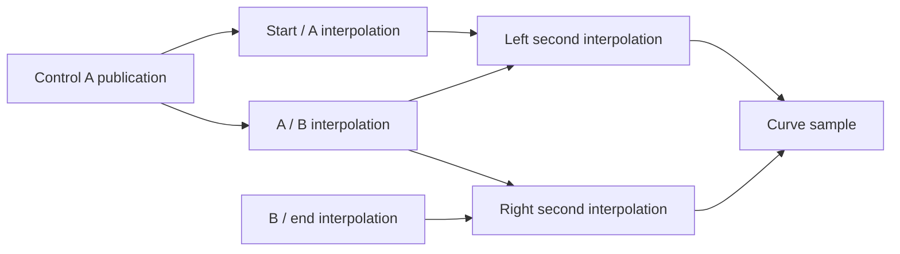

# A control moves: keeping current answers and earlier evidence distinct

Status: implemented fixture and local replay extension, September 2026.

Start with the [visual walkthrough](examples/curve-replay.html), or the example
below. The visual illustrates checked fixture values; its buttons select
stages rather than execute Gojo in the browser.

## The real-world example

Imagine drawing a curved handle. Its cubic Bézier curve has controls
`(0,0), (4,8), (8,0), (12,4)`. We calculate one point on it at parameter
`t=1/2`: `(6,3.5)`. This parameter midpoint is not necessarily halfway along
the curve's length.

Now move the first inner control from `(4,8)` to `(4,16)`. The recalculated
point is `(6,6.5)`. The control moved eight local drawing units; this particular
sample moved three. Different samples respond by different amounts.

The interesting interval is after the control changes and before that sample
has been recalculated. The old value is still exactly the answer for the old
curve. It is stale as an answer for the new curve.

| Stage | Current control A | Current sample | Earlier sample |
| --- | --- | --- | --- |
| Original observations | `(4,8)` | `(6,3.5)` | Retained with its inputs |
| Edit published | `(4,16)` | Pending | `(6,3.5)` remains historical evidence |
| First affected calculations refreshed | `(4,16)` | Pending | Still retained |
| Remaining calculations refreshed | `(4,16)` | `(6,6.5)` | Still `(6,3.5)`, with the earlier inputs |

This same distinction appears when a sensor publishes a new reading, an
estimate changes, or a local space revises an interpretation. A downstream
answer can remain mathematically correct for its earlier premises while no
longer answering the current question. An unchanged visible answer can also
need refreshed provenance if its supporting observations change.

## What the fixture actually does

The [syntax fixture](../../Tests/Gojo.Encoding.Tests/Fixtures/Syntax/bezier-replay.gojo)
connects a control-publication port, six interpolation instructions, an
independent observation, initial bindings, an explicit edit, and open replay
and timeline roles. The [tests](../../Tests/Gojo.Encoding.Tests/GojoSyntaxReplayTests.cs)
fill those roles with ordinary focus, application, dependency, stale-dependency,
replay and time-step structures.

Each cubic sample uses six local interpolations. Each takes two inputs and a
parameter contract, and publishes one result. Later interpolations consume
those actual outputs:

The control change affects five of the six calculations. The B/end
interpolation remains `(10,2)` and is carried forward. A separate observation
using an independently authored `(4,8)` point also remains unchanged. Sharing
a coordinate basis, or currently having identical coordinates, does not turn
that other point into the edited control.

The exercise proceeds as follows:

1. **Observe the original construction.** Use the exact affine reader for each
   interpolation. Record the inputs, output, and mathematical witness in a
   transform application. Preserve the original application frame.
2. **Publish the edit through the same role.** Bind a new control version to
   the publication input. Connect the old and new versions explicitly. Build
   a focus change and the control publication's replay record.
3. **Read the affected region.** Follow producer-output/consumer-input
   connections inside the selected dependency frame. Keep the two unaffected
   applications in the current frame; withhold all affected old applications
   from it. Keep them in the earlier frame and affected slice.
4. **Pause with explicit pending work.** Immediately after publication, the
   first two consumers have stale dependencies. The full affected slice also
   retains the later consumers beyond that immediate boundary.
5. **Resume in local steps.** Recalculate an interpolation, publish its new
   result, and expose the next stale dependencies. A consumer waits until all
   its affected producers have been refreshed. If two inputs changed, one
   consumer replay discharges both incoming stale edges.
6. **Publish the final sample and retain the transition.** The current frame
   regains all eight applications, with the two unaffected applications still
   the same objects. The sample is `(6,6.5)`. The timeline connects every pause
   and replay to the earlier state. An unrelated residue remains even after
   the curve's dependencies have been refreshed.

No global solver chooses a result here. The caller chooses which exposed local
read to perform, and the existing arithmetic supplies its result. The replay
mechanism checks structural progress and records supplied observations; it
does not independently certify their mathematical or real-world truth.

## Why the old inputs must also be retained

Keeping only a pointer to a live control is insufficient history. If that
control's shared tick moves from 8 to 16, an old witness that still points to it
now appears to have used 16, even though its stored sample remains 3.5.

The main fixture uses explicit old and new coordinate versions, connected by
the edit, rather than retargeting the historical input. This retains the same
publication role while distinguishing the observations supplied through it.
The test also captures the complete original application frame numerically
and checks that publishing and replaying the new version leaves it unchanged.

A separate counterexample deliberately retargets a live tick through an
explicit structural import. It demonstrates the drift in the live reference,
then restores a packet captured before the change and recovers the original
input and result. A packet captured only after the drift could not recover the
lost earlier tick value.

The authored versions are not intrinsically immutable objects. Code that
deliberately retargeted the old version would still change it. The exact
history promise therefore requires retained versions under that ownership
contract, or an actual captured packet. Shared axes do not supply immutable
historical coordinates by themselves.

## Problems exposed and corrected

The original dependency discovery could equate structurally equal point
groups and could treat input-binding targets as produced output. The example
revealed false edges, including dependencies on the independent lookalike and
backward edges between calculations that merely shared inputs.

Discovery now follows participant references, shared grounded tick sites and
output-role bindings. Rebuilding a point wrapper around the same carrier and
tick still exposes that shared site; independently authored equal ticks do not.
Explicit dependency evidence remains available when two different exposed
participants are deliberately connected. Three older operation-output tests
now explicitly publish the consumed result through the declared output port;
numeric resemblance to a calculated target alone is not that connection.

The earlier residue-only resume helper could also leave one stale record
behind when two changed producers fed the same consumer. It now removes all
stale records for that replayed consumer and preserves unrelated residue.

For a longer chain, the immediate stale records alone do not describe every
downstream connection. The new
[`TryResumeDependencyReplay`](../Structures/TransformSurface.Replay.cs)
therefore takes the retained affected slice explicitly. It checks readiness
against that selected graph, recomputes the next stale boundary, and keeps the
slice and preceding partial replay in provenance. The older residue-only
helper remains usable for discharging known stale edges; it does not claim to
discover further downstream obligations.

## What this proves, and what remains open

The fixture demonstrates one explicit edit, local dependency discovery,
partial progress, exact recomputation, and historical correspondence. It checks
the complete process before and after numeric restoration. It also restores a
paused replay together with its dependency context and successfully continues
from that restored state.

It does not add an autonomous observer or scheduler. A caller must announce
the changed focus, retain the relevant dependency scope, and choose the next
read. Nor does it supply a policy for concurrent edits, feedback cycles,
conflicting observations, or compression of history.

Staleness is one form of incomplete local knowledge. This exercise keeps it
separate from a measurement distribution or uncertain control range. Here the
new coordinates are exact; what is temporarily unavailable is an observation
whose inputs all belong to the refreshed construction. The same lifecycle
can later carry bounded or distribution-valued observations without changing
that distinction.
