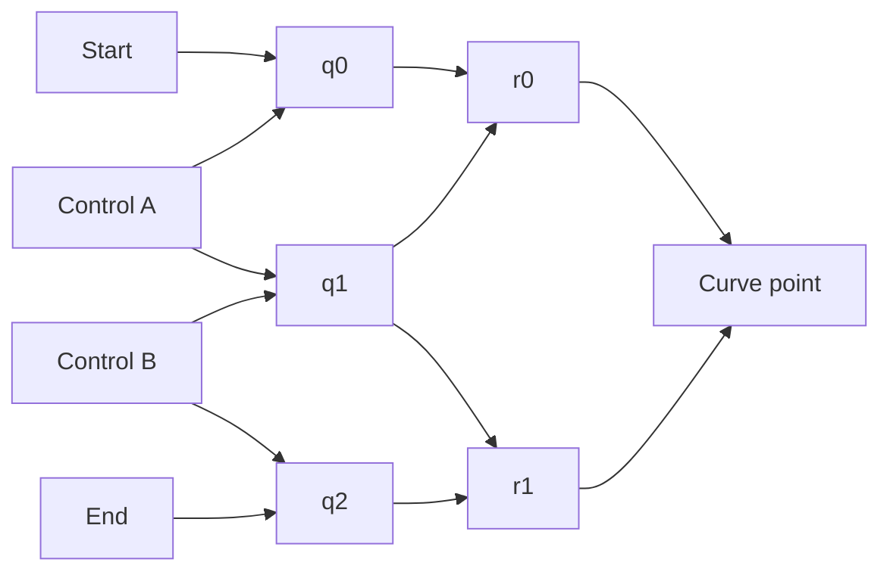

# Syntax exercised against graphic structure

Status: representation review and executable fixtures, September 2026.

Follow-up: the [selected affine construction fixture](GojoAffineConstructionFixture.md)
now implements exact interpolation, derivative-displacement checks and exposed
motif correspondence. The review below records the original pass and the gaps
it identified. The linked follow-up is authoritative for the current status
of those three contracts; the Bézier and frieze fixtures have been extended.

The syntax can express the selected graphic structures with one small
authoring addition: `group_on(holder, ...)`. The more significant gaps concern
how much a selected reader may conclude from a compact shape. Transporting a
graph does not establish geometric intent, continuity, construction validity
or an infinite pattern's symmetry.

This pass authors structures, applies explicit placeholder bindings and checks
existing local reads. It adds no curve sampler, frieze expander, rendering
backend, compiler or machine-learning operations.

## Inventory and evidence

| Source examined | Representation exercised | Result |
| --- | --- | --- |
| Blocks primitive glossary and `GraphicStructure` | Ordered segments, opposed-start directed segments and shared junctions | Existing primitives suffice; flow face, order and site identity stay distinct |
| `GraphicParameterSurface` and SketchViewer house/leaf instances | Normalized parameters, coarse/fine results, templates and bindings | Reproduced the surfaces; corrected a reader that accepted unrelated parameter frames |
| Native line/circle structures | An orthogonal point or zero span crystallized into a carrier promise | Expressible without coordinate tuples; the captured promise stays stable when its source moves |
| `GraphicConceptShape` ports and sections | Known start site, open endpoint, trace, tangent, normal and residue | Partial construction remains readable before full geometry exists |
| `GraphicStructure.FramePoint` and curve readers | Shared holder and ordered x/y/z carriers | Added `group_on`; coordinate compatibility currently follows axes rather than holder identity |
| Blocks line–line, line–arc and arc–arc Bézier rows | Incoming section, bridge and outgoing section | Fixed bridges to share the actual surrounding endpoint references |
| Existing quadratic/cubic CAD recipes | Chord/control and chord/control-span structure | Ordinary examples read; degenerate cases expose ambiguity |
| `TransformSurface.Interpolate` | Six connected interpolation requests for a cubic construction | Shared parameter, control order and intermediate dependencies survive partial binding and transport |
| `RepeatSurface`, transforms and affine frames | Translation and glide-reflection generators over a motif | Exploratory representation; coordinate laws checked, general expansion remains open |
| GearShapeLadder and Visualizer ladder sources | Repeated profile, transforms, correspondence and history | Composition precedents reviewed; a whole gear or ladder was not re-authored |

Sources are current builders and readers. Glossary JSON files are sparse
teaching projections containing some caption-derived hints, not semantic
proofs. The three affected snapshots were regenerated after the bridge fix;
existing tests require them to agree with the live teaching projection. The
full inventory also checks current Blocks exports through two numeric round
trips.

The legacy teaching projection also treats the word `tangent` in a note as a
positive hint, even in a sentence denying continuity. The bridge note avoids
creating that misleading hint. This is a remaining limitation of teaching
summaries; source-faithful inspection should use `EntryFromStructure` and local
reads rather than infer semantics from prose.

Executable sources:

- [Graphic primitives](../../Gojo.Encoding.Tests/Fixtures/Syntax/graphic-primitives.gojo)
- [Bézier construction](../../Gojo.Encoding.Tests/Fixtures/Syntax/bezier-construction.gojo)
- [Frieze generators](../../Gojo.Encoding.Tests/Fixtures/Syntax/frieze-patterns.gojo)
- [Semantic checks](../../Gojo.Encoding.Tests/GojoSyntaxGeometryTests.cs)

## One authoring addition, no graphic opcodes

`group`, `ports` and `frame` allocate a fresh holder. To retain an explicitly
authored shared holder, the syntax now also provides:

```gojo
let $space = carrier();
let $x = carrier();
let $y = carrier(unit_of($x));
let $p = group_on($space, at($x, 2), at($y, 4));
let $q = group_on($space, at($x, 8), at($y, 10));
root $p -> $q;
```

This expands directly to `Relation.OrderedGroup(space, ...)`, with no geometry
dependency in the parser. For two participants its primitive expansion is:

```gojo
root ((point($space,0) -> at($x,2)) -> (point($space,0) -> at($y,4))) -> $space;
```

The raw form was already expressible. The addition improves readability and
reduces accidental loss of holder identity. Empty and singleton groups remain
ordinary groups. A missing or unbound holder is not silently replaced.

The current CAD reader compares ordered coordinate carrier identities. It can
read points with different holders in the same coordinate basis. Sharing a
holder does not make swapped x/y axes compatible. Compatible unit shapes do
not make those axes identical. The fixture tests these distinctions in three
coordinates as well as the two-coordinate curve examples.

## Parameters are calibrated perspectives

The parameter fixture maps a 0..100 parameter onto a 10..210 metric span.
Its coarse parameter 40 gives 90; its refined parameter 47 gives 104.
A separate coarse read retains the known seven-tick remainder. The record
connects the basis, domain, both parameters, both results, refinement evidence
and calibration. The known remainder is not a statistical error bar.

`TryReadNormalizedValue` previously accepted any relation in its domain role
and any two grounded points in its parameter roles. Seven regression cases
reproduced false reads: an unrelated relation, zero/reversed/non-origin scale,
mixed-axis endpoints and parameter points on unrelated carriers.

The reader now requires a concrete same-carrier span from zero to a positive
scale, with both parameter points on that carrier face. Rejected records remain
available as structure. This still does not prove that supplied results were
correctly calculated. Values outside 0..scale are not newly forbidden:
extrapolation is a separate question from the existence of a calibration.

A template instance also preserves its repeated center role:

```gojo
let $template = ?center -> (?center -> ?rim);
let $bindings = frame(bind(?center, $p), bind(?rim, $q));
root group($template, $bindings, $p -> ($p -> $q), ?provenance);
```

This is the shared-frame circle recipe. Its center occurs twice by identity.
A partial instance retains an open rim and unconstructed result. This uses
the same template/binding approach as SketchViewer leaf and opening instances,
without reproducing the house's processing code.

## Direction, sites and native carriers

An ordinary ordered span and an opposed-start directed segment are distinct:

```gojo
let $axis = carrier();
let $joint = tick(3);
root span($axis, -4, $joint);
root point(dual($axis), -4) -> point($axis, $joint);
```

Reversing endpoints, negating a location and opposing a carrier face remain
different structures. A following segment reusing `$joint` follows its motion.
A separately authored equal coordinate does not.

A circle carrier crystallizes from an orthogonal point; a line carrier from
an orthogonal zero span. These structures retain origins without requiring
global x/y coordinates. Crystallization captures the tick promise: moving the
original anchor does not silently recenter the stabilized carrier. Live moving
origins require an explicit connection.

Carrier-native arcs and shared-frame curves can coexist at different
perspectives. This is a useful benefit, but not yet a general law for angles,
curvature or arbitrary embeddings.

## Bézier intent needs more than a convenient silhouette

The current concrete recipes are compact:

```gojo
root ($start -> $end) -> $control;
root ($start -> $end) -> ($first_control -> $second_control);
```

The second shape also pairs two curve sections. The current reader chooses a
transition when those spans meet and a cubic curve otherwise. It also declines
a shared-frame segment with equal-position endpoints. Consequently closed
cubics, repeated control spans and endpoint-coincident controls can lose the
intended cubic read, although such Bézier controls are legitimate.

Reversing the outer relation exchanges chord and control span. It does not
reverse traversal. A reversed cubic needs reversed control order, with the
parameter correspondence `t -> 1-t` when comparing it to the original.

These are recorded limits of the existing recognition heuristic. This pass
does not change the global reader's choice or introduce a `Bezier` tag to
decide between otherwise identical graphs.

The new fixture instead connects three first interpolations, two second
interpolations and a final interpolation, all sharing one parameter surface.
This is the de Casteljau construction: each intermediate interpolates adjacent
points of the preceding level. See its
[geometric derivation](https://pages.mtu.edu/~shene/COURSES/cs3621/NOTES/spline/Bezier/de-casteljau.html).



An edge is ordinary relation structure:

```gojo
let $ab = ports(?start, ?control_a, $grade) -> ?q0;
let $bc = ports(?control_a, ?control_b, $grade) -> ?q1;
let $abc = ports(?q0, ?q1, $grade) -> ?r0;
```

These are existing `TransformSurface.Interpolate` requests in a selected
interpolation context. That generic three-input shape alone is not a universal
proof of affine interpolation. The fixture supplies the construction dependency
pattern and a shared bounded parameter domain. A general numerical interpolation
reader, spatial calibration validation, parameter-domain enforcement and
residual propagation remain to be developed. Intermediate values and the
final point remain open; parsing does not evaluate the curve.

Construction intent survives coincident controls, partial binding and reversed
control order. Uncertainty can attach to a control or parameter without
inventing missing coordinates. This is inspectable construction evidence,
not yet a canonical replacement for every CAD curve.

## Actual Blocks bridge correction

The Bézier glossary builder used fixed example coordinates for all three
source/target combinations. The line–line bridge ended at `(26,-10)` while
the outgoing line started at `(8,-10)`. Arc combinations needed different
entry/exit sites too. Even equal coordinates were separately constructed.

The bridge now reuses the actual incoming end and outgoing start relations.
Nine checks cover the three rows before and after one/two restores. Controls
remain illustrative: endpoint connection does not establish tangency,
curvature continuity or a computed best bridge. The export note now states
that boundary.

## Frieze patterns as motif plus generators

No active explicitly named frieze implementation was found in the searched
sources. This exploratory fixture uses current repeat/transform and projection
mechanisms, connecting an asymmetric triangular motif to candidate generators:

```text
T(x,y) = (x+12, y)
G(x,y) = (x+6, -y)
```

The operations are actual affine frames:

```gojo
let $translate_x = span($x,0,12) -> span($x,12,24);
let $glide_x = span($x,0,6) -> span($x,6,12);
let $reflect_y = span($y,0,1) -> span($y,0,-1);
```

Reflection reverses the target frame on the same carrier, rather than selecting
an opposed flow face. Existing projection checks establish `G(G(p)) = T(p)`
on 35 signed integer samples per axis at each transport depth. The general
affine identity follows directly from the frames; this is not an exhaustive
classification of frieze groups.

Each repeat retains motif, controller, transform, output-to-next-input
feedback, residue and history. The controller connects a cell-index carrier
to open support. A `-2..2` observation window uses that same index carrier but
is separate from the unresolved repetition domain. A bounded observation does
not claim to define the whole infinite strip.

The pointwise extension of coordinate maps to every motif participant remains
an exposed correspondence slot. Another example leaves x calibration unbound
until an explicit binding arrives. A missing step is not zero translation.

A generator has a potential advantage over a list of repeated shapes: motif,
period and operation have a common structural source. Learning that generator
from observed copies is a separate inference. Changing a period must update or
invalidate its dependent calibrations; sharing one period tick alone does not
maintain an entire affine relation automatically.

## Remaining representation work at this checkpoint

1. **Selected curve construction reads.** Establish affine interpolation over
   exposed spatial bases, including degeneracies and partial controls. The
   six-edge fixture is a concrete starting point.
2. **Continuity constraints.** Attach desired endpoint, tangent and curvature
   relationships to a bridge, separately from the fact that a curve exists.
3. **Identity versus geometric contact.** The coordinate reader can find
   candidate joins from equal coordinates. That is not shared tick identity
   or a material/topological connection without further evidence.
4. **Repeating constructions.** Define correspondence over transformed motifs,
   integer-domain repetition, inverse traversal and generator composition.
   A complete frieze classifier or expander is unnecessary for the next fixture.
5. **Authoring reuse.** Version 1 lacks reusable text definitions, imports and
   a canonical text writer. Aliases and structural templates suffice here;
   repeating six interpolation clauses will become cumbersome at larger scales.

This pass does not establish coverage of every possible structure. It shows
that the small vocabulary reaches useful geometric examples and reveals
ambiguity and missing connections that scalar tests alone would not expose.

## Verification

```powershell
dotnet test Gojo.Encoding.Tests/Gojo.Encoding.Tests.csproj --filter FullyQualifiedName~GojoSyntaxGeometryTests
dotnet test GojoCAD.Tests/GojoCAD.Tests.csproj --filter FullyQualifiedName~GraphicParameterSurfaceTests
dotnet test Gojo.slnx
```

Every new text fixture also enters `NumericMilestoneInventoryTests`, which
compares its complete encoded graph before and after two restorations.
