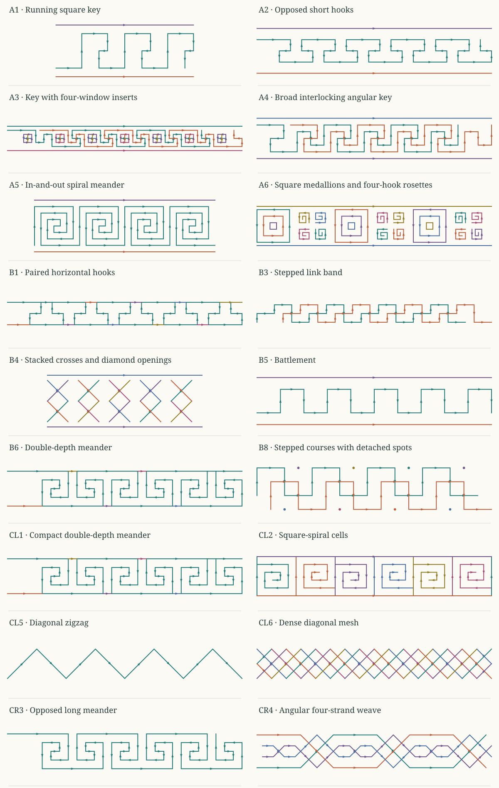

# Straight-line ornament: parts, pairs, and possible engines

## What this study is trying to show

The same ornament can be read in several useful ways. Follow one strand and
there is a sequence of turns. Select a second strand and a mirrored pair may
appear. Read the space between them and there may be a diamond, a long hexagon,
or a winding corridor. None of these reads needs to erase the others.

This study breaks down every wholly straight-edged pattern in the three supplied
reference sheets. There are **18 selected rows and 10 explicitly deferred rows**.
Each selected row has an authored centre-line interpretation, a short verbal
construction, alternative generating ideas, and a statement of what the image
does not establish. Duplicate-looking rows remain in the source index so that
coverage is visible; they are not counted as independent discoveries.

Start by selecting **CR4, the angular weave**, then isolate its outer pair and
inner pair before examining all four strands together. Next compare the simple
battlement B5, the zigzag CL5, the continuous winding A5 and finite coils CL2, and the crossing bands
B4 and CL6. These show different uses of repetition, opposed orientation,
start/stop participation, and multiple paths.



The reference sheets are evidence supplied by the user. The reconstructions are
**declared idealizations**, not automatic image traces, exact measurements,
recovered pen histories, or proof of the original designers' intentions. Source
colors, printed thickness, watermarks, and small raster irregularities are not
part of the centre-line grammar. The source images remain available intact in
the web study for comparison.

## What is being encoded

A centre-line construction retains connected frames, ordered sections, shared
endpoint handoffs where intended, separate path ownership, and repeat or
transform correspondence. The public coordinates and path labels are
presentation reads. Their labels do not supply native topology.

A useful schematic is:

```text
source frame -> ordered path sections -> exposed start/end sites
                           |
                           +-> selected pair -> transform correspondence
                           |
                           +-> larger group -> repeat correspondence
```

A pair is an additional read over the same participating sections. It does not
copy the material or weld the two paths. A visible crossing remains different
from an actual junction. An exposed end can be a real termination, a crop
boundary, or an unresolved continuation; those interpretations must remain
separate.

The centre lines can later acquire ribbon width. That expansion is a further
construction with side correspondence and clearance requirements. It can close
gaps, introduce overlaps, or alter the connected white regions, so a thin-line
symmetry is not automatically a proof about every possible ribbon thickness.

## Vertical reflection is a particularly useful shared construction

Take a path advancing through a band. In a chosen frame, one partner can use the
same ordered instructions while reversing the vertical basis. A rise becomes a
fall, while horizontal advance remains horizontal advance. In a display frame
with middle axis at zero, this reads as `(x, y) -> (x, -y)`.

That operation is different from reading the path from its end back to its
start. It is also different from reversing flow on a carrier or swapping the
over/under order at crossings. Those changes can be combined, but each needs its
own correspondence.

For the angular weave, reflected members of each pair are the strongest
same-instruction comparison. The outer pair and inner pair belong to a similar
construction family, but their detailed reach and turn words are not asserted
to be identical. A coarse read can retain their common pattern of advance,
turn, return, and repeat while leaving their additional detail available.

A horizontal run directly on the reflection axis is fixed by reflection. If two
independently owned paths both draw that run, their projected ink overlaps for a
positive length. Avoiding such a run is therefore a useful anti-overdraw rule
for a paired-strand engine. It is **not a universal prohibition on horizontal
flow at zero**. A shared carrier, a non-draining observation, or a deliberately
coincident read would be a different construction.

Reflection plus that anti-overdraw rule does not alone guarantee diamonds or
hexagons. The sequence of encounters, plateaus, turns, and matching endpoints
must also support the enclosing boundary. These are strong candidate engines,
not a substitute for checking their resulting structure.

Changing a pair needs the same care. Moving one partner can break reflection
about the original axis while preserving reflection about a shifted axis.
Changing phase can replace a direct reflection with a glide correspondence.
Changing only one extent may break exact matching but preserve the ordered
word. A report must say which of these questions it checked.

The source breakdown also reveals a useful neighboring family. In the selected
through-routing reads of A3, A4, and B3, two copies of the **same word in the same
vertical frame** interleave after a half-period horizontal translation. B8 uses
a horizontal and vertical translation of one square-wave word, plus a separate
spot stream. These pairs should not be forced into the vertical-reflection
explanation merely because their combined silhouette has opposed-looking parts.
They share the broader idea of a word, a partner correspondence, and a relative
phase, while differing in the actual transform.

## How to read the alternatives

The alternatives below are **candidate descriptions**, not a ranking of original
construction histories. Several may reproduce the same visible support while
retaining different path ownership, connections, controllers, or future
possibilities. Before calling two engines interchangeable, compare their exposed
ports, end conditions, crossings, and retained uncertainty as well as their
picture.

A compact description is useful when it pays for its shared word, placements,
transform relations, and exceptions. It does not establish a probability by
itself. Reuse across other patterns can eventually provide evidence for a useful
default, but this source survey does not train such a preference.

Descriptions of white regions are observations unless an explicit region reader
has verified them. Selecting an outer or inner strand pair can reveal a simpler
boundary candidate without proving that every visible opening has been
mechanically extracted. This study does not report an exhaustive symmetry search,
a learned beauty score, or a recovered historical machine.

## Comparisons that are already useful

These are comparisons between the declared reconstructions. They are not claims
that the original makers used the same engines.

| Compare | Shared idea | Difference worth retaining |
| --- | --- | --- |
| A3, A4, B3 | One angular word used by two horizontally phased courses | The word differs, and A3 adds a separate four-window insert stream. |
| B5 and B8 | A square-wave course | B8 combines two translated courses and detached spot pens. |
| A5 and CL2 | Repeated square winding | A5 turns around at its center and returns outward; CL2 retains finite inner ends and alternates half-turned cells. |
| B4 and CL6 | Opposed diagonal participation and diamond-like spaces | B4 repeats separated stacked-X motifs; CL6 reads a clipped, denser diagonal field. |
| A2 and CR4 | Opposed vertical reads | A2 can put the opposition into successive parts of one course; CR4 retains separate strands and crossing-order evidence. |
| A3, A6, B8 | A main pattern plus other participants | Inserts, hook groups, and spots need their own participation and placement correspondence. |

The A5/CL2 distinction is especially important. At a glance both look like rows
of square spirals. A tiny connecting bridge changes whether a pen stops or
returns outward. The larger family resemblance survives, while the behavioral
read changes. This is the kind of evidence that a compact signature should
retain instead of flattening both examples into one spiral label.

## Source-by-source breakdown

Sheet A has six rows. Sheet B has eight. Sheet C has eight rows in its left
column and six in its right column; each column is numbered from the top.
Decorative top and bottom rails are included or separated according to the
particular row, rather than silently assumed to be detached everywhere.

### A1 — Running square key

Sheet A, row 1.

**Visible organization.** Short inward hooks repeat between two separate border rails. Their outside reaches advance the band while the hooks turn back into each repeat.

**One construction.** Build one angular reach word: advance, rise, advance, descend partway, return inward, and descend to the next handoff. Repeat it by translation. Keep the framing rails separate from the ornament course.

**Other candidate engines.**

- Place repeated hook cells and connect their exposed ends.
- Read alternating upper and lower hooks as two coordinated collections; their handoffs must still be supplied.

**Limit.** A repeated silhouette does not establish the original pen route. The authored centre-line read ignores printing irregularities and treats border rails as separate participants.

**Compare with:** A4, CR3.


### A2 — Opposed short hooks

Sheet A, row 2.

**Visible organization.** Shallow hooks alternate between upper and lower portions of the strip. Short returns and longer horizontal reaches give a compact interlocking rhythm.

**One construction.** Make a short hooked path, place an opposed partner at the next horizontal phase, and repeat the pair. The partnership can be read independently from the top and bottom border rails.

**Other candidate engines.**

- Execute one continuous word containing both upper and lower hooks.
- Use two translated, vertically opposed streams with an explicit phase relation.

**Limit.** A vertical reflection alone may not align the two hooks; translation or a different start phase may also be needed. Connectedness belongs to actual handoffs, not close-looking corners.

**Compare with:** B1, B3.


### A3 — Key with four-window inserts

Sheet A, row 3.

**Visible organization.** Interleaving angular key routes alternate with small square inserts containing four white windows. The hooked routes have visible crossing sites, and long horizontal rails frame the composition.

**One construction.** Repeat one ordered key word in two courses separated by half its horizontal repeat. Use a separate placement stream for the square inserts. Construct each insert as an outer square with a vertical and horizontal divider, retaining those material contacts without duplicating the dividers.

**Other candidate engines.**

- Repeat a compound group containing both phased key routes and their divided-square inserts.
- Drive the key pair and the inserts from separate streams tied to the same repeat surface.

**Limit.** The chosen through-routing at key crossings is not established by black ink alone. Four white windows do not imply four independent square pens. Exact attachment of inserts to nearby key strokes remains a chosen reconstruction premise.

**Compare with:** A1, A6.


### A4 — Broad interlocking angular key

Sheet A, row 4.

**Visible organization.** Long outside reaches surround smaller inward returns. Adjacent key forms interleave and contain visible crossing or contact sites, alongside repeated angular white passages.

**One construction.** Repeat one angular word in two courses shifted horizontally by half the word's repeat. Its long outer reaches and shorter returns cross the partner at the observed contact sites. Preserve through-routing separately from a connected-junction interpretation.

**Other candidate engines.**

- Assemble translated nested-hook cells with explicit end connections.
- Describe the white corridor first, then retain its two offset sides as separate material boundaries.

**Limit.** Coincident contact coordinates do not decide through-routing versus joined flow. The corridor-first description needs a width and side correspondence, and cannot erase those contact sites. Similar hooks do not prove uniform scaling of A1.

**Compare with:** A1, B6, CR3.


### A5 — In-and-out spiral meander

Sheet A, row 5.

**Visible organization.** The path winds inward through square turns, passes through a short central S-like turnaround, then winds outward between its incoming reaches before advancing to the next coil.

**One construction.** Repeat a continuous inward-and-outward turn word. Preserve the small central bridge and the outside handoff to the next repeat; they are what distinguish this row from separate finite spiral pens.

**Other candidate engines.**

- Construct inward and outward halves as separate exposed paths, then connect them at the central turnaround and the repeat seam.
- Read nested square sides with alternating openings that form one inward-and-outward route.

**Limit.** The earlier coarse survey treated these as finite inward spirals. Closer source inspection shows the central bridge, so that interpretation is superseded here. The continuous path still does not establish a closed loop or an original pen history.

**Compare with:** CL2, A6.


### A6 — Square medallions and four-hook rosettes

Sheet A, row 6.

**Visible organization.** Large nested-square medallions alternate with groups of four small angular hooks arranged around a center. Several colors distinguish parts in the source.

**One construction.** Construct two cell types: nested square boundaries, and a quarter-turn orbit of one small hook. Alternate these cells along a shared horizontal repeat. Treat their surrounding border as another participant.

**Other candidate engines.**

- Repeat one compound medallion-plus-rosette cell.
- Interleave a square-cell stream with a four-hook stream at a shared phase offset.

**Limit.** This centre-line read intentionally omits color. Nested boundaries do not establish one spiral route. A four-hook arrangement is not automatically one connected four-way junction, and quarter-turn matching must preserve the selected hook roles.

**Compare with:** A3, A5, CL2.


### B1 — Paired horizontal hooks

Sheet B, row 1.

**Visible organization.** Upper and lower hooked runs oppose one another at staggered positions. A continuous upper rail visibly meets several stems, so this is more than a detached-rail version of A2.

**One construction.** Repeat the shallow hooks while retaining the continuous upper rail and all stem contacts. Read the contacts as projected incidence first, then select shared-site joins only where the construction explicitly supplies them.

**Other candidate engines.**

- Use an alternating upper/lower course together with the observed continuous rail.
- Translate two-hook cells beneath a common rail, retaining their exposed stem contacts.

**Limit.** The source does not supply pen identities or a flow law at rail contacts. A line that looks like a border may already belong to the motif; adding a second copy there creates duplicate material.

**Compare with:** A2, B3.


### B3 — Stepped link band

Sheet B, row 3.

**Visible organization.** Small rectangular steps interleave along a narrow strip. Two copies of a step sequence cross at staggered positions.

**One construction.** Repeat one six-move step word in two courses offset by half a horizontal repeat. Keep the same vertical frame for both copies and preserve their separate through-routing at projected crossings.

**Other candidate engines.**

- Translate a bent-cross cell made from separate elbow paths.
- Read the repeated small angular openings and reconstruct the surrounding step boundaries.

**Limit.** Black crossings in this source do not determine over/under or a material junction. The step pairing is an authored explanation; a different grouping can produce the same projected support.

**Compare with:** B8, A2, B1.


### B4 — Stacked crosses and diamond openings

Sheet B, row 4.

**Visible organization.** Each separated motif contains two vertically stacked crosses with a diamond-shaped opening between their centers. The motif repeats horizontally between border rails.

**One construction.** Place four independent diagonal sections as two stacked Xs, retaining their crossings and coincident end contacts. Translate that finite motif with a gap before the next motif rather than connecting everything into a horizontal zigzag lattice.

**Other candidate engines.**

- Use two vertically zigging pens with the same projected support, explicitly joining each pen's middle handoff.
- Construct the central diamond boundary and its four projecting diagonal arms, preserving the change in native ownership.

**Limit.** The raster does not distinguish a weld, a crossing, or over/under at the black intersections. Coincident middle endpoints do not select a pen continuation. A diamond only has quarter-turn symmetry when its proportions support that stronger read.

**Compare with:** CL6, CL5, CR4.


### B5 — Battlement

Sheet B, row 5.

**Visible organization.** A single stepped course alternates high and low horizontal plateaus between separate horizontal rails.

**One construction.** Repeat advance, rise, advance, descend. The end of each word is the start of the next. Give the two plateaus and the vertical span shared relations where equality is intended.

**Other candidate engines.**

- Repeat U-shaped cells with the required connecting lower spans.
- Use a vertical two-state controller alongside a continuing horizontal advance.

**Limit.** An alternation of levels does not by itself determine plateau widths. The rails are not endpoints of the vertical steps unless the construction explicitly connects them.

**Compare with:** B6, CL1, CL5.


### B6 — Double-depth meander

Sheet B, row 6.

**Visible organization.** Each large rectangular excursion contains a smaller return, producing alternating deep and shallow white passages. Continuous outer rails visibly contact the inner course.

**One construction.** Extend the battlement word with an inward rectangular return before leaving each large excursion. Repeat the word, then retain the outer rails and their contacts as part of the complete row.

**Other candidate engines.**

- Nest a smaller U-like course inside a larger one and connect the appropriate exposed ends.
- Compose upper and lower opposed hook groups at a fixed relative phase.

**Limit.** The standalone inner meander omits observed rail contacts and is only a partial read of this row. Contacts do not specify flow routing. Common nearest clearance does not imply that all white regions have the same width or area.

**Compare with:** CL1, B5, A4, CR3.


### B8 — Stepped courses with detached spots

Sheet B, row 8.

**Visible organization.** Two staggered stepped courses interleave, accompanied by alternating detached spots above and below. The apparent bent-cross motifs emerge where the courses encounter one another.

**One construction.** Repeat a square-wave word in one course and a second copy shifted both horizontally and vertically. Retain separate spot pens at the alternating free positions. The chosen through-routing keeps both courses continuous through their projected crossings.

**Other candidate engines.**

- Cut the same support into coordinated finite elbow pieces, keeping their coincident endpoints distinct until joined.
- Repeat a compound group containing both phased step courses and their two spot placements.

**Limit.** The black crossings do not establish over/under or a material junction. The dots are separate participation, not evidence that a continuous course is interrupted. Other path decompositions can share this projected support.

**Compare with:** B3, CR4.


### CL1 — Compact double-depth meander

Sheet C, left column, row 1.

**Visible organization.** A compact rectilinear course repeats small inward returns within continuous framing. The framing visibly contacts the course at repeated sites.

**One construction.** Use the nested-return family of B6, choosing a compact repeat. Preserve the ordered handoffs and add the observed framing with its contact correspondence.

**Other candidate engines.**

- Repeat one large U with a smaller opposed return inside it.
- Compose upper and lower hook collections before selecting a continuous route.

**Limit.** The inner course alone is a partial read because the framing contacts remain. Similarity to B6 does not prove identical proportions or original construction. The low-resolution reference does not establish exact stroke widths or routing at contacts.

**Compare with:** B6, B5, CR3.


### CL2 — Square-spiral cells

Sheet C, left column, row 2.

**Visible organization.** Finite square coils alternate by a half-turn inside rectangular cell framing. Each coil has a visible inner end and meets its surrounding frame at the outer end.

**One construction.** Place a finite inward-turn word in one cell, rotate the next copy by a half-turn, and repeat the pair. Retain the surrounding rectangular framing and the coil-to-frame contact correspondence.

**Other candidate engines.**

- Repeat a two-cell unit containing one coil and its half-turned partner.
- Construct the surrounding cell boundaries first, then attach finite inward paths at alternating sites.

**Limit.** The inner ends remain finite, unlike the connected turnaround in A5. Frame contacts do not by themselves select a material transfer law. Half-turn placement is different from a vertical reflection, and the coarse source does not establish exact stroke widths.

**Compare with:** A5, A6.


### CL5 — Diagonal zigzag

Sheet C, left column, row 5.

**Visible organization.** A light zigzag repeatedly rises and falls across a dark band. Each peak and trough joins opposing slopes.

**One construction.** Repeat one rising diagonal and one falling diagonal while advancing horizontally. Tie their vertical extents when symmetric peaks and troughs are intended.

**Other candidate engines.**

- Repeat V-shaped cells and connect their adjacent endpoints.
- Combine a steady horizontal stream with a vertically alternating stream.

**Limit.** The black band is the background in this read, not an additional zigzag strand. Reflection relates slope roles; it does not reverse the order in which the course is traversed.

**Compare with:** B5, B4, CL6, CR4.


### CL6 — Dense diagonal mesh

Sheet C, left column, row 6.

**Visible organization.** Several light diagonal strands cross inside a dark strip, leaving a row of small diamond openings and clipped diagonal ends near the strip edges.

**One construction.** Place two opposed diagonal families with more than one offset lane, then select their support within the strip. Keep clipping separate from a native termination or a turn at the boundary.

**Other candidate engines.**

- Repeat a wider multi-crossing cell with explicit continuation ports.
- Overlay shifted sparse diamond lattices while retaining their distinct strand identities.

**Limit.** This is denser than the sparse X band B4. The reference does not identify material junctions or establish over/under. Boundary clipping must not be reported as proof of strand endpoints.

**Compare with:** B4, CL5, CR4.


### CR3 — Opposed long meander

Sheet C, right column, row 3.

**Visible organization.** Large upper and lower rectangular reaches contain smaller hooks. Their alternation forms matching angular openings across the band.

**One construction.** Repeat an ordered meander word containing an upper hooked excursion and an opposed lower excursion. Inspect the two halves separately before reading their combined course.

**Other candidate engines.**

- Place a hook and a reflected, shifted partner as a compound repeat.
- Construct the alternating white corridors and derive their participating boundary sides.

**Limit.** Matching the upper and lower halves can require both a reflection and a phase shift. White-region correspondence does not establish that one pen originally traced the whole pattern.

**Compare with:** A4, B6, CL1, A1.


### CR4 — Angular four-strand weave

Sheet C, right column, row 4.

**Visible organization.** Long outer angular strands surround smaller inner runs. Their diagonals interlace near the seams, while separated pair reads reveal large and small hexagon-like openings and diamond-like encounters.

**One construction.** Use an outer strand word and its vertical reflection, plus a more detailed inner strand word and its reflection. Repeat with the required phase exchange and retain crossing order separately from planar continuation.

**Other candidate engines.**

- Treat each reflected pair as one exposed structure, then coordinate the two pair structures.
- Use a local encounter construction with continuation, boundary-turn, and complementary over/under laws; the encounter layout would still need evidence.

**Limit.** Reflected partners share instructions under a change of vertical basis. The outer and inner words are not asserted to be identical at full detail. Selecting a pair exposes useful projected regions but does not by itself discover all white boundaries or recover the historical machine.

**Compare with:** B4, CL6, CL5, B8.

## Rows outside this straight-line pass

These are exclusions from this particular read, not judgments about quality or whether Gojo can represent them. Mixed rows are recorded so that their straight components can be studied later without silently flattening their curves.

- **B2 — Sheet B, row 2:** Curved spiral-wave band. Its repeat and rail can be studied separately, but the motif is not a straight-line pattern.
- **B7 — Sheet B, row 7:** Curved leaf pairs on a stem. The straight stem does not make the full motif eligible for this centre-line polygonal study.
- **CL3 — Sheet C, left column, row 3:** Mixed angular lattice and curved rosette detail. The lattice could be isolated in a later partial read; replacing the curves with corners would invent a different pattern.
- **CL4 — Sheet C, left column, row 4:** Mixed diamond lattice and curved floral centers. The outer lattice is eligible as a component, but the complete row is not wholly straight-edged.
- **CL7 — Sheet C, left column, row 7:** Angular key motifs follow a curved carrier. A local key word is straight-edged, but flattening the whole row would erase the carrier transformation.
- **CL8 — Sheet C, left column, row 8:** Curved feather or leaf band with overlapping contours.
- **CR1 — Sheet C, right column, row 1:** Curved two-strand braid. Its crossing cadence is relevant, but its centerline geometry is outside the straight-line scope.
- **CR2 — Sheet C, right column, row 2:** Curved spiral pairs with curved enclosing turns. The small corner marks alone do not describe the full row.
- **CR5 — Sheet C, right column, row 5:** Curved leaves alternating along a straight stem.
- **CR6 — Sheet C, right column, row 6:** Curved scroll or paisley-like motifs. Their translated arrangement remains relevant for a later curve study.

## What the collection suggests

Several reusable ideas recur without requiring one mandatory taxonomy:

- A word can alternate between two vertical states, as in a battlement or zigzag.
- Reflected hooks can be placed in a shared phase relation, making a larger word.
- An inward turn sequence can stop; repetition then starts a new independent pen.
- A motif and its insert can have separate placement streams while sharing a repeat.
- Two diagonal families can form crossings and white openings without becoming one material junction graph.
- A pair of paths can become the participant in a larger pair relation, as in the angular weave.

These labels summarize connected constructions. They do not replace the
constructions. The source survey is useful because it gives several places to
try the same mechanism and several places where that mechanism is insufficient.

A later learning pass can compare a candidate engine's description cost,
coverage, unresolved contacts, and ability to predict held-out sections. It
should retain competing engines while their visible outputs agree, then use a
perturbation or a different exposed read to discover where their behavior differs.
