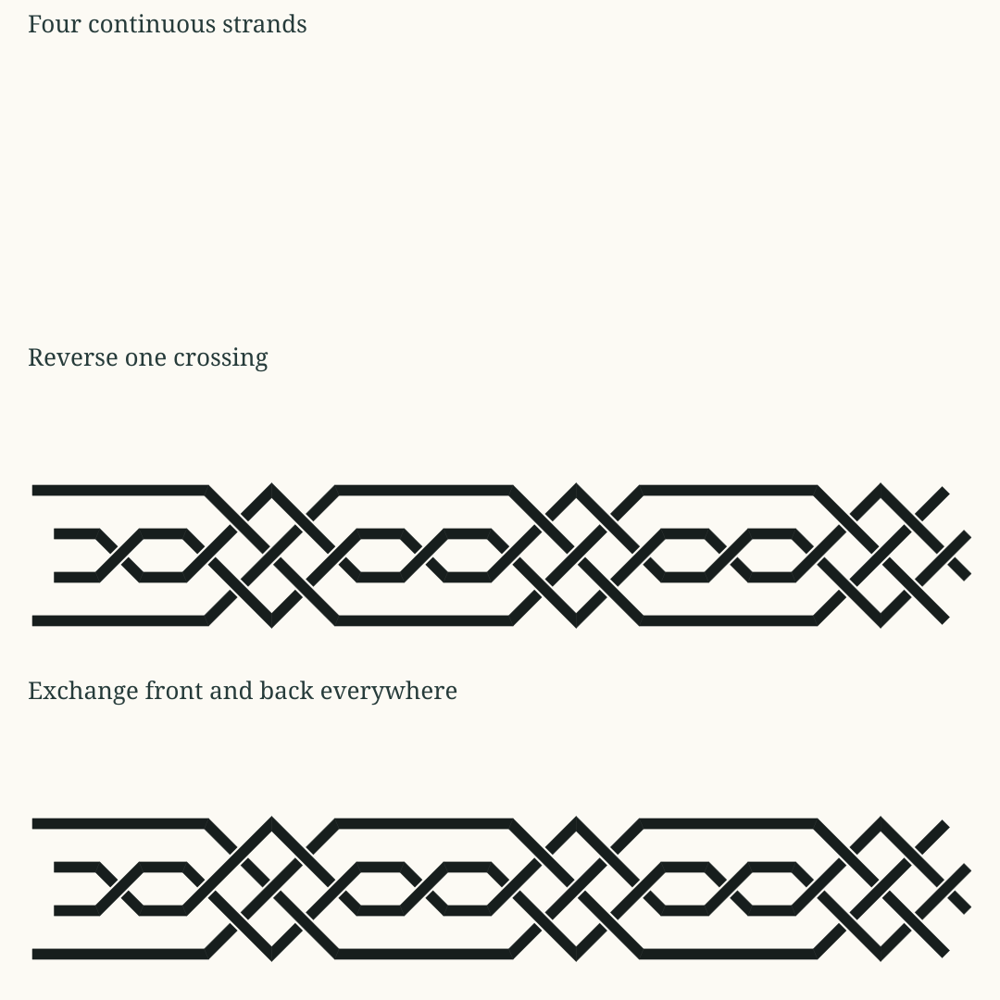

# Following a strand through a weave

This experiment asks what a small interlaced ornament needs beyond an ordinary
repeating path. Follow each coloured strand, then look at the same structure as
black ribbon. A strand can disappear underneath another while its route
remains continuous. The crossing specifies which strand is in front at that
encounter. It does not join the two strands.

The second question starts with less information. If only two visible pieces
remain, does their alignment support a hidden connection? The experiment keeps
a proposed continuation separate from a known connection. Even a convincing
proposal leaves its missing connection open until further evidence or an
explicit construction supplies it.

The source is the angular interlaced band supplied in the conversation. This is
an authored, idealized reconstruction and a collection of controlled changes.
It does not identify the original maker's construction or automatically trace
the supplied image. The renderer chooses the displayed size, ribbon width,
clearance and depth exaggeration.



## Three things to keep separate

| Question | Structural evidence | What it leaves open |
| --- | --- | --- |
| Where does this strand continue? | Ordered sections whose successive ends share a site | Whether the strand is visible throughout |
| Which strand is in front here? | A crossing tied to the two actual sections, with a local front/back relation | The height elsewhere and the history of making the weave |
| Could these fragments connect? | Exposed positions, endpoint directions, a selected occluder and candidate relations | Whether the hidden connection actually exists |

Coordinate equality alone supplies none of these connections. Two sections can
cross in a drawing while remaining independent. Two ends can occupy the same
display position while retaining different site identities.

## A very small depth read

At a resolved crossing, the front strand can be displayed at `+h` and the back
strand at `-h`. The amount `h` is a presentation choice. The important information
is their local order. One strand may be above at one crossing and below at the
next, so assigning one global layer to each strand would lose the weave.

The view exposes the ordered depth samples along each strand. Connecting those
samples visually illustrates a possible shallow lift. It does not assert a
measured height, a physical bend law, an exact three-dimensional ribbon or a
collision-free embedding. Unknown crossing order remains unknown.

An over/under alternation is a relation between successive encounters along a
route. It is different from alternating by screen position or by the order in
which a drawing program happened to discover crossings. Reversing traversal
reverses the encounter sequence. Exchanging front and back changes the depth
read. Reflecting the planar geometry is a third operation.

## Reading several symmetries

A useful signature retains several questions instead of collapsing them into
one score.

* Does the projected route geometry correspond?
* Are the same native connections preserved?
* Does the correspondence preserve each strand or exchange strands?
* Does it preserve the local over/under order?
* Does it require reversing depth as well as transforming the plane?
* Do successive crossing visits retain their alternating rhythm?

Changing one local crossing can leave all projected centerlines unchanged.
Removing a section changes participation and continuity. Replacing a crossing
with a shared junction changes possible routes. These changes should have
different signatures even where a small drawing makes them look similar.

## The first recorded results

The baseline contains four separate strands across three repeated bays. Its
42 sections produce 24 projected crossings. Following the crossing visits in
each strand's actual order gives 44 adjacent encounter pairs, all alternating.
No strand closes within this finite view. The eight ends belong to the four
continuing routes at the boundary of the selected drawing.

| Controlled change | Material components / ends | Known material crossing orders | Alternating adjacent encounters |
| --- | --- | --- | --- |
| Baseline | 4 / 8 | 24 / 24 | 44 / 44 |
| Reverse one crossing | 4 / 8 | 24 / 24 | 41 / 44 |
| Reverse every depth order | 4 / 8 | 24 / 24 | 44 / 44 |
| Reflect the planar construction | 4 / 8 | 24 / 24 | 44 / 44 |
| Omit one material section | 5 / 10 | 24 / 24 | 44 / 44 |
| Leave one crossing order unknown | 4 / 8 | 23 / 24 | 41 / 41 |
| Shift one inner strand | 4 / 8 | 24 / 24 | 44 / 44 |
| Omit a section through two crossings | 5 / 10 | 22 / 22 | 38 / 38 |

The omitted section lies between encounters. The over/under rhythm survives
while the material continuity fails. This shows why a rhythm signature alone
cannot account for the object.

An unknown crossing leaves three neighbouring comparisons unscored in this
finite sample. The reader does not jump over the unknown encounter and compare
its former neighbours as though they were adjacent. A result of 41 out of 41
therefore carries less coverage than the baseline's 44 out of 44.

The selected inner-strand displacement also preserves the over/under rhythm.
Its positions have changed, but this particular reading is insensitive to that
change. A later clearance or spacing reader may distinguish it. This study
does not assign a quality penalty merely because the parameter was changed.

A second omission removes a section that actually passes through two crossing
sites. Those encounters remain in the construction record, but they no longer
supply material over/under readings. The view distinguishes this from hiding
an intact section behind another strand.

The bounded repeat comparison tests the proposed strand correspondence
`[1, 0, 3, 2]` after one bay and `[0, 1, 2, 3]` after two. These are labels for the four actual
route scopes in this read. The shorter repeat exchanges the two outer roles
and the two inner roles. The longer repeat preserves each named role. Neither
translation returns a strand to the same physical endpoint, so neither proves
closure. The checks cover the available overlapping part of the three-bay
sample. The mappings and candidate periods are supplied by this experiment.
The reader checks their segment and crossing correspondences; it does not
search all possible periods or strand permutations.

The phase mechanisms are supplied constructions. A two-state exchange law
selects the reflected or unreflected profile for successive bays. Independent
encounter sequences use a two-state exchange law to offer their local
over/under roles. The recorded orders can disagree with those offers or remain
open. This is a small executable law over structure, with authored inputs and
geometry; it is not a learned generator or a simulation of moving physical
ribbon.

## What the structural encoding contains

The native root connects the common frame and reach, a repeat displacement,
the phase controller, four ordered strand scopes, local crossings and the
generation witnesses. Each strand connects its full construction route to a
selection of actual material sections. A material omission edits that selection.
An occlusion changes the visible read while leaving the selection intact.

In simplified notation, the central relationships are:

```text
strand       -> ordered sections -> shared endpoint handoffs
material     -> selected actual sections
crossing     -> (actual section A, actual section B, projected location)
local order  -> (that crossing, front section, back section)
depth sample -> (actual section, end of this crossing's depth relation)
phase step   -> (current phase, exchange law read, next phase)
```

The table identifiers on the page are read addresses for inspection. They do
not create the connections. No universal participation, uncertainty or depth
bit has been added to the historical ODV word. This pass composes the existing
qualitative relation grammar and executes its finite laws.

The separate X comparison holds projected support constant while changing
native incidence. Two full crossing sections form two components. Four arms
sharing one central site form one component with a four-way junction. The
junction supplies possible connectivity; a switch or material transfer law
would be an additional connected construction.

## From alignment to possible closure

The continuation reader receives only selected exposed fragment surfaces and
the occluder premise. It does not consult a concealed original path to decide
the answer. Collinearity, compatible directed tangents and coverage of the
missing interval can support a candidate. Another candidate can pass the same
local checks. Without the occluder premise, an ordinary gap stays a gap
under this particular reader.

These are independent small fixtures for the continuation rule. Their opaque
rectangle is supplied as an observation premise. This pass does not extract
those fragment ports or discover the occluding object from the photograph.

Tangent compatibility is weaker than knowing the hidden curve. Many different
curves can meet the same endpoint directions. This pass preserves that freedom
instead of manufacturing an interpolation and calling it recovered evidence.
For curved candidates, the rectangular occluder test covers the endpoint chord.
It does not certify that every possible connecting curve stays behind that
rectangle.

If the exposed remainder already supplies a return route, a candidate bridge
can describe **conditional closure**. That means the route would close if the
candidate were connected. Actual closure requires the appropriate endpoint
identities and connections throughout the cycle. Repetition into the next motif
also remains different from returning to the same physical site.

## What is implemented and what remains open

The construction uses the existing qualitative motion frame, curve sections,
crossing reads and ordered relations. Native structure carries the connections.
The page's names, colours, table identifiers and numerical coordinates are
diagnostic or presentation reads.

This is a bounded, authored experiment. It does not learn the supplied pattern,
recover an unknown number of strands from pixels, solve general knot topology,
or discover every hidden continuation. The earlier cardinal-course whitespace
reader is not applied to diagonal ribbon gaps. A later gap reader must preserve
the distinction between projected white space, an occlusion break and physical
space between ribbons.

The useful next learning problem is to compare competing connected explanations
of the same fragments, retain their different consequences, and test them on
new observations. A good local continuation cue can help with that without
being promoted to a proof of the entire object.

## Reproduce the recorded study

From the repository root:

```powershell
dotnet run --project experiments/QualitativeFrieze -c Release -- --angular-weave --output artifacts/angular-weave
python experiments/QualitativeFrieze/Composition/AngularWeavePage.py artifacts/angular-weave/study-data.json Visualizations/Gojo.Demos.Web/ornaments/weave
node Visualizations/Gojo.Demos.Web/tools/build-ornaments.mjs
```

The C# experiment records native structural reads. The page adapter presents
those recorded results and converts this Markdown document to HTML. The
website is published at <https://gojo.inklingai.ca/ornaments/weave/>.
