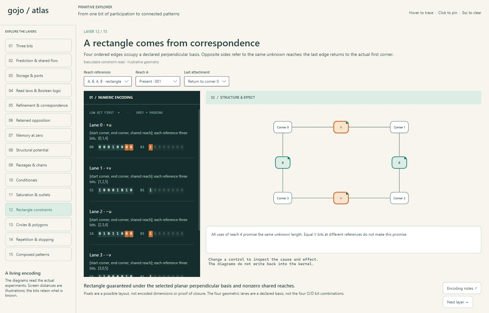

# Primitive Explorer

An interactive visual overview of the primitive experiments, from the original
ODV word to connected flow, geometry constraints and repeated patterns.



```powershell
dotnet run --project Visualizations/Gojo.PrimitiveExplorer
```

Or run `Open-Explorer.ps1` in this directory. This is a local Avalonia desktop
application, with native drawing and no XAML, web service or external assets.
It requires the repository's .NET 10 development environment.

## How to explore

Choose a layer on the left. The dark panel contains actual packed bytes, with
hexadecimal byte labels and individual bits in **low-bit-first storage order**.
The diagram is on the right. Hover either side to highlight its counterpart;
click to pin a selection and scroll to its encoding. Escape clears it.

Use the controls above the panels to change observations, wiring premises or
construction. Passage chapters step actual owner-local transitions. Repetition
and composition chapters advance one external beat at a time, or play slowly.
Reset returns to the selected scenario's initial state. Changing a scenario
also resets its timeline. Each displayed timeline is reconstructed by replaying
the bounded experiment from its selected initial state; it is not a general
live simulator or persistence format.

The result underneath explains what changed and what can be concluded. The
smaller text states the interpretation's limits. **Encoding notes** opens the
corresponding experiment document in the repository.

| Layer | What can be changed / inspected |
| --- | --- |
| Three bits | All eight words, explicit reorientation versus direction reversal, packing |
| Prediction & shared flow | Coarse addition, incomparable orientations, opposed reads of one word |
| Storage & ports | Release D, widen payload, release O, follow a stable port, inspect dirty retired slots |
| Read laws & Boolean logic | OR, XOR, AND, addition; exact admitted tuple bits; missing and uncertain support |
| Refinement & correspondence | Two-part presence ladder; distinct versus shared uncertain input references |
| Retained opposition | Fine demonstration settlement and separate coarse occupancy; zero net with retained participation |
| Memory at zero | Previous direction, new observation, explicit feedback update |
| Structural potential | One site, two sites, one site occupying two roles |
| Passages & chains | Whole handoff, shared middle site, occupied target, unknown control |
| Conditionals | Complementary outlets, continuations, shared Done, correlated branch predictions |
| Saturation & outlets | Forward-first ordered routing, side overflow, blocked contents, uncertain capacity read |
| Rectangle constraints | Shared opposite reaches, missing correspondence, open seam, zero/unknown reach |
| Circles & polygons | Circle, triangle, square, pentagon, hexagon, alternating-part rectangle; radius and seam |
| Repetition & stopping | Reused bodies, phase/contour correspondence, feedback, continuous or observed-contact stop |
| Composed patterns | Five waiting stages and independent displacement; continuous body in a moving frame |
| Closure & boundaries | Open, closed, reversed, disconnected, coincident, patch, self-loop and retraced structures |
| Cycles: claims & flow | Strict-order contradictions versus repeating activation; absent, uncertain and missing closing observations |
| Work & read budgets | Larger rings; packed bytes, construction/read time, allocations and unresolved partial inspection |
| Two communicating paths | Host seams and private paths, optional packing, stale claims, side attachment and repair |
| Two uses of a seam | Shared versus independent edges, cut correspondence, boundary cancellation and meter orientation |
| Stroke & interpretation | Add a proposed closing use or omit an interval of a template while retaining the source read |
| A fork with two owners | Stale vacancy report, held offer, material handoff, arrival reply, wire cuts and passive refusal meter |
| Capitals without a box | H, A, E, N and Z, shared interior sites, rotation and optional local ground |
| Two orders of E | Partial and contradictory spatial comparisons, possible completions and independent pen history |
| Straight capital atlas | 15 straight-stroke letters, directed ground, zero contacts, corners, branches, crossings and a traceable loop read |
| Curves in capitals | Eleven further letters, rounded and cornered D, C as open ink or a gap in O, and one-arc radial O |
| Across a glyph gap | Move one cut in O, query or follow the retained arc, and try different interiors against the same ends of D. [Experiment and reader results](../../experiments/PrimitiveMeasure/GlyphCompletion.md) |
| Push a bowl outward | Push two initially coincident D bows, then compare two B constructions with a wider lower bowl. Inspect the tip connections, waiting request and observer's read. [Encoding chart and results](../../experiments/PrimitiveMeasure/BowlReach.md) |
| Glyph clues & junctions | Withhold glyph evidence, draw possible completions, and trace different entrances and exits through the same Y or T. [Evidence and route charts](../../experiments/PrimitiveMeasure/GlyphEvidence.md) |
| One stem, two inputs | Compare three Y receivers, move dot assignments on a shared writing line, and hide the upper join of a 4. [Encoding charts and results](../../experiments/PrimitiveMeasure/WritingLine.md) |
| Two reaches, one choice | Compare two unmeasured tips on one rail, then use the same joint read for a dot with two possible owners. [Encoding chart and handoff](../../experiments/PrimitiveMeasure/PairedReach.md) |

The [boundary playground notes](../../experiments/PrimitiveMeasure/BoundaryExperiments.md)
include concrete endpoint/use encodings and initial scaling results. Browser
links can start at a layer, for example `/encoding/explorer/?layer=16`.

## What the pictures mean

The viewer references `experiments/PrimitiveMeasure` directly. It calls the same
packing, prediction, settlement, shape readers and controller fixtures as the
console experiments. There is no second arithmetic or flow implementation in
the UI. Numeric row charts are repacked with `EndpointRows` and checked against
the originating fixture's bytes where that fixture exposes them.

Screen positions, colors, labels and highlight mappings are presentation data.
They are not new fields in the primitive representation. Shape dimensions and
placement offsets on screen are illustrative; they cannot supply absent
lengths, calibration, closure or equality. A phase cycle does not prove a turn
angle without its displayed contour correspondence. The shape readers select
explicit geometric contracts, rather than deriving physical geometry from ODV.

Keep three different bit interpretations separate:

- **Stored values:** ODV words, or owned V/D/O fields in their positional context.
- **Read supports:** bit w admits word w; several bits represent alternatives.
- **Joint states / transition laws:** bits describe complete multi-site patterns
  or before/after pairs. They are not extra ODV quantities.

Grey final bits are padding. Rows have no internal padding. The owning table's
arity, reference width and law supply the interpretation. Current port/binding
maps use host references and integers; the viewer does not imply that these
maps already have a compact serialized format.

Unknown control is a limited read of actual state; hiding it does not mutate
the stored bit. Predictions are never committed as actual flow. The material
passage executor requires a complete resolved observation; the later pulse
controller can avoid reading an irrelevant guard. The two behaviors are shown
without claiming they are the same executor.

Automatic material splitting, discovered radial fields, automatic hardening,
calibrated ladders, garbage collection, shrinking and contact detection remain
open or separately scoped work. They are explained at the relevant layers,
not animated as if already implemented.

## Checks and visual review

```powershell
dotnet test Tests/PrimitiveExplorer.Tests/PrimitiveExplorer.Tests.csproj
dotnet test Gojo.slnx
dotnet run --project Visualizations/Gojo.PrimitiveExplorer -- --capture=C:/Temp/gojo-primitive-explorer
```

The focused checks exercise every exposed choice combination at several step
counts, enforce bit/padding bounds, compare uncertain conditional storage with
its joint predictions, test missing shape evidence, verify shared-reference
highlight spans, and check repetition/composition correspondence.

Capture mode renders all 15 chapters from the actual Avalonia control tree,
plus a linked selection, then exits. It is a visual review aid; it does not
replace testing pointer and keyboard interaction in the live window. Capture
mode also exercises the native direction button, uncertainty selector, step
button and diagram hit detection. Representative screenshots are retained in
`previews/`; the complete generated capture set is not required at runtime.

Verified 1 November 2026: all 5,816 solution tests across 15 test projects
passed, including 10 explorer cases and 250 primitive cases. All 15 chapter
captures and the linked-selection capture were visually reviewed. The desktop
window was also launched and confirmed responsive. The primitive kernel and
experiment laws are unchanged by this viewer.
