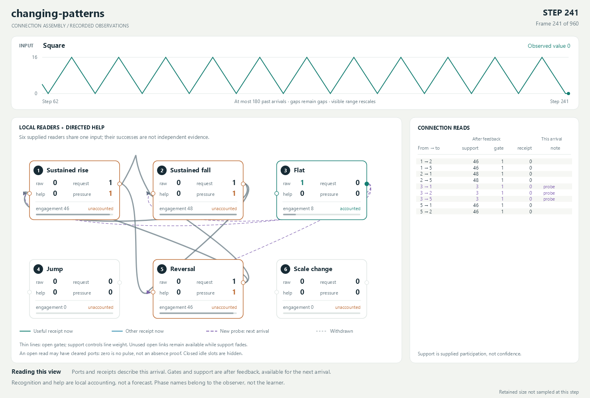

# Connection assembly capability experiment

The runner now reuses its connected operational equations and mutable input
sites, and uses actual core attachment/withdrawal for helper participation.
See [the dynamic-equation follow-up](dynamic-update.md),
[the lifecycle follow-up](lifecycle-update.md), and
[the allocation audit](../ConnectionAssembly.Audit/README.md). New runs write
to `results-dynamic`. The earlier `results` and `results-lifecycle` are preserved.
Statements below about missing detach and reconstruction describe the original
revision, not the current implementation.

## Original gated-connection probe

This pauses the timing work and asks a narrower question: can a few local Gojo
readers recruit useful contributions, retain intermittent use, and withdraw
unused contributions as one shared input changes? The answer is **yes for
executable participation, with clear limits on discovery, retention and cost**.
No kernel files or older experiments were changed. No other test suites ran.

## What ran

Six supplied readers inspect the same three consecutive levels through native
difference/product equations and bound claims: sustained small rise, sustained
small fall, flat, jump, reversal, and same-direction scale change. The learner
receives only a sequence coordinate and the integer observation. Waveform names,
phase boundaries, future input and the replay history stay outside it.

The main trial runs 240 arrivals each of zigzag, square, a synthetic heartbeat,
and zigzag again. A second changes order/sign and ends flat. Fresh ordered and
shuffled heartbeat controls share initial conditions. A larger zigzag tests the
fixed scale assumptions. There are 2,640 arrivals across five runs.

This is recognition and help on an arriving input, **not forecasting the next
input**. A proposed connection cannot help on its discovery frame. This follows
the relaxed criterion that an already connected structure accounting for an
arrival counts as useful. A helper answering a request never changes the
recipient's raw interpretation: fall helping rise does not make fall into rise.

The pre-run rules are in [PROTOCOL.md](PROTOCOL.md); the complete measurements and
connection tables are in [results/first-run.md](results/first-run.md).

## What worked, and what did not

| Observation | Meaning |
| --- | --- |
| First small-zigzag block: rise 104, fall 105, reversal 29; zero flat, jump or scale-change outputs. Six directed helper connections remain. | The supplied scopes separate continuous runs and turns. The rare reversal helpers survive and actually contribute. |
| Square after zigzag: 221 flat and 19 jump outputs; zero sustained rise/fall, reversal or scale change. | Old direction readers stop recognizing; flat and jump take over the raw description. |
| The main changing-pattern run makes 123 probes and 108 withdrawals. | Gates change real attached PRODUCT/SUM contributions, rather than just drawing different edges. |
| Square jump-to-flat repeatedly expires before the next edge. | A new link gets three support packets, lost in at most twelve arrivals. In the fresh square run it is proposed at step 13, closes at 22, and is merely proposed again at 25. This is a failure of the supplied fade policy. |
| On the final flat block, all 720 requests are served, but four now-unused links still remain open at the end. | Those requests mostly came from old readers losing engagement. Their helpers kept earning support until demand stopped; link support then has its own slow tail. A high help count can reward servicing the network's own obsolete expectations. |
| Fresh ordered heartbeat serves 747/879 requests; shuffled increments serve 645/760. | Both are about 85 percent. The small local readers are useful, but this measure barely distinguishes the organized temporal pattern from its shuffled control. |
| Larger zigzag produces jump on all 238 complete arrivals, plus 29 reversals, and no sustained small rise/fall. | The experiment has fixed tick-scale scopes. It has not learned a scale-relative notion of a jump. |

Inactive connections can linger: this is gradual stabilization, not a claim of
an optimal final assembly. Redundant simultaneous helpers get no individual
ablation credit and can fade together. The first-successful-neighbor scan is
also supplied policy; it is not learned relevance or a global utility measure.

## Native structure and the experiment boundary

Each node is connected to its shared input, constraint equations, raw output,
engagement, request, received help, held pressure and accounted read. Each link
connects its producer output, consumer request, support, gate, actual live
PRODUCT publication and receipt. A native SUM supplies each consumer's help.
Removing a gate changes that calculation; the focused checks perturb the real
ports without calling the experiment's learning step to verify this.

Unmet requests are whole packets of **actual carrier tension**, retained by a
local `1 -> 0` reset boundary. Native arithmetic accounts for both carrier value
and tension when help discharges a request. The latest frame's demand replaces
the previous frame's demand; this is not an accumulating history of every miss.
The experiment locally seeks a helper when the request remains unsatisfied. It
does not yet demonstrate arbitrary transfer of that tension into a newly grown
subnetwork.

Core provides the arithmetic, qualified claims, live publication, grouped
admission, settlement and tension. The experiment supplies the six readers,
neighborhood, conjunction-to-pulse scheduling, proposal traversal, support
grants/caps and fade timing. Those numbers and calculation witnesses remain in
the connected graph, but the response schedule has not become an autonomous
Gojo structure. There are no semantic operation enums or named waveform classes
inside the learner. JSON records exist only in the observer/viewer.

There are 30 potential directed links, attached once. Recruitment opens an
executable gate; withdrawal closes it. **These are functional connections in a
finite preattached neighborhood, not creation and deletion of arbitrary graph
edges.** Core has attachment but no public inverse detach operation. This probe
does not discover new primitives or crystallize their combination into a new
reusable concept.

## Preservation, verification and cost

Eight focused check groups cover warmup/gaps, stale and duplicate admissions,
feature separation, delayed probe credit, actual gate effects, physical held
tension and discharge, gradual fade, pure inspection and repeated changes.
All passed. The viewer builds and three native Skia exports were visually
inspected. Full solution tests were deliberately not run.

Review caught an inert `0 -> 0` pressure boundary in the first implementation:
it stored the native deficit as a value instead of holding tension. The
replacement `1 -> 0` boundary needed no kernel or policy change. New checks
assert that pressure has value zero and tension equal to the reported deficit,
and that later help and explicit unknown input clear it appropriately.

The complete first run is preserved in
[initial-deficit-port-results.zip](initial-deficit-port-results.zip). The
corrected rerun is in `results`. Every recorded behavioral field in all five
replays matches the initial run after excluding physical IDs and graph-size
diagnostics; the hashes are in
[results/behavior-comparison.json](results/behavior-comparison.json). No thresholds,
grants, input patterns or fade rules were tuned after seeing results.

The retained world is bounded, but expensive: each measured boundary contains
3,990 carriers, 40,378 relations and 42 distinct attached relations. The latest
full equation/claim/transition witness dominates this scaffolding. There is no
growing attached history, yet admission allocates roughly 14.6 MB per arrival;
the 960-arrival main run allocated about 14 GB cumulatively, not simultaneously.
These single-run figures include exhaustive native evidence construction and
are not an optimized kernel benchmark. A final native archive is about 1.5 MB.
Only final native worlds and observer replays are saved, not a native snapshot
for every arrival. This is not yet a small efficient learning algorithm.

## Small next steps

1. Add a reversible core connection lifecycle: withdraw an attached contribution
   without discarding its unresolved tension or other participants, and expose
   enough local structure to verify removal. Rerun this unchanged experiment
   with real attachment/withdrawal in place of prewired slots.
2. Separately revise the experimental participation rule around useful
   opportunities and actual downstream demand. Infrequent unused time is not
   the same as failed usefulness, and satisfying an obsolete reader should not
   indefinitely justify a connection. Preserve this run as the comparison.
3. Before more timing or pattern machinery, try one small shared-input
   composition whose output has a real consumer. Reward what it adds beyond its
   constituents and the shuffled control. Only then consider automatic growth.

The experiment gives reasons to continue with local connections. It does not
justify a larger prediction stack yet.

## Run and view

From the repository root:

```powershell
dotnet run --project experiments/ConnectionAssembly -c Release -- --checks-only
dotnet run --project experiments/ConnectionAssembly -c Release
./experiments/ConnectionAssembly/Compare-Replays.ps1
dotnet run --project experiments/ConnectionAssembly.Viewer -c Release
```

The separate native viewer has play/pause, stepping, scrubbing and phase jumps.
Purple dashed lines are probes available on the next arrival; teal lines are
useful current receipts; thin lines are still-open connections. Support is
participation, not confidence. Ports describe the current arrival, while gates
and support describe availability after feedback. See the
[viewer guide](../ConnectionAssembly.Viewer/README.md).


