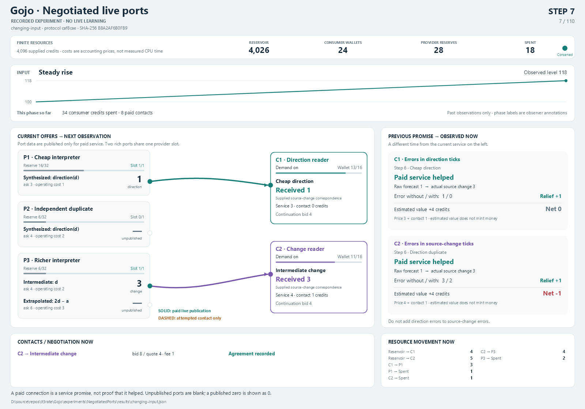
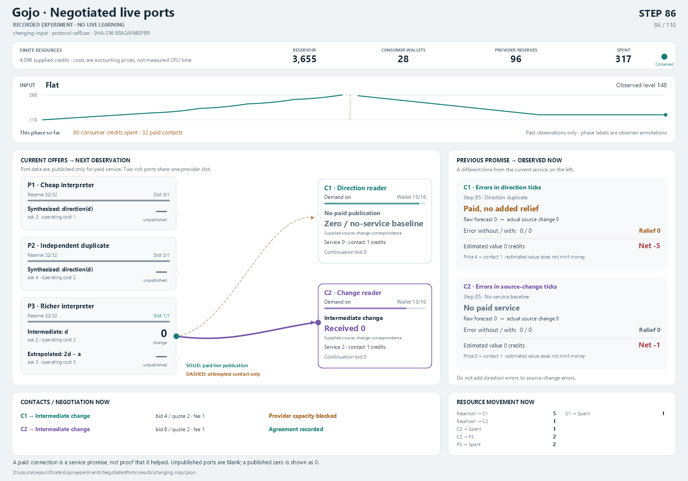

# Negotiated ports replay viewer

Native Avalonia and Skia, without XAML. This separate project displays recorded
observations from `NegotiatedPorts`; it does not run learning, choose a provider,
calculate predictions or assign usefulness. Observer records are rendering
adapters, not canonical Gojo state.

From the repository root:

```powershell
dotnet run --project experiments/NegotiatedPorts.Viewer -c Release
```

Or run `Open-Replay.ps1` using its absolute path from any working directory:

```powershell
& 'D:\source\repos\It3rate\Gojo\experiments\NegotiatedPorts.Viewer\Open-Replay.ps1'
```

The default is `NegotiatedPorts/results/changing-input.json`. The title and
footer identify the exact recording and its content fingerprint. Playback runs
at three observations per second; use step, phase navigation and the scrubber
to inspect a specific observation. This is a recorded replay, not a live model.

Choose another recorded control:

```powershell
dotnet run --project experiments/NegotiatedPorts.Viewer -c Release -- --replay=experiments/NegotiatedPorts/results/scarce-funding.json
```

Use `--frame` with a zero-based frame index. `--render` exports the same native
Skia view used by the desktop window, without opening a window:

```powershell
dotnet run --project experiments/NegotiatedPorts.Viewer -c Release -- --frame=71 --render=experiments/NegotiatedPorts.Viewer/obj/flat-frame.png
```

## Reading the view

- **Left:** current offers and their actual published data. Blank means the port
  is not publishing now; a recorded numeric zero is shown as `0`. Direction
  offers publish direction packets. Intermediate and extrapolated offers
  publish source-change ticks. Static recipe captions describe supplied wiring.
- **Solid routes:** current paid service with an open gate. Color identifies the
  consumer, not success. A paid forecast has not yet met its next observation.
- **Dashed routes:** unsuccessful contact attempts, not live service. A contact,
  affordable quote or occupied provider slot alone does not prove delivery.
- **Right:** the previous frozen promise evaluated against the current input.
  Direction-reader errors and change-reader errors have different bases. Raw
  forecasts and receipts use the explicitly supplied source-change
  correspondence; the renderer does not invent a normalized direction read.
- **Bottom:** observed contact decisions and drained resource transfers now.
  Estimated service value does not create resource credits. Wallet/reserve bars
  use the protocol's supplied caps of 16 and 32. Total supplied resources are
  4,096; these are accounting units, not measured CPU costs or physical energy.

The input plot and phase expenditure counters use only observations at or before
the selected frame. Past report rows remain outside the learner. Known flat
input can still attract paid contacts and unhelpful service: the viewer shows
that spending rather than coloring every connection as useful.

## Selected views

At step 7, the direction consumer buys the inexpensive synthesized port while
the change consumer tries the richer provider's intermediate output. The right
panel still evaluates the previous issue, not the current selected service.



At step 86, the flat phase has consumed 80 consumer credits and 32 paid contacts.
Published zeros are valid observations, while paid service adds no predictive
relief over the zero baseline. This is a visible weakness of the supplied search
policy, not a hidden success condition.



Both PNGs use the same Skia renderer as the desktop window. Reproduce them with
`--frame=6` and `--frame=85`, respectively, against `changing-input.json`.
