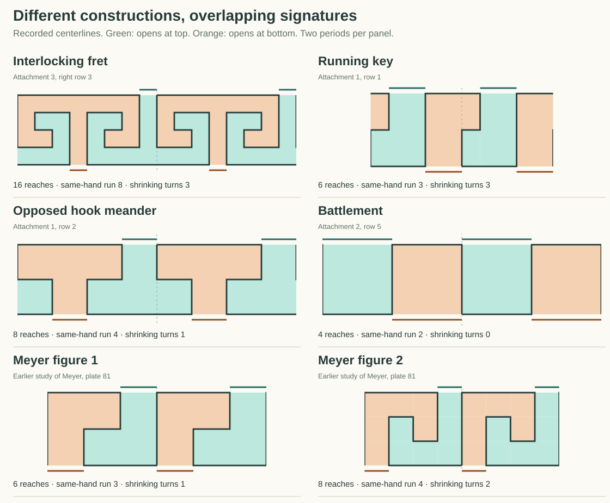
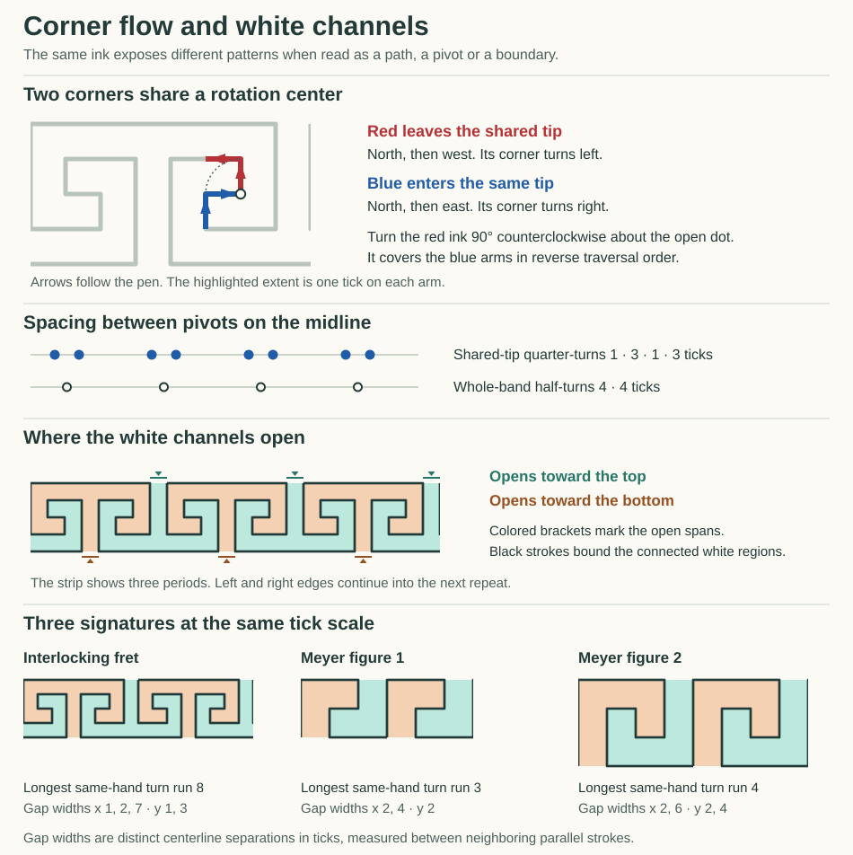
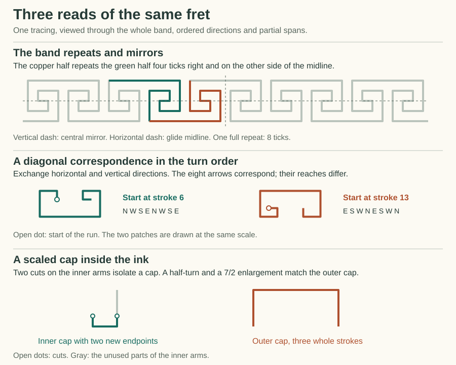
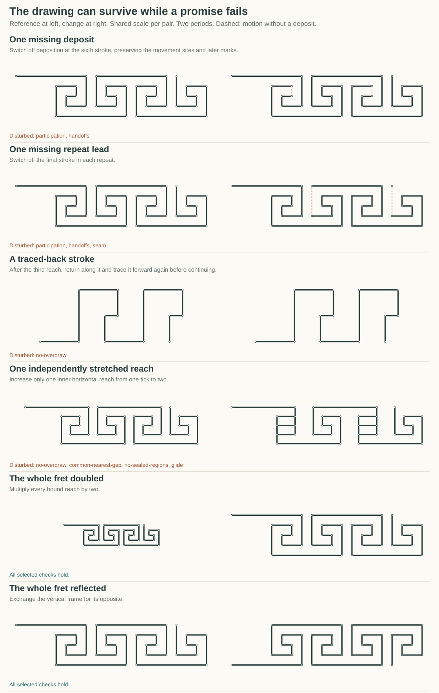

# Reading ornament through its structure

A line can participate in several patterns at once. It can be one arm of a corner, part of an inward turn, a wall of a white passage, and an occurrence in a reflected repeat. Gojo lets us keep those readings connected to the same strokes while asking different questions of them.

This study compares six idealized line bands, including three newly traced from the supplied sheets, and six controlled changes. Its scorecard keeps 18 observations separate. Select a pattern to see the paths, flow arrows, whitespace and pivots, then inspect the individual matches behind its larger symmetries. The examples show what a reusable construction could preserve and what evidence would distinguish it from another construction.

## Which patterns were selected



Three new continuous cardinal courses could be traced clearly. In each, the separate framing rules are outside the selected course. The tick lengths are idealization bindings chosen from the visible spacing.

| Selected reconstruction | Location in supplied sheets | One period, from the selected starting site |
|---|---|---|
| Running key | Sheet 1, row 1 | E3 N4 E3 S2 W1 S2 |
| Opposed-hook meander | Sheet 1, row 2 | E3 S1 W1 S1 E3 N1 W1 N1 |
| Battlement | Sheet 2, row 5 | E1 N1 E1 S1 |
| Interlocking fret | Sheet 3, right column, row 3 | E7 S3 W2 N1 E1 N1 W2 S3 E7 N3 W2 S1 E1 S1 W2 N3 |
| Meyer figure 1 | Earlier reading of Meyer, plate 81 | N4 E4 S2 W2 S2 E4 |
| Meyer figure 2 | Earlier reading of Meyer, plate 81 | N6 E6 S4 W2 N2 W2 S4 E6 |

The first four come from this selection of supplied imagery, with the interlock reusing the previously checked tracing. The two Meyer controls connect the comparison to the earlier historical study. All six execute Gojo motion words or path rows before the observers inspect them. Exact geometry claims apply to these reconstructed centerlines. The photographed drawings leave stroke order, generating machine, calibration and treatment of ink thickness open.

The supplied sheets contain 28 rows. Curved leaves and spirals, diagonal braids, bounded spiral motifs and multiple-pen designs need other readers. Some apparent duplicates have an important extra participant. The continuous upper rail in sheet 2 row 1 meets the stems, and the orange band in sheet 1 row 4 has crossings. Removing those contacts would change the object being studied. The source-selection list records the scope of every row.

The publication contains fresh executed line figures. The uploaded reference sheets remain outside this public edition.

## What is encoded, and what is measured

The small motion words keep orientation, direction, participation and reach references distinct. A gate can skip a contact without claiming a measured magnitude of zero. Where a stroke participates, its reach comes from a bound input. A clock determines which motion stream emits next, while a separate reflected frame can reuse the same stored word with a different physical direction.

The generators supply the paths. The analysis is an external observer. It compares explicit structure, reports matches and failed claims, and preserves the source and target stroke indices. It supplies evidence that a future learner could use. Pattern labels and scorecard columns are descriptive reads of that evidence.

There are several levels of comparison.

* **Literal words** can be equal in two places, while the places use different frames.
* **Directed corners** compare incoming and outgoing arms, preserving or reversing traversal explicitly.
* **Whole reaches** compare lengths as well as directions.
* **Partial arms** permit cuts inside existing strokes. Their extra endpoints belong to the selected read.
* **Repeated bands** ask whether a local correspondence continues across the seam.
* **White regions** retain the strokes on their sides, their open mouths and their internal connectivity.
* **Generating constructions** can share an input or keep two inputs independent, giving identical ink now and different behavior after a change.

## A corner, its flow and its pivot



On the marked interlock, the red corner leaves a common tip and the blue corner enters it. A 90° counterclockwise turn about that tip maps red onto blue in reverse pen order. Following both in forward order instead takes a vertical mirror and a downward shift. These are two valid correspondences with different input and output implications.

At another pair of corners the two complete stored motion bytes are identical, `21 19` in hexadecimal. One use emits east then north. The other emits east then south through its reflected vertical frame. Byte equality alone does not supply a physical direction until the reader knows the frame.

The shared tips of local quarter-turns occur at horizontal positions 1, 2, 5 and 6 in the interlock's eight-tick period. Their spacings are **1, 3, 1, 3**. The whole-band half-turn centers have a separate **4, 4** spacing. The signature therefore records which kind of correspondence produced each pivot.

## Larger repetitions and smaller likenesses



The interlock can be stored as sixteen reaches or as eight reaches played twice, with a vertical reflection on the second pass. The latter uses 10 motion, clock and frame bytes against 18 for the independently stored body, before adding reach bindings and strip lengths. If one inner reach is changed, the shared body changes both occurrences together. Independent occurrences can separate. The same initial ink supports both possibilities.

Following the interlock's corners gives eight consecutive left turns and eight right turns, up to starting phase. An inward reach sequence is 7, 3, 2, 1 over three turns. It then holds at 1. The running key also has three strictly shrinking same-hand turns, while the simplest battlement has none. Those are different kinds of regularity at different scales.

The diagonal example matches eight stroke directions after exchanging axes, but its length ratio fails on the second stroke. Permitting two endpoint cuts reveals exact scaled three-stroke caps. Each cut comparison fixes a positive range on the outer arms and a common scale for the fully included interior strokes.

The complete reference search made **15,104 alignment attempts** across windows and corners. Windows cover 3 through the number of strokes in a period, with every start phase, target phase, eight square frames and both target traversal senses. Corners add the two-arm read. One matching record represents a maximal prefix and its supported shorter prefixes.

| Reference | Strokes | Pitch | Same-hand turn runs | Strict shrinking turns | Length-only period |
|---|---:|---:|---|---:|---:|
| Interlocking fret | 16 | 8 | 8 / 8 | 3 | 8 |
| Running key | 6 | 5 | 3 / 3 | 3 | 6 |
| Opposed-hook meander | 8 | 4 | 4 / 4 | 1 | 4 |
| Battlement | 4 | 2 | 2 / 2 | 0 | 1 |
| Meyer figure 1 | 6 | 6 | 3 / 3 | 1 | 6 |
| Meyer figure 2 | 8 | 8 | 4 / 4 | 2 | 8 |

The largest spans and recurring turn runs supply the displayed dominant descriptions. Their labels are summaries of witnessed structure. A high number of matches is sensitive to segment count, starting phase and repeated versions of the same fact.

## White space has its own participants

Each recorded gap has two wall references and a positive interval over which those walls face one another. Each white region has a collection of connected cells and actual openings. The periodic side boundaries continue into the next copy. Top and bottom are open only where no stroke covers them.

In the interlock every stroke has a one-tick parallel neighbor somewhere along its length. Across whole passages the separations can be 1, 2, 3 or 7 ticks. The two white channels each have area 16, with a one-tick mouth alternating between top and bottom. A half-period glide maps every part of one channel onto the other.

The battlement is a useful limit. Its two vertical strokes have unit-width partners. Each horizontal ledge faces open space with no parallel ledge over a positive overlapping interval in that direction, so that particular width is unavailable. It remains a coherent regular design.

The white-space measurements use zero-width centerlines. Printed edge-to-edge clearance also depends on thickness. A whole complement carried by a known ink symmetry is a consistency check. It shares its evidence with the ink. Local gap widths, alternating mouths and sealed pockets can expose different changes without becoming independent statistical votes.

## Controlled changes



The defects are relative to a stated construction promise.

| Change | What remains | What the selected read detects |
|---|---|---|
| Sixth interlock deposit absent | All movement sites and later marks | Four missed handoffs among 31 in two copies, while the outer seam still participates |
| Final repeat lead absent | Earlier strokes | Three missed handoffs among 31 and a failed periodic material seam |
| One running-key stroke retraced backward and forward | Endpoint, native handoffs and final visible support | Six positive-length overlap pairs across two copies |
| One independently bound inner interlock reach grows | Turn word and alternating openings | Four overlap pairs across two copies, four lost nearest-gap promises, two enclosed pockets and a lost glide |
| Every interlock reach doubled | Relative construction | All six selected gap, seam, overlap and glide obligations pass |
| Vertical frame reflected | Paired structure and white passages | All six selected obligations pass, with left and right exchanged |

A missing deposit is encoded by a participation strip over the material slots. Its original movement sites remain available. The observer does not bridge the absent ink, and it leaves whole-course symmetry and white-region answers unavailable until a gap-aware interpretation is selected. A reversal or straight-through retrace likewise leaves the corner-run reader unavailable while independent material reads remain possible.

The overlap reader distinguishes positive-length collinear retracing from a transverse crossing. The two-copy check exercises the immediate repeat seam as well as the interior. It is a finite scope and cannot establish behavior at every distant translation. Intentional disconnected ornaments, crossings and asymmetric designs need their own premises.

## A scorecard with overlapping evidence

The comparison keeps **18 named features** in five families: material, symmetry, sequence, joints and space. There are 15 pairwise comparisons between the six references. Selecting a pair shows exactly which feature values agree and differ.

For example, the running key and Meyer figure 1 agree on 16 of these 18 fields. Their shrinking-reach and pivot-row readings distinguish them. The interlock and opposed hook agree on 15. Their same-hand run lengths, contraction depths and paired-pivot rhythm distinguish them.

Those overlap counts include common absences and shared construction facts. Features such as reflected ink and reflected complementary space can depend on the same source relation. They should remain inspectable together, without treating each as an independent confirmation or converting their total into a universal aesthetic score.

A previous small search through 72 invented hook settings demonstrated why the families should remain separate. All retained alternating mouths, 36 retained a whole-band glide, and 10 met the selected unit-neighbor and mouth conditions. A one-tick change could align a set of pivots while worsening local spacing. A learner can ask which feature predicts a useful next action instead of assuming that maximizing every column produces a pleasing ornament.

## How to use this next

A candidate concept can point to a set of connected occurrences, the frame or reversal relating them, the range of reaches it admits and the openings it preserves. When a new example fits only some of those readings, the remaining differences are useful evidence. The same two segments can keep their corner role while acquiring a place in a larger winding course or in a wall of a white passage.

The current study covers connected cardinal tracings and selected material edits. Curves, diagonal over/under braids, filled outlines, rail-joint alternatives and multi-pen motifs remain explicit gaps in this reader. The source list records those choices. The result is a starting comparison set with known premises and limits, ready for additional constructions and counterexamples.

## Reproduce the study

```powershell
dotnet run -c Release --project experiments/OrnamentFlowPilot -- patterns artifacts/local-ornament-flow-pilot/patterns.json
python experiments/OrnamentFlowPilot/PatternStudyPage.py artifacts/local-ornament-flow-pilot/patterns.json Visualizations/Gojo.Demos.Web/ornaments/signatures
```

The page includes the executed figures, scorecard, matched windows, source selection and complete recorded report. The Markdown document is retained in the repository. The original sheets and the earlier local experiment archives remain outside this public edition.
