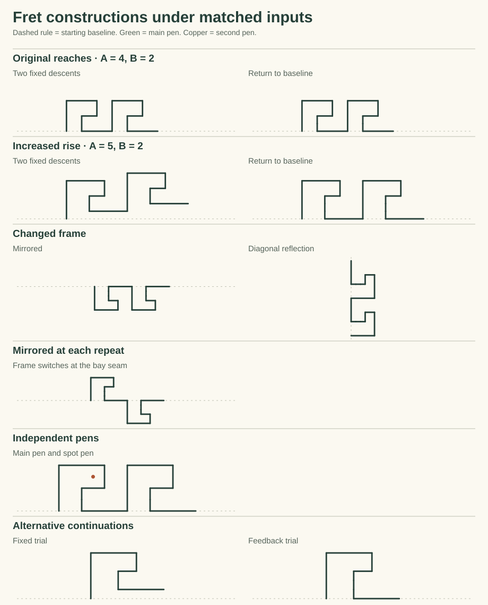

# One fret, two ways to return

Two little machines drew the same line as the existing Meyer Figure 1 reconstruction. Both rose by A and made the same first inward turn. To finish the return, one delivered a second reach of B. The other connected its pen to a question: “Am I back at the baseline?” While the pen was still above it, the machine delivered one downward tick and asked again.

At A = 4 and B = 2 the finished ink is identical. Set A to 5, leave every wire in place, and the first machine climbs the page by one tick per repeat. The second still lands on its baseline. This is a small test of what a construction predicts when its inputs change. The two machines and their input connections were supplied. The comparison uses the prior plate study’s exact line observer. [Original Figure 1 experiment](../OrnamentPlateStudy/README.md)

A [separate symmetry study](Symmetry.md) follows an interlocking fret and tests which reflections, translations and changes of scale its encoded stroke windows support.

Its [corner and whitespace signatures](Signatures.md) compare the marked red and blue corners, two established Meyer frets and a small family of invented patterns.



## What carries the flow

A single occupied state passes to the next connected state on a beat. The primary pen reads the states that have a pen outlet. Entering one activates its contact. Entering a junction or a sensor site consumes a beat while drawing nothing. The same seam site feeds the beginning of the next repeat, and the pen keeps its actual position across that seam.

| Source | Connection and law | Effect |
|---|---|---|
| Seam activation | Pass to rise → across → first descent → inward → junction | Four pen outlets read the bound extent ports A, A, B, B. |
| Fixed junction | Pass to the second B descent, then to the final across outlet | Draw B downward and A across. |
| Feedback junction | Pass to a site connected to the pen’s **above** and **at** baseline ports | Above admits one downward tick and returns to the same sensor site. At admits the final across outlet. Below leaves both passages closed. |
| Final across outlet | Pass back to the actual seam | The next repeat starts at the site just reached. |
| Prior-beat ink output | A second pen’s waiting site passes to its point contact when it reads a deposit | That pen makes one dot at its own bound location and passes into a terminal state. |
| Seam output, in the alternating example | A second two-state switch exchanges normal and mirrored frames on a seam pulse | The following repeat turns to the other side. The shared endpoint and beat order survive. |

**What is encoded.** The controller uses the existing packed passage rows. Each row holds three local references (source state, guard, destination), grouped under an eight-byte truth table. A pen outlet separately packs three references (participating state, directed axis, extent). For example, state 2 on the first machine selects axis 1 and extent 0: rise using A. Five bits per reference suffice for this fixture. The secondary pen has its own two-bit reference space. An across or rise outlet refers to a direction in the supplied frame. A and B refer to independently bound lengths. Coordinates and the one-tick motion of the feedback pen are the study’s calibrated realization.

**Participation and zero.** On an ink contact, a clear participation gate skips the extent read. A missing input and an uncertain input also leave the pen in place, with distinct witnesses. A participating **point contact** with no extent source deposits a spot. A participating **stroke** bound to exact zero reads its extent and deposits nothing. A positive extent draws a line. Participation describes this contact action. The dot comes from its particular outlet. These checks use the existing positive-context port supports (missing 0, off 1, on 2, uncertain 3). The historical three-bit ODV word keeps its zero/nonzero magnitude meaning. This pilot uses exact ticks and leaves below-detection magnitudes for a separate sensor.

## What the samples showed

| Two repeats | Fixed second descent | Baseline feedback |
|---|---|---|
| A = 4, B = 2 | Ends at (6, 0), (12, 0). 12 strokes over 16 beats. | Same ink and endpoints. 14 strokes over 24 beats. |
| A = 5, B = 2 | Ends at (8, 1), (16, 2). 12 strokes over 16 beats. | Ends at (8, 0), (16, 0). 16 strokes over 28 beats. |

* **Multiple pens.** The primary’s first deposit at beat 0 released the spot pen on beat 1. Only the public ink bit crossed the boundary. The spot pen stamped (3, 3), stopped, and left the primary’s entire edge and beat sequence intact. That placement is supplied. The two pens have separate cursors.
* **Symmetry.** Translating and reflecting the live frame carried every feedback stroke, site reference and beat to its expected counterpart. Reflection across the rising diagonal exchanged the across and rise axes. Within a single repeating machine, a seam-driven switch reflected just the second bay. Its first stroke began at the actual endpoint of the first bay.
* **A bounded second try.** An external trainer ran a machine with a choice port at the last descent. It tried the fixed outlet first and replayed once if the endpoint missed baseline. At A = 4 the first trial sufficed. At A = 5 the two independent histories had five identical opening beats, including four deposits. The first ended one tick high, the alternative at zero. Both histories survive in the report. The trainer knows the baseline goal. The running pen sees only its connected ports. This demonstrates a use for replay and a cost in extra beats; autonomous learning or live rollback would be a separate experiment.
* **Where it breaks.** At A = 1, B = 2 the first drop already takes the pen below baseline. With only a downward correction outlet, it stays one tick below and the repeat remains incomplete. An uncertain choice and a missing choice stop on the same four inked reaches but have different support witnesses. With zero pulse budget even the first stroke stays undrawn.

## Reproduce locally

From the repository root:

```powershell
dotnet run -c Release --project experiments/OrnamentFlowPilot -- artifacts/local-ornament-flow-pilot/trace.json
python experiments/OrnamentFlowPilot/FlowGallery.py artifacts/local-ornament-flow-pilot/trace.json experiments/OrnamentFlowPilot/FlowGallery.svg
```

The first command checks the original ink, altered inputs, participation, wiring effects, frame changes, pen timing, alternative continuations and blocked cases. Its JSON contains the actual marks, the comparative timelines and the packed law and connection bytes. The second command draws only the marks those runs deposited.
