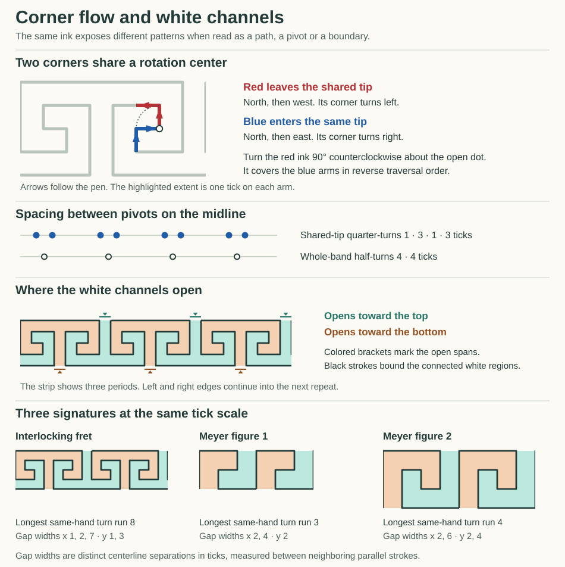
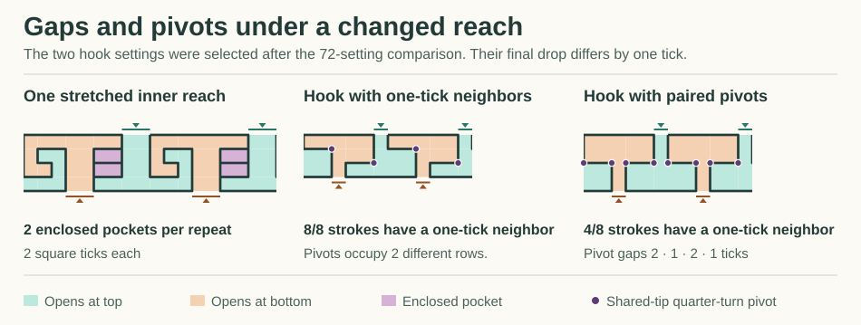

# A corner can match the ink and reverse the flow

The red corner in the annotated fret leaves the shared tip. The blue corner enters it. Rotate the red ink a quarter-turn about that tip and it covers the blue ink exactly, but the arrows run backwards. Keeping the arrows forward gives a different correspondence. That distinction survives even on a pair of one-tick arms.

Two more observations characterize this fret. The common tips of local quarter-turns have a **1, 3, 1, 3** spacing. Every one of the **16 strokes** has a parallel neighbor one tick away along some part of its length. The white regions between the strokes have their own symmetry: a four-tick glide exchanges a bottom-opening channel with a top-opening channel. These results use the [previously traced continuous course](Symmetry.md). The historical drawing order remains open.



## Read the colored corners

Start at the left end of the first long top bar, set it to (0,0), and read positive y upward. Stroke and vertex indices in the data start at zero.

| Selected corner | Actual stroke pair | Part selected in the image | Stored motion bytes |
|---|---|---|---|
| Blue, vertex 4 at (5,−2) | North 1, east 1. A right turn. | Both whole arms; the pen arrives at (6,−2). | `19 21` hex |
| Red, vertex 6 at (6,−1) | North 1, west 2. A left turn. | The first tick of the west arm; the pen departs from (6,−2). | `19 13` hex |

A 90° counterclockwise rotation about **(6,−2)** takes red's outward path into the reverse of blue's path. To map red to blue *in forward pen order*, reflect across x = 5½ and shift downward one tick. The two maps agree on the selected ink and give different input and output ends to a machine attached there.

Each motion byte includes the reach reference, axis and low three ODV bits. The low bits of the marked red pair are `001, 011`; blue's are `001, 001`. Elsewhere in the very same fret, vertices **5 and 13** both store the complete pair `21 19` hex. One emits east then north, the other east then south because its vertical frame is reflected. Literal word equality, correspondence after a frame change, and direction of traversal can each be read separately. Pen order here comes from the selected executable path. A small visible L by itself supplies neither that order nor evidence of a shared construction.

## A signature at several resolutions

| Read of one period | Interlocking fret | Meyer figure 1 | Meyer figure 2 |
|---|---:|---:|---:|
| Strokes / advance in ticks | 16 / 8 | 6 / 6 | 8 / 8 |
| Consecutive left turns, then right turns, up to starting phase | 8 + 8 | 3 + 3 | 4 + 4 |
| Longest strictly shrinking sequence while turning to the same side | 3 turns | 1 turn | 2 turns |
| Shortest period of the **lengths alone**, in strokes | 8 | 6 | 8 |
| Ordered corner alignments at equal full arm lengths, counting both traversal senses | 80 | 20 | 24 |
| Rows occupied by shared quarter-turn tips | 1 | 3 | 4 |
| Nearest unobstructed parallel neighbor for every stroke | 1 tick | 2 ticks | 2 ticks |
| White regions per bay; area of each | 2 × 16 square ticks | 2 × 12 | 2 × 24 |
| Width of each top or bottom opening | 1 tick | 2 ticks | 2 ticks |

The historical examples are the two native [Meyer plate 81 controls](../OrnamentPlateStudy/README.md). Both reproduced the registered line support. Their path rows supply directions, extents and pen order in a different byte format. Their raw ODV comparison fields are therefore left open.

**A winding read.** Following the interlock, the consecutive reaches **7, 3, 2, 1** shrink through three right turns. The next reach stays at 1. The other half has the same shrinking sequence through left turns. This supports “winds inward for three turns” in either half. A continued contraction would make a different prediction at the plateau. The sequence of lengths repeats after eight strokes although the directed course takes sixteen. The comparison counts cyclic runs, so changing the starting corner cannot split a run into two.

**Pivots of the pivots.** To count a shared tip we require a quarter-turn with a positive arm extent ending at an actual shared site on the ordered pen path. The interlock has eight directed witnesses, reducing to four midline sites at x = 1, 2, 5, 6 modulo 8. Their cyclic gaps are **1, 3, 1, 3**. By contrast the 180° centers carrying the whole band lie at x = 1½ and 5½ on that same line, with gaps **4, 4**. Meyer figure 1 has two tips in its middle row with gaps 2 and 4; figure 2 has one tip on each of four rows. Other rotations around isolated corners and contacts between coincident positions remain available in the detailed report with their own witnesses.

**Exhaustive within the chosen read.** For each ordered corner pair, the reader tests eight frames and both possible target traversals. In the interlock this gives 4,096 attempts, 512 matches of headings on cropped arms, and 40 forward plus 40 reverse matches at equal whole arm lengths. Any pair of right-angle corners can match headings under a suitable map. The stronger information comes from arm lengths, flow, which site can serve as a pivot, and how often that configuration recurs. The report retains half-tick rotation centers, equal and proportional arm reads, source and emitted word comparisons where supplied, all length-only windows of at least two strokes, and the earlier whole, cut and direction-only windows of three through sixteen strokes. These are reads of an authored single pen course with ordinary bends. Counting bends does not establish branching or material flow direction in a photographed ornament.

## Measure the white space

Take one pitch of the path, join the two side boundaries by repetition, and keep the top and bottom edges open wherever the pen leaves an opening. Each stroke is a zero-width wall with a reference to its actual place in the path. Adjacent white rectangles communicate through unobstructed sides. The reader records connected regions, entrance intervals and areas, including enclosed pockets. It also sweeps across both axes. A gap measurement requires two parallel walls facing each other over a **positive** interval. Each measurement retains the strokes on both sides.

On the interlock the bottom opening occupies x = 3…4 and the top opening x = 7…8. The two channels each have area 16. Reflect across the horizontal midline **and shift four ticks** and every part of one region maps into the other. With the reflection alone, eight square ticks land in each channel, so neither receives the whole image of its partner. Region equality under a known ink symmetry is a consistency check. The opening rhythm and local widths are additional, coarser questions.

Every stroke can find a parallel neighbor one tick away somewhere. Across complete passages, the horizontal separations are **1, 2, 7** ticks and the vertical separations **1, 3**. For example, a wide section under a long cap can coexist with a one-tick gap farther along the same stroke. These are centerline distances in the selected frame. Clear paper between the edges of two equally wide printed strokes also depends on their thickness.

Change just one independently bound inner reach from 1 to 2. The sixteen turn signs stay identical, the top and bottom openings still alternate, and the two outward channels still have area 16 each. But two **sealed white pockets**, area 2 apiece, now appear. Four strokes lose their one-tick nearest neighbor. The length period grows from 8 to 16, and the two pairs of local midline pivots reduce to a single pair per repeat. This is an example where reading just the ink's turn word or just the opening sequence would miss a substantial change.

## Look for the same features in invented patterns

The invented family has a shorter half-body: move across, descend, move back, descend again. A second pass mirrors the vertical voice. We tried 36 settings: inset 1 or 2, across equal to twice the inset plus 1 or 2, and each drop independently 1, 2 or 3. For each setting we also ran a comparison with an independently bound second half and increased only its across reach by one tick. The generator received the input bindings; the signatures were measured after execution.

| Read | 36 shared settings | 36 independently stretched partners |
|---|---:|---:|
| Whole-band glide | 36 | 0 |
| Alternating top and bottom openings | 36 | 36 |
| Two open regions, two one-tick mouths, and a one-tick nearest neighbor for every stroke | 10 | 0 |
| Four quarter-turn tips in one row with alternating unequal gaps | 2 | 0 |
| Three consecutive shrinking turns of the same hand | 0 | 0 |



Two settings selected from the sweep illustrate the trade. With across 5, inset 2 and drops **2, 1**, all eight strokes have one-tick neighbors. Change only the last drop to **2**. Both one-tick mouths remain at the same places. Now the shared tips line up on one row in a **2, 1, 2, 1** rhythm, while only four strokes still have a one-tick neighbor. The two features can vary independently. Counts here describe this finite family; the glide in the shared settings was supplied by construction. There was no training or aesthetic scoring.

## Reproduce locally

```powershell
dotnet run -c Release --project experiments/OrnamentFlowPilot -- signature artifacts/local-ornament-flow-pilot/signature.json
python experiments/OrnamentFlowPilot/SignatureGallery.py artifacts/local-ornament-flow-pilot/signature.json experiments/OrnamentFlowPilot/Signature.svg experiments/OrnamentFlowPilot/SignatureVariants.svg
```

The JSON records the seven illustrated or diagnostic signatures, the per-corner comparisons, per-stroke nearest gaps with their source spans, full white-region maps, and all 72 hunt outcomes. Indices start at zero. Pivot coordinates and pivot gaps in fields ending in `2` are doubled integers to preserve half ticks.
