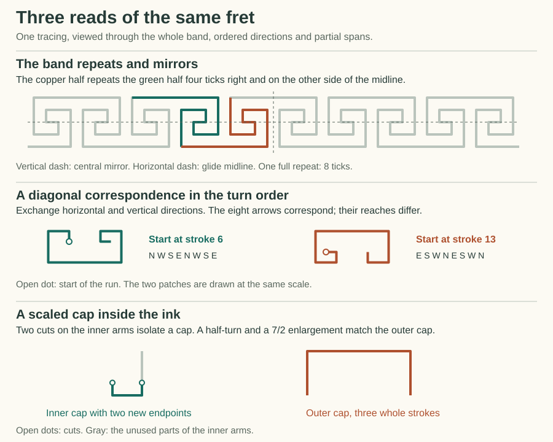

# Finding symmetry in a continuous fret

The uploaded ornament can be drawn by one pen. Start at the left end of a long top bar and follow the ink. After eight strokes the pen is on the bottom of the band. Play the same eight strokes four ticks farther right, reflecting up and down, and the pen reaches the top of the next repeat. This suggests a shorter Gojo encoding and predicts what should happen if one of the inner reaches is stretched. It leaves the historical construction open.



## The selected reading

I traced the center of the thick line, treating the outer rails as part of the path. The small marks at the image margins are outside that course. From the top-left corner of the first long upper bar, the idealized period is:

```text
E7 S3 W2 N1 E1 N1 W2 S3
E7 N3 W2 S1 E1 S1 W2 N3
```

These numbers are divisions of a fitted grid. The five top bars in the 717-by-99 crop repeat about every 140.5 pixels. As a check on the transcription, the upper-left corner was placed at pixel (18.5, 13.5), with 17.5625 pixels per horizontal tick and 17.625 per vertical tick. All 3,551 samples along the fitted centerline inside drawing columns 10–712 landed on dark ink. In the same columns and rows 8–90, all 21,651 pixels below grayscale 128 were within 4.1 pixels of the centerline. The small variations in the scan and its two clipped lower arms belong to the image. The exact equalities below belong to the transcription.

## What repeats

Use a bottom origin so the top-left start is (0,4). One period advances by (8,0). Allow all integer translates of a repeat. Four families account for the symmetries of the continuing band:

| Operation | One representative in this drawing frame | How to follow the ink |
|---|---|---|
| Translation | Move right 8 ticks. | Follow the next bay in the same order. |
| Vertical mirror | Reflect about x = 3½. Equivalent axes occur every 4 ticks. | Follow the corresponding strokes in reverse order. |
| Glide reflection | Reflect across the horizontal midline y = 2 and move right 4 ticks. | Keep the stroke order. Doing this twice advances one full repeat. |
| Half-turn | Rotate 180° about (1½,2). Equivalent centers occur every 4 ticks. | Follow the corresponding strokes in reverse order. |

The central vertical mirror also fits the ideal five-bar crop, including its two partially visible bottom arms. Translation and glide match its interior and predict its continuation. A pure top-to-bottom flip misses the registration of the top and bottom bars. A diagonal reflection exchanges the along-band and cross-band axes, so its match is local. The JSON reports affine offsets with the **top-left** vertex at (0,0); its equivalent glide maps (x,y) to (x+4,−y−4).

## What survives on part of the path

The reader examines windows of **3 through 16 consecutive strokes**, including those crossing the repeat boundary. It tries every source phase, every target phase, both target traversal senses, and the eight rotations and reflections of the square frame. That gives 4,096 alignments. Translation is set by the window's starting sites. Reversing traversal reverses the target order and negates its arrows. Reflecting the frame changes the arrows while leaving their order alone. These are separate choices.

| Which information is retained? | Result for this fret |
|---|---|
| Ordered directions, ignoring lengths | 400 alignments match for at least three strokes. Across a diagonal, the longest directional match lasts eight strokes. |
| Complete reaches, one uniform scale for the window | 64 alignments match. Each has scale 1, extends through all 16 strokes, and belongs to one of the four band families above. |
| Two existing corners with cuts permitted on the outer arms | 288 alignments admit a scale different from 1. Every such match stops at three strokes. |

These counts include different starting phases, inverse correspondences and, where applicable, identity reads. They count candidate alignments, not independent concepts. Windows longer than a period in the whole-reach reading simply continue a full-band match. The cut reading records each positive range of possible endpoint positions as a pair of upper limits. Its first whole interior stroke fixes the scale. Extending a match to four strokes makes the next interior stroke pass the same ratio test. A three-stroke cut match is consequently weaker evidence of a repeated construction than a four-stroke match.

Three examples make the difference visible:

* **Turn order.** Follow the corners continuously, across the chosen seam. There are eight consecutive left turns followed by eight right turns. A start at the first upper bar splits one run of right turns between the beginning and end of the printed instruction word.
* **Diagonal.** Exchange horizontal and vertical on the eight-stroke run starting at stroke 6 (one-based). Its directions match the run starting at stroke 13. The respective lengths begin **1, 2** and **1, 1**, so the equal scale set by the first stroke fails on the second. Both runs in the middle illustration use the same drawing scale.
* **Scale.** The outer cap uses three whole strokes, N3 E7 S3. On the inner run S3 W2 N1, enter the first arm 6/7 tick before its corner and leave the last arm 6/7 tick after its corner. Turn that smaller cap through 180° and enlarge it by 7/2. All three strokes land exactly on the outer cap after translation. The two corners already exist in the encoded shape. The two new tips come from the selected cut. This is concrete evidence for a scaled subshape at a finer choice of landmarks.

A diagonal reflection and a scale change can also hold **together**. The complete run S1 W2 N3 (strokes 14–16) becomes W1½ S3 E4½ under reflection across the rising diagonal followed by a 3/2 enlargement. Those are portions of strokes 7–9. Its two internal corners land on existing corners. This gives a distinct exact match once the receiver admits cuts, even though the whole-band diagonal test failed.

The bounded search is exhaustive for these cardinal, connected windows and similarity reads. Separate branches, the thickness and outline of the ink, negative spaces, and approximate matches under a chosen tolerance would each call for a different read.

## What it buys the encoding

Both constructions below actually execute the existing Gojo `BorderScore`. Two strips emit signed uses of bound reaches. The packed clock alternates horizontal and vertical participation. A lap-level strip controls the vertical reflection independently of traversal order.

| Encoded construction | Motion bytes | Clock + frame bytes | Inner horizontal reach increased from 1 to 2 |
|---|---:|---:|---|
| Full 16-stroke body, with the two inner reaches independently bound | 16 | 2 | Only the selected occurrence changes. Pitch becomes 9. The band retains translation and half-turns. |
| Eight-stroke body, played twice through the glide | 8 | 2 | Both occurrences change together. Pitch becomes 10. The band retains all four families, now with a five-tick glide. |

The byte comparison covers motion, clock and reflection strips. Each drawing also needs its reach bindings and strip lengths. The original ink supports either construction. The shorter body **requires** its two halves to vary together, which makes it a useful candidate when that prediction holds on new examples. One observed ornament can suggest that binding; an intervention on the two supplied machines shows why the binding matters.

## Reproduce the read

```powershell
dotnet run -c Release --project experiments/OrnamentFlowPilot -- symmetry artifacts/local-ornament-flow-pilot/symmetry.json
python experiments/OrnamentFlowPilot/SymmetryGallery.py artifacts/local-ornament-flow-pilot/symmetry.json experiments/OrnamentFlowPilot/Symmetry.svg
```

The JSON includes every matching alignment with its source and target stroke indices (zero-based), frame, traversal sense, direction-only and equal-ratio prefix lengths, and cut limits. It also contains both encoded bodies, their nominal and changed binding reads, and the exact fractional cap witness. [Encoding](FretSymmetrySource.cs) · [Symmetry reader](FretSymmetry.cs)
