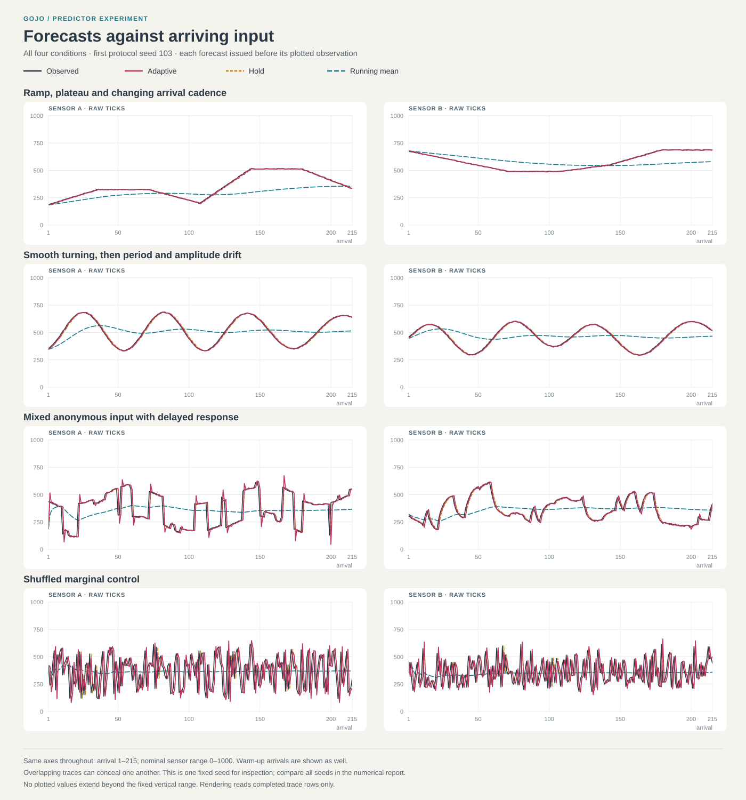

# Predictor network: first exploratory run

This experiment finds useful predictive structure, but does **not** establish that
its present adaptation rule improves on simpler supplied structures. That is a
useful distinction: Gojo can run the connected calculation; choosing which
structure should participate, and recognizing that the whole palette is inadequate,
remain open problems.

The [protocol](PROTOCOL.md) and running-mean control were committed before the
first predictor run. Seven supplied branches operate on two anonymous sensors.
Four conditions, three seeds and 216 arrivals per trial give 12 trials. Sample 0
initializes each circuit; forecasts precede observations 1–215. The first eight
arrivals are warm-up, leaving 208 scored arrivals per trial and sensor. No seed,
phase, latent switch, physical sampling interval or future value reaches a learner.

## What exists in Gojo

The network is a connected `Relation` root containing carriers, signed temporal
coordinates, equations, input bindings, update surfaces and participation reads.
The seven branches represent hold, last change, half change, slow change,
half-bend, reverse change and a supplied quarter-strength cross-input calibration.
Change feeds change-of-change and other equations. Names appear only in reports;
there is no semantic operation enum or light/heat model object.

Every forecast, error, loss update, participation weight, mixture and evaluation
metric is calculated by native equations, claims and carrier accumulation. No
host regression or host-computed forecast is attached to a graph afterward.
The host supplies synthetic input, constructs the initial palette, traverses
bindings, schedules reads and commits temporal coordinates. The ratio law and
all calibrations are supplied assumptions, not discovered mathematics.

The learner retains bounded lag, slow-change and recent-error traces. Derived
answers are read again from structure. The causal running mean is an explicit
comparator with sum/count state; it is not an adaptive branch. No learner can read
the evaluator's CSV history. Startup repeats the first sample in both lag slots
and assumes zero slow change; that does not establish unseen history.

This is a host-scheduled equation network. The update equations and targets are
connected in its ordered relation format, but the host still interprets their
temporal roles. Archive replay needs that reader. It is not autonomous kernel
scheduling, topology growth, pruning, crystallization, source separation, or
discovery of a cycle or switch.

## Results

Mean absolute error in original sensor ticks; lower is better. A and B remain
separate local bases. Each entry pools all three seeds, including transitions.

| Input | Sensor | Hold | Last change | Adaptive | Equal mixture | Frozen at 40 | Running mean |
|---|---|---:|---:|---:|---:|---:|---:|
| Ramp / plateau / cadence | A | 4.19 | 4.08 | 3.48 | 3.56 | 3.54 | 83.24 |
| Ramp / plateau / cadence | B | 2.53 | 3.25 | 2.60 | 2.60 | 2.60 | 67.11 |
| Smooth turning | A | 10.98 | 4.12 | 5.70 | 7.45 | 5.44 | 109.36 |
| Smooth turning | B | 8.55 | 3.94 | 5.08 | 5.92 | 5.07 | 86.46 |
| Mixed sources | A | 33.73 | 61.71 | 39.94 | 42.58 | 39.23 | 121.60 |
| Mixed sources | B | 17.41 | 14.51 | 13.04 | 13.84 | 12.80 | 96.90 |
| Shuffled marginals | A | 153.89 | 268.91 | 157.50 | 186.39 | 157.44 | 123.12 |
| Shuffled marginals | B | 136.02 | 238.64 | 137.86 | 162.99 | 142.74 | 96.83 |

The untouched [first run report](results/first-run.md) and complete
[metrics](results/metrics.csv) preserve the initial outcome. The metrics include
every branch, MAE, MSE and signed bias, with per-seed totals and pooled phase
totals. They do not include seed-by-phase breakdowns. Squared error drives
adaptation while MAE is the primary report metric; both are retained.



Promising observations:

- Ramp A improves over hold, last-change, equal and frozen participation in all
  three seeds. The mechanism can favor useful supplied structure during motion.
- Both smooth channels improve over hold and equal participation in every seed.
- Delayed mixed sensor B improves over hold, last-change and equal participation
  in every seed. Local temporal structure helps even without latent source labels.
- Forecasts and successful residue coordinates remain unchanged after input
  admission. Saving and restoring each representative circuit reproduces its
  next forecast by recalculation; changing a restored input leaves the original
  independent. Reachable learner structure stays constant in all 12 trials.

Challenges that matter:

- The supplied slow-change branch beats the adaptive mixture on both ramp
  sensors in every seed. Adaptive participation also loses to hold on all four
  pooled plateau/channel combinations. Averaging keeps too much motion active.
- On smooth inputs, last-change and slow-change beat the mixture in every seed.
  Frozen participation beats adaptive on A in every seed; during the drift phase
  frozen wins on both channels. Continued adaptation is not established as useful.
- Abrupt mixed sensor A loses to hold in every seed. It cannot forecast independent
  random switches, and extrapolation after a jump adds avoidable error.
- On mixed B, half-change beats the mixture in every seed (pooled 12.34 versus
  13.04), as does frozen participation (12.80). Improvement over hold is consistent
  with the delayed response, not evidence of discovered causes or cross-input
  explanation. These single-branch comparisons diagnose a supplied palette;
  no hindsight-selected branch is allowed to forecast earlier observations.
- On shuffled input, the running mean wins in every seed and sensor. Beating an
  equal mixture of poor candidates does not establish useful temporal prediction.
- All branch weights can shrink while normalization still emits a full forecast.
  There is no structural response to inadequate common support: no refinement
  demand, abstention, or growth pressure. A cross-input branch can retain weight
  on independently shuffled channels. Weight is relative recent loss, not a
  probability, confidence, or proof of a meaningful connection.

## Resolution and pressure

Post-run inspection added probes and evidence export without changing the
prediction law. Native division truncates toward zero: `11/4` reads `2` with
residue `3`; `-11/4` reads `-2` with residue `-3`. Residues remain on their source
bases and are never added across unrelated carriers into a total noise score.

The current temporal commits deliberately take only the represented coordinate.
Starting from zero, `(7L + e2)/8` remains zero for repeated squared errors 1–7.
Similarly `(3v + d)/4` stays zero for sustained change +1 or -1. The discarded
part is visible in each read; it does not accumulate in the next update. The
probes run 16 repetitions and retain their native evidence.

This is a legitimate coarse read, but zero loss alone cannot establish perfect
prediction. The present network has no mechanism to request finer resolution
when this distinction becomes useful. We should not repair that by treating all
read residue as newly transferred pressure: observing the same source twice must
not create change twice. Any future temporal import/refinement rule needs an
explicit local meaning and budget.

Successful read coordinates and residues are frozen observations. Failed reads
retain a live requested surface with frozen upstream observations; they are not
wholly immutable historical snapshots. All scored trial reads were successful.

## Cost and next experiment

Each two-sensor circuit reaches **919 carriers, 9,916 relations and 6,094 tick
references**, unchanged across a trial. This includes all controls and explicit
calibration structure. It is large for seven branches. Bounded persistent
structure does not establish low compute or allocation cost; neither was benchmarked.
Per-read memoization lasts only for that read and is not a stored answer table.

The next useful step is to connect subsequent prediction error and unresolved
resolution to explicit local update/transfer structure. Keep represented prediction,
read residue, recent predictive loss and newly transferred tension distinct.
Give a small competing structure access to an unexplained stream and require it
to improve **later** forecasts over the existing local branch before gaining
participation. Compare continued adaptation against frozen structure again.
Retain the shuffled and switching conditions so correlation and surprise are not
rewarded merely for being explainable afterward.

Before arbitrary growth, make one such local transition and residual route
inspectable without the host pairing independent target/update arrays. Then test
a modest candidate change, separately declared in a new protocol. The present
results do not justify tuning this palette until it wins or declaring a learned
day/night model.

## Reproduce and inspect

From the repository root:

```powershell
dotnet run --project experiments/PredictorScratchpad/PredictorScratchpad.csproj
dotnet run --project experiments/PredictorScratchpad/PredictorScratchpad.csproj -- --mechanism-only
```

The short mechanism run writes under `out/mechanism`, preserving full trial output.
The full run writes the report, metrics, forecasts, participation, representative
network archives, native metric evidence, selected read/update evidence, residue
samples, resolution probes and `forecast-traces.svg` under ignored `out/`.
The SVG shows all four conditions at fixed seed 103, not a selected best seed.
Only coordinate/display conversion occurs in its renderer.

The first full run passed 224,117 mechanism assertions; these check execution,
causal ordering and preservation, not predictive superiority. Post-review changes
only add inspection/rendering and make displayed adaptive-minus-baseline differences
subtract native totals before rounding once. The first report subtracted already
rounded means and can differ by 0.01 tick. No forecast, update law, supplied
calibration, input sequence or scoring window was changed.
The expanded run passes 224,206 assertions and reproduces the original metrics
file exactly. A plot-export file-sharing error was fixed by closing completed
trace output before rendering; it did not affect calculations or results.
