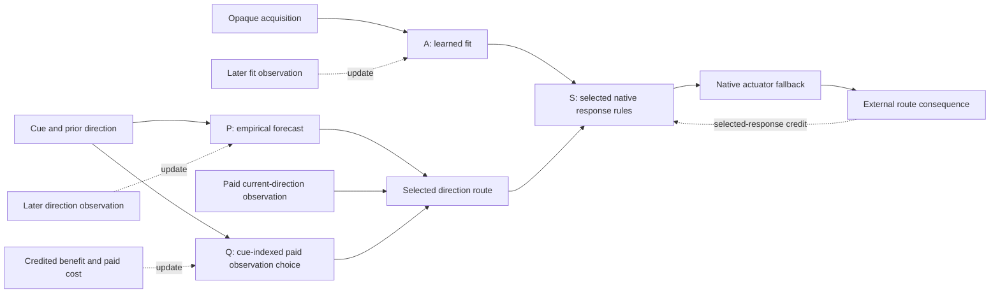

# Primitive learning in Gojo

**Status: both fresh studies are complete.** The primary reversal study uses
eight seeds (100–107); the repetition comparison uses four of those identities
(100–103). Results come from `campaign-fresh` and `persistent-fresh`, with
completed run records and matching frozen source hashes. Pilots and interrupted
development campaigns are excluded from confirmation.

In the primary study, the full controller earned **3.258 resource units per
episode**, routed **97.705%** correctly, and bought a direction observation on
**55.859%** of episodes. Its paired advantage over always buying the observation
was **0.258 [0.160, 0.356]**. This is evidence for useful local composition and
selective paid observation in this authored task. It does not establish a
general learning architecture or automatic discovery of numeric primitives.

## 1. What is being tested

The study asks whether four small, authored learning laws can construct useful
native Gojo distinctions, empirical forecasts, information choices, and response
compositions from later observations. The host schedules an external episodic
world and traverses the native structures. The learned model lives in carrier
sites, ordered relations, comparison witnesses, rule surfaces, candidate
correspondences, count updates, and retained evidence.

This is a bounded local learning experiment. It does not establish unrestricted
program synthesis, discovery of a new learning algorithm, autonomous hierarchy
formation, or closed-loop organism survival. No Jev calls are used in these runs.

### The two-lane relay

A parcel has an opaque load. The creature-like agent can acquire its presence and
request ordering comparisons with retained acquisitions. A later lane probe
publishes whether that parcel fits; neither its private load coordinate nor the
lane threshold enters the learner.

A separate flow has a last witnessed direction and a binary public context cue.
In cue0, the next flow reverses its predecessor with probability 95% in the primary
study. In cue1, direction is random. The cue identifies a context, not its law.
A separate comparison study uses 95% repetition in cue0. Direction becomes
observable after acting, including when a paid pre-action query was skipped.

A fitting parcel must be routed with the current flow; a non-fitting one must
take the opposite lane. Correct routing earns 4 resource units, incorrect routing
loses 4, holding or genuine absence earns 0, and each optional current-direction
query costs 1 in the baseline world. The world publishes actual consequences; it
does not write learner memory.

This task deliberately requires composition: fit alone and flow alone are each
insufficient for the final lane choice. That imposed information requirement
must be kept separate from what the local learning algorithms discover.

Interfaces, axes, context keys, direction conventions, binary fit labels and the
candidate grammar are authored. The load acquisition is opaque and nonmetric;
this study does not test autonomous number-system, unit or calibration discovery.

### Information path and an interpretable response



Q uses its public cue ledger; it does not directly read the forecast's current
ambiguity. The selected route exposes the forecast or a purchased observation
to S. Independent later publications feed the four explicit update contracts.

The intended four-case route is comprehensible:

| Learned fit | Selected direction | Action |
|---:|---:|---:|
| 0 | −1 | +1 |
| 0 | +1 | −1 |
| 1 | −1 | −1 |
| 1 | +1 | +1 |

As explanatory shorthand, `action = (2 × fit − 1) × direction`. The implementation
selects among native condition/response rules; it does not insert that equation
as a learned numeric law or grant S the private fit/flow truth.

## 2. What changes inside the native model

| Learner | Observations admitted | Native change | Important limit |
|---|---|---|---|
| A: adaptive distinctions | Opaque acquisitions, requested order signs, later fit consequences | Retained contrast landmarks, binary consequence-count cells, and connected comparison-to-response rules | Piecewise-constant consequence hypotheses; landmark rank never becomes distance |
| P: ordinal prediction | Ordered context ports on their declared axes and later direction publications | Context-to-outcome count rows, explicit majority-selection conditions and forecast witnesses | Empirical outcomes are hypotheses; they do not tighten a sensor's guaranteed bounds |
| Q: query allocation | Public cue, credited consequence and paid cost tied to the selected query decision | Native benefit/cost ledgers and a choice between observing or using the current cheap hypothesis | Credit depends on the declared local task and its current input quality |
| S: program selection | Fit and direction ports, actual resource consequence of the selected response | Candidate support, acceptance evidence and selection of a native condition/response program | All 16 native truth-table candidates exist before the campaign; this is bounded selection without invented syntax |

The predictor's context cue and previous direction have distinct concrete axes.
Its point forecast requires at least 4 observations and a winning count margin of
at least 2 against each alternative. Observed minority directions remain
inspectable alongside a nominal forecast. A returned point is an empirical
choice, not a guaranteed interval or a calibrated probability. A random context
can still emit a nominal forecast when its finite observed counts happen to lead
by that margin.

Count sites use finite declared budgets. A and P expose aging and retained loss;
Q and S pool lifetime empirical evidence until their finite admission limits,
with bounded receipt retention. The adaptive model permits at most 16 landmarks
and keeps a 64-receipt duplicate exclusion window. Its tightened boundary anchors
can share pooled class-support
cells; those counts are not repeated exact observations of a replacement anchor.
Native root snapshots and focused readers preserve the semantic model, while
host lists and artifact fields are inspection projections.

Known absence, an unavailable acquisition, an equal order comparison, and an
unknown magnitude are different states. No absent sample is turned into a
brightness zero. Open or contradictory evidence remains connected to failed
reads, alternatives, losses or claims.

## 3. Evaluation fixed before fresh confirmation

### Fresh seeds and protocol history

The primary confirmation uses seed identities 100–107. The repetition comparison
uses 100–103. Each run has 1536 training episodes and 768 test episodes. Training
tapes use `41000 + seed`; test tapes use `91000 + seed`; shuffled feedback uses
`141000 + seed`.

Pilots used identities 0 and 1. The first campaign also began at 0 and was stopped
when that overlap was noticed. Its partial artifacts and the corresponding
partial repetition study are retained as development data. Only the new fresh
campaigns belong in the confirmation tables. Their manifests record the source
hashes and settings before evaluation. No learner laws are changed using fresh
test outcomes.

### Staging, credit and controls

A and P learn immediately. Q and S start updating after 128 warmup episodes, so
the query service is not trained entirely on an immature forecast. A simultaneous
query control starts Q at 0 while leaving S at 128. Q estimates a lifetime
empirical mean while its forecast producer is changing. Warmup mitigates that
stale-credit problem; it is not a convergence result.

The main query credit is a known-fitting shadow parcel using only the selected
direction response. This isolates whether that information choice was useful;
it does not supply both alternative counterfactual outcomes. Shadow actions are
counted. A separate whole-route-credit control removes that auxiliary task and
credits Q from the actual route's gross resource consequence, before subtracting
the separately declared cost.

The local query-only experiment uses a fixed previous-direction hypothesis.
The integrated experiment can instead use P's learned forecast. Those are
different cheap alternatives; selective querying in the integration should not
be attributed to the isolated query learner alone.

Q selects from public-cue-indexed empirical ledgers. It does not inspect the
current support ambiguity or whether a particular decision needs refinement.
A and P still run every episode, including when a direction query is taken.
The measured behavior is selective paid observation under the declared local
credit contract, rather than a complete value-of-information controller.

All 16 combinations of A/P/Q/S updating or retaining their initialization are
tested on matched physical tapes. The primary comparisons are full versus
frozen initialization, the three fixed neutral responses, always-query, and
no-predictor. Secondary controls include shuffled feedback, missing or inverted
communications, never-query, simultaneous querying, and whole-route credit.
The disabled factor retains its initial graph and authored fallback rather than
silently receiving the missing learned information.

### Frozen evaluation and statistics

Test phases freeze learned count, candidate and calibration states. Native
learned-model signatures are checked before and after each frozen test; runtime
reads and latest witnesses may still change. Changed flow law, lane threshold,
query price and sensor availability are therefore transfer tests of a fixed
policy, not demonstrations of adaptation to those changes.

Means and two-sided 95% Student t intervals use seed as the independent replicate.
Primary differences use paired seed results. For 8 seeds the critical value is
2.364624 with 7 degrees of freedom; for 4 it is 3.182446 with 3 degrees of freedom.
Individual episodes are not counted as independent experiments. Intervals and
contrasts are descriptive and are not corrected for multiple comparisons. The
repetition comparison shares identities 100–103 with the primary study: it is a
paired protocol change, not four additional independent confirmation replicates.

Correct rate uses all episodes. Coverage records whether the evaluated read is
available; accuracy when covered uses only established reads. The analysis
excludes zero-coverage seeds from conditional accuracy rather than scoring their
placeholder ratios as 0% accurate. Overall action coverage can be 100% because an
explicit native actuator fallback holds when intent is open; that does not mean
the learner had a confident answer. Active accuracy excludes genuine absence
but still includes unavailable-sensor episodes.

Main factorial effects are on-minus-off means averaged over other factors. AS is
a difference of differences. APQS is the fourth-order alternating cell contrast;
its numerical scale differs from a main effect. Complementarity is measured
under the entire prescribed interface and learning design. In particular, A-off
falls back to fit 0, so S sees only two of its four input cases. Candidate
acceptance requires at least four observations in every case, preventing a
candidate from qualifying there. AS therefore includes that authored admission
gate as well as the task's need to combine fit and direction.

## 4. Fresh confirmation results

### Primary reversal study: seeds 100–107

All figures in this subsection use eight completed seed means. Brackets are
descriptive 95% t intervals; percentages in compact tables are means.

| Controller | Return per episode [95% CI] | Routing correct | Paid queries |
|---|---:|---:|---:|
| Full A1P1Q1S1 | **3.258 [3.160, 3.356]** | **97.705%** | **55.859%** |
| Always query | 3.000 [3.000, 3.000] | 100% | 100% |
| No predictor A1P0Q1S1 | 3.000 [3.000, 3.000] | 100% | 100% |
| Never query, learned full model | 1.772 [1.617, 1.927] | 72.152% | 0% |
| Frozen initialization A0P0Q0S0 | 0.007 [−0.115, 0.128] | 50.081% | 0% |
| Shuffled feedback | 0.007 [−0.115, 0.128] | 50.081% | 0% |
| Neutral left | 0.007 [−0.115, 0.128] | 50.081% | 0% |
| Neutral alternating | −0.051 [−0.099, −0.002] | 49.365% | 0% |
| Neutral hold | 0.000 [0.000, 0.000] | 0% | 0% |

The full correct rate interval was [96.783%, 98.627%], and its query rate interval
was [40.903%, 70.816%]. It queried every cue1 episode. Seven seeds skipped all
cue0 queries; seed 105 instead queried both contexts and returned 3.000. That
exception is observed, but its particular cause is not established by the
detailed seed 100 archive.

| Full minus matched control | Return difference [95% CI] |
|---|---:|
| Frozen initialization / shuffled / neutral left | 3.251 [3.172, 3.331] |
| Neutral alternating | 3.309 [3.189, 3.429] |
| Neutral hold | 3.258 [3.160, 3.356] |
| Always query / no predictor | **0.258 [0.160, 0.356]** |
| Never query, learned full model | 1.486 [1.350, 1.621] |

Against always-query, the full controller lost 2.295 percentage points of routing
accuracy [−3.217, −1.373] while saving enough query fees to improve net return.
The known-law reference is 3.300 for selective querying, 3.000 for always-query,
and 1.800 for a learned forecast without querying, assuming balanced contexts,
known fit, exact purchased direction and no missing events. These are analytical
references, not additional measured controllers.

#### Each isolated learner

These controls test a local contract with its required ports supplied; none is
an independently capable complete relay agent.

| Local learner / control | Available reads | Correct over all episodes | Accuracy when available | Local return |
|---|---:|---:|---:|---:|
| A learned | 100% | 100% | 100% | Classification only |
| A frozen / shuffled | 0% | 0% | Unavailable | Classification only |
| P learned | 90.186% | 67.562% | 75.549% | Forecast only |
| P frozen | 0% | 0% | Unavailable | Forecast only |
| P shuffled | 91.032% | 41.162% | 47.853% | Forecast only |
| Q learned | 100% | 100% | 100% | 3.000 [3.000, 3.000] |
| Q frozen / shuffled | 100% | 27.441% | 27.441% | −1.805 [−1.989, −1.621] |
| S learned | 100% | 100% | 100% | 4.000 [4.000, 4.000] |
| S frozen | 100% | 50.081% | 50.081% | 0.007 [−0.115, 0.128] |
| S shuffled | 100% | 59.456% | 59.456% | 0.757 [−0.793, 2.306] |

A retained two useful contrast landmarks. P retained four context rows. Its
cue0 coverage was 100% and accuracy 94.991% [93.867%, 96.114%]; cue1 coverage
was 80.015% and conditional accuracy 50.146% [45.698%, 54.593%]. Its overall
accuracy when available was 75.549% [71.086%, 80.011%], alongside the lower
all-episode correct rate of 67.562% [62.050%, 73.074%]. This distinguishes useful
prediction in one context, abstention, and nominal forecasts in random data.

Q's isolated cheap hypothesis is the previous direction, which is wrong about
95% of the time in cue0 under reversal. It learned to query both contexts. The
integrated Q can use P's improved forecast and therefore often skips cue0.
S's local test supplies observed fit and current direction, with no paid-query
fee in its isolated return. Its 4.000 is the gross routing reward, not the net
return of a self-sufficient information-gathering policy.

#### Turning one learner's updates off

| Updates disabled, other three enabled | Return [95% CI] | Routing correct | Paid queries | Full minus this control [95% CI] |
|---|---:|---:|---:|---:|
| A0P1Q1S1 | −0.552 [−0.817, −0.287] | 50.081% | 55.859% | 3.810 [3.622, 3.998] |
| A1P0Q1S1 | 3.000 [3.000, 3.000] | 100% | 100% | 0.258 [0.160, 0.356] |
| A1P1Q0S1 | 1.419 [1.051, 1.788] | 67.741% | 0% | 1.839 [1.454, 2.223] |
| A1P1Q1S0 | −0.552 [−0.817, −0.287] | 50.081% | 55.859% | 3.810 [3.622, 3.998] |

Q-off training changes the information and credit seen by S; it is distinct from
disabling queries only during deployment of the fully trained model. A-off and
S-off retain authored initial policies, so these effects apply to this specified
interface and admission design. With communication withheld entirely, return
was −0.559: the agent still paid for observations but had no usable response.
Inverting either the fit or direction port produced −4.375 and 2.295% correct
routing, verifying that the connected meanings matter to the resulting action.

#### Complete factorial and declared contrasts

| Updates A/P/Q/S | Return [95% CI] | Routing correct | Paid queries |
|---|---:|---:|---:|
| 0000 | 0.007 [−0.115, 0.128] | 50.081% | 0% |
| 0001 | 0.007 [−0.115, 0.128] | 50.081% | 0% |
| 0010 | −0.993 [−1.115, −0.872] | 50.081% | 100% |
| 0011 | −0.993 [−1.115, −0.872] | 50.081% | 100% |
| 0100 | 0.007 [−0.115, 0.128] | 50.081% | 0% |
| 0101 | 0.007 [−0.115, 0.128] | 50.081% | 0% |
| 0110 | −0.552 [−0.817, −0.287] | 50.081% | 55.859% |
| 0111 | −0.552 [−0.817, −0.287] | 50.081% | 55.859% |
| 1000 | 0.007 [−0.115, 0.128] | 50.081% | 0% |
| 1001 | 1.432 [1.104, 1.761] | 67.904% | 0% |
| 1010 | −0.993 [−1.115, −0.872] | 50.081% | 100% |
| 1011 | 3.000 [3.000, 3.000] | 100% | 100% |
| 1100 | 0.007 [−0.115, 0.128] | 50.081% | 0% |
| 1101 | 1.419 [1.051, 1.788] | 67.741% | 0% |
| 1110 | −0.552 [−0.817, −0.287] | 50.081% | 55.859% |
| 1111 | 3.258 [3.160, 3.356] | 97.705% | 55.859% |

| Return contrast | Mean [95% CI] |
|---|---:|
| A main effect | 1.330 [1.216, 1.444] |
| P main effect | 0.196 [0.099, 0.293] |
| Q main effect | **−0.159 [−0.266, −0.052]** |
| S main effect | 1.330 [1.216, 1.444] |
| AS difference of differences | 2.660 [2.432, 2.889] |
| APQS fourth-order contrast | −0.171 [−0.658, 0.317] |

Q's effect averaged across all combinations is negative, despite useful selective
querying in the full controller. A paid local service can provide accurate
information while wasting global resource when its consumer cannot use it.
The positive AS contrast includes the authored all-case candidate-admission
gate described above. The fourth-order interval includes zero; these data do
not establish four-way superadditivity or a discovered hierarchy.

#### Schedule, credit and progression

Starting Q simultaneously led every primary seed to query both contexts: return
3.000, matching always-query. The full-minus-simultaneous paired difference was
0.258 [0.160, 0.356]. Staging helped here, but did not prevent the seed 105
always-query exception or prove convergence of lifetime credit.

Whole-route credit returned 3.016 [2.431, 3.601]. Its paired full-minus-control
difference was 0.242 [−0.373, 0.857], so a mean advantage for auxiliary credit
is not established. Seed 100 returned 1.309 with 72.526% correct routing;
seed 102 queried both contexts and returned 3.000; the other six returned
between 3.232 and 3.375. These are system outcomes of coupled learning and
credit, not an isolated diagnosis of which component caused the exception.

Full training return rose by 3.237 [2.853, 3.621] from the first 128-episode block
to the last; correctness rose by 47.754 percentage points [42.352, 53.156].
Two landmarks and four predictor rows were already present by the first block,
while selected responses continued to change. These paired block differences
describe progression over different training episodes and are not held-out
causal comparisons.

### Completed repetition comparison: seeds 100–103

This comparison uses 95% repetition in cue0. It shares seed identities with the
primary reversal protocol and is not an additional independent four-seed sample
of that protocol. All figures in this subsection use four completed seed means;
brackets are descriptive 95% t intervals.

| Controller | Return per episode [95% CI] | Routing correct | Paid queries |
|---|---:|---:|---:|
| Full A1P1Q1S1 | 3.322 [3.292, 3.353] | 97.754% | 49.805% |
| No predictor A1P0Q1S1 | 3.322 [3.292, 3.353] | 97.754% | 49.805% |
| Always query | 3.000 [3.000, 3.000] | 100% | 100% |
| Never query | 1.859 [1.538, 2.180] | 73.242% | 0% |
| Frozen initialization | 0.008 [−0.180, 0.196] | 50.098% | 0% |
| Neutral hold | 0.000 [0.000, 0.000] | 0% | 0% |
| Neutral alternating | 0.003 [−0.229, 0.234] | 50.033% | 0% |

The full controller queried no cue0 episodes and all cue1 episodes. Its paired
return advantage over always-query was **0.322 [0.292, 0.353]**. Its paired
advantage over no-predictor was exactly **0 [0, 0]** across these tapes: the
authored prior-direction fallback already fits the repetition context. This is
a concrete limit on a claim that prediction always improves utility.

The isolated adaptive learner achieved 100% coverage and correctness, retaining
two landmarks. The isolated predictor covered every test episode and achieved
73.242% accuracy [69.230%, 77.254%]: cue0 accuracy was 95.520% and cue1 accuracy
50.834%. Its empirical rows can therefore forecast random directions without
becoming reliable. The local query task attained 3.322 return by retaining the
already useful prior in cue0 and querying cue1. The program learner, given
observed fit and current direction ports, selected a response with 100% correct
routing and 4.000 gross return. These local tasks supply different ports and do
not each solve the complete relay problem alone.

The repetition factorial AS contrast was **2.600 [2.250, 2.949]**. The P main
effect was **0.010 [−0.137, 0.157]**, and the fourth-order APQS contrast was
**−0.081 [−1.255, 1.094]**. Thus the measured contrast supports fit/response
complementarity in this task, while these data do not establish a separate
four-way interaction or a useful average predictor effect in the repetition
regime. The same authored all-case candidate-admission gate applies here.
Complete cells and other contrasts are in the saved analysis.

Starting Q simultaneously produced the same final test behavior as staging it
on all four repetition seeds. Whole-route credit was less consistent: its mean
return was 2.625 [0.742, 4.508], with a full-minus-whole-route paired difference
of 0.697 [−1.172, 2.566]. Seed 103 returned 0.865 and queried both contexts;
seed 102 also queried both but retained 100% routing accuracy and returned 3.
Seeds 100 and 101 matched the full controller. This identifies a credit/schedule
failure worth inspecting, but four seeds do not establish a reliable mean
advantage for the auxiliary credit contract.

## 5. Frozen transfer and information boundaries

The following shifts keep each learned model frozen. They test finer unseen
loads, less predictable flow, reversal of the learned flow law, query price 5,
a changed fit threshold, and missing or genuinely absent acquisitions.

| Primary test condition, n = 8 | Return per episode [95% CI] | Routing correct |
|---|---:|---:|
| Baseline | 3.258 [3.160, 3.356] | 97.705% |
| Finer unseen loads | 2.799 [2.677, 2.922] | 91.976% |
| Less predictable flow | 2.361 [2.135, 2.586] | 86.491% |
| Reversed flow law | 0.081 [−0.908, 1.070] | 57.992% |
| Query price 5 | 1.023 [0.335, 1.712] | 97.705% |
| Changed fit threshold | 2.520 [2.389, 2.650] | 88.477% |
| Missing and absent | 2.727 [2.676, 2.778] | 87.907% |

Primary missing/absent active accuracy was 90.743% [89.508%, 91.977%]. It
excludes genuine absence but includes unavailable acquisitions. The price shift
preserves routing and increases fees; no current pre-action price port is supplied
to the frozen query policy. Changed laws and fit boundaries degrade the fixed
learned response rather than trigger recovery. Successful baseline learning
therefore does not imply robust transfer across those changes.

Strictly increasing private encodings are trained and evaluated on matched tapes:
an affine encoding and a cubic encoding. Their check compares decision digests,
scalar outcomes, computation counters, native graph footprints and learned
digests. Matching encodings tests the specified ordinal boundary; it is not
identity equality between separately constructed carrier graphs.

The completed repetition study shows the following frozen transfers:

| Repetition test condition | Return per episode [95% CI] | Routing correct |
|---|---:|---:|
| Baseline | 3.322 [3.292, 3.353] | 97.754% |
| Finer unseen loads | 2.856 [2.810, 2.902] | 91.927% |
| Less predictable flow | 2.359 [2.159, 2.558] | 85.710% |
| Reversed flow law | −0.287 [−0.462, −0.112] | 52.637% |
| Query price 5 | 1.330 [1.191, 1.470] | 97.754% |
| Changed fit threshold | 2.580 [2.507, 2.653] | 88.477% |
| Missing and absent | 2.903 [2.849, 2.957] | 89.486% |

Missing/absent active accuracy was 92.372%, excluding genuine absence but
including unavailable sensor episodes. In the price shift, routing remains
correct but the fixed query policy keeps paying the larger fee; a current
pre-action price port is absent. The reversed-law loss is a transfer failure
of the frozen empirical forecast and query contract, not online relearning.
Both monotone private encodings matched all checked decisions, outcomes, work
counts, footprints and learned digests across all eight primary seeds and all
four repetition seeds. The native source manifests also match between studies.

Across the four shared seed identities, primary-minus-repetition full return was
−0.047 [−0.111, 0.017]. For no-predictor it was −0.322 [−0.353, −0.292], while
always-query matched exactly. The prior-direction fallback already works in the
repetition context; learned prediction becomes useful when that relationship
reverses. These are paired changes in the authored protocol, not independent
extra replications or evidence that a predictor helps every world.

## 6. Computation and native archive cost

The primary full controller retained two landmarks, four predictor rows and
selected complexity 8 on all eight seeds. Mean reachable graph size was
40,998.25 carriers [39,798.55, 42,197.95] and 430,774.75 relations
[419,939.30, 441,610.20]. Deployment used 1.508 comparisons per episode
[1.496, 1.521] and one later direction audit per episode, with no deployment fit
probes or shadow actions. It accepted an average 4.625 program edits
[2.680, 6.570]. Selected complexity 8 counts two conditions for each of four
response rules; it is not a count of every native graph node.

The repetition full controller also retained two landmarks, four predictor rows
and complexity 8 on all four seeds. Mean reachable size was 41,486.75 carriers
and 435,046 relations, with 1.508 deployment comparisons per episode.
This distinguishes active landmarks, context rows and selected program size
from the much larger reachable evidence graph.
Graph counts include unit-shape surfaces, attachments, witnesses, bounded ledgers
and coordinate occurrences. They are neither process memory measurements nor
active rule counts alone.

Deployment query fees are debited from the simulated resource return. Comparison
work, fit probes, post-action audits and shadow actions are separately counted;
CPU work and training audits are not charged the same resource fee. A policy
with fewer paid queries is not automatically cheaper to execute in wall time.

Native `.gojo` transport archives are read back and structurally verified. Query
choices and all fit/direction combinations of the selected program receive
behavioral readback checks. Adaptive deployment also requires the external opaque
comparison service's acquisition correspondence; that private service is not
reconstructed by inventing a magnitude inside the learner.

### A concrete restored native query ledger

The primary seed 100 archive exposes these cue/choice ledgers. Benefit and cost
are declared resource amounts; load magnitude is still unavailable to the learner.

| Cue / choice | Credited observations | Positive benefit | Negative benefit | Paid cost | Native net-mean score / 256 |
|---|---:|---:|---:|---:|---:|
| cue0 / skip | 655 | 2464 | 156 | 0 | 902 / 256 |
| cue0 / ask | 25 | 100 | 0 | 25 | 768 / 256 |
| cue1 / skip | 26 | 56 | 48 | 0 | 78 / 256 |
| cue1 / ask | 702 | 2808 | 0 | 702 | 768 / 256 |

The native score read computes the finite fixed-frame mean of
`(positive benefit − negative benefit − paid cost) / observations`, with its
declared scale and rounding evidence. Cue0 favors skip (902 versus 768); cue1
favors ask (768 versus 78). This is an inspectable empirical comparison, not a
calibrated confidence estimate or a counterfactual score for every current
decision. The counts reflect the producer and credit contract used during
training. They illustrate one saved seed rather than explain the seed 105
exception.

### Scheduled episodes and recorded duration

The primary study completed 624 result rows in 1369.4 seconds; the repetition
study completed 312 in 742.4 seconds. The runs overlapped, so these are recorded
elapsed durations, not matched execution benchmarks or CPU-work measurements.

Per seed, 31 saved training records and 47 saved test records total 83,712 saved
episode evaluations. Two additional re-encoding training cohorts are executed
without saved ResultRow records, adding 3,072 episodes. That is 86,784 scheduled
controller episodes per seed: 694,272 primary and 347,136 repetition, or
1,041,408 combined. The 936 saved rows cover 1,004,544 of those episodes.
Shadow actions, later audits and native candidate score calculations are
additional work within an episode. These totals count repeated controllers on
paired tapes; they are not a million independent samples or physical situations.

An independent structural inspection of fresh primary seed 100 found a 14,967,449
byte program archive but a 5,936 byte selected four-rule policy and 117,695 byte
active candidate/ledger/selector core. Its 64 full feedback receipts reached
14,856,443 bytes, retaining complete selection audits (16 scores and about 64
claims each). They account for about 99.3% of the complete program archive.
This is a bounded ring of large audit bundles, not recursive retention of old
whole roots. Omitting the receipt root edge diagnostically yielded 440,067 bytes
(about 97.1% smaller), but that omission changes retained semantics and is not a
validated optimization or measured runtime gain. See [GRAPH-COST.md](GRAPH-COST.md).

Some retained program claims use live `ValueSlot` premises. Later count changes
can move those historical source coordinates, even though computed residuals,
scores and ledger before/after captures are snapshots. The saved structures are
retained audit graphs, not guaranteed exact historical replay packets. Current
decisions read current counts correctly; the transport and frozen-model checks
remain valid. Concise receipts and frozen premise capture should be addressed
together before promising exact historical reconstruction.

## 7. Interpretation and next experiment

The confirmed studies support three bounded conclusions:

- Native comparison-only acquisitions learned useful binary consequence
  distinctions without converting rank to load distance or receiving a private
  magnitude. In this fixture, two contrast landmarks sufficed for baseline tests.
- Native context counts, declared paid-observation credit and selected response
  rules composed into a high-return relay controller. In the primary reversal
  task, it improved net return over always-query while accepting a small error
  rate. Prediction's benefit vanished when the initial prior already fit the
  repetition law.
- Utility is a property of the connected consumer as well as the local service.
  Paid information had a negative factorial effect averaged across all consumer
  combinations, and the complete four-way interaction was not established.
  The fit/response interaction also includes the authored acceptance gate.

The laws, ports, context keys and 16-candidate grammar were supplied. What emerged
was useful landmark placement, empirical context forecasts, paid-observation
selection and an interpretable response within those contracts. There is no
evidence here for spontaneous number systems, autonomous unit calibration,
invented program syntax or a discovered hierarchy. Native alternatives and
tension remain useful evidence, but their presence alone is not successful
learning.

The next small matched study should address two concrete costs first: replace
large audit receipts with an explicitly narrower native retention contract and
freeze the necessary historical premises; then test producer-aware or aged
query utility against the current lifetime mean. A later price-port experiment
can distinguish a fixed-fee policy from one that sees changing costs. Each change
needs frozen behavior/transport checks plus measured allocation and runtime;
the archive-size diagnostic is not a speedup forecast.

Closed-loop foraging, online recovery after a changed law, and expanded program
grammars are subsequent tests. The present result is a useful foundation for
those experiments, with observable failure modes and explicit computational
costs, rather than evidence that they already work.

## Reproducibility

The machine-readable analyses are produced from saved data with:

```powershell
& 'C:/Program Files/Python310/python.exe' experiments/PrimitiveLearning/Analyze-Results.py artifacts/primitive-learning/campaign-fresh artifacts/primitive-learning/persistent-fresh --output artifacts/primitive-learning/analysis-fresh
```

The confirmation passed 64 focused experiment tests and 2109 tests in the full
solution gate. Completed row counts, unique keys, return-law consistency and
encoding parity also passed. The matching launch hashes cover the experiment's
C# files; reproducing native behavior also requires the retained Gojo/core
sources and recorded .NET runtime. Elapsed study times above are not benchmarks.

See [README.md](README.md) for run commands, [VALIDATION.md](VALIDATION.md) for
verification evidence, [PROTOCOL.md](PROTOCOL.md) for experimental boundaries,
and [LITERATURE.md](LITERATURE.md) for the reviewed research context. The complete
saved-data analysis is in
[analysis.json](../../artifacts/primitive-learning/analysis-fresh/analysis.json)
and [analysis.md](../../artifacts/primitive-learning/analysis-fresh/analysis.md).
