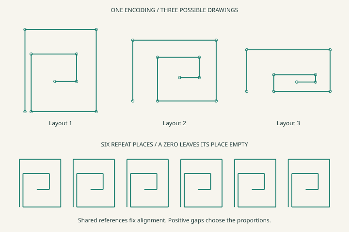
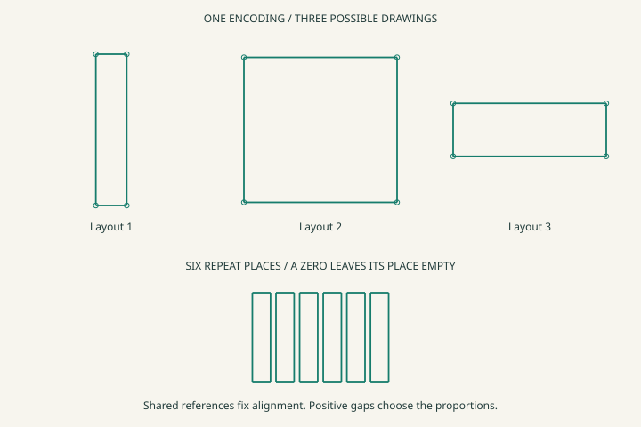
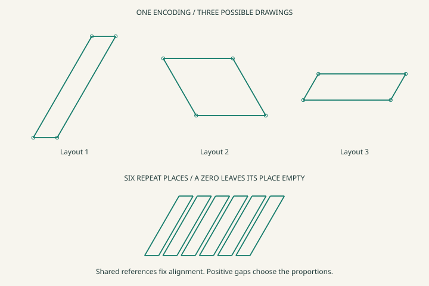
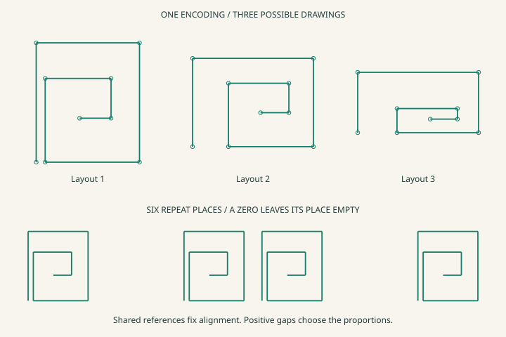
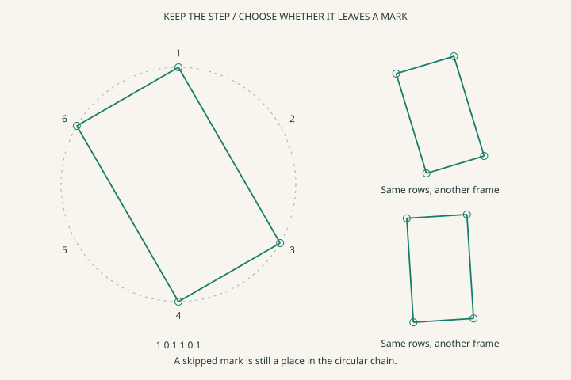
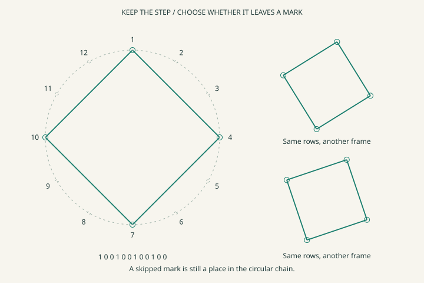
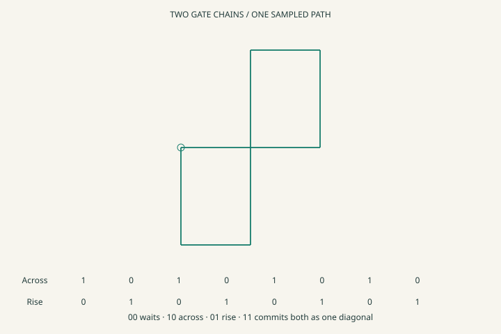
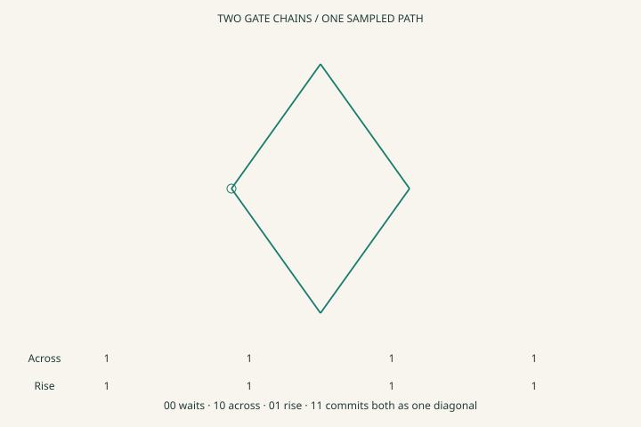

# Draw from hints

This experiment asks whether a small connected description can draw a recognizable ornament without storing its coordinates. It starts with a square return fret and a rectangle. They store ordered landmarks, which landmarks each corner uses, and which corners connect. Three different drawings then choose different positive distances while keeping exactly the same encoding.

A second experiment uses a chain of one-bit gates around a circle. **Every slot is a step. A one leaves a landmark and a zero skips the landmark.** The circular traversal still visits both. Six equal steps with the second and fifth gates off leave a rectangle. A third experiment pairs two gate chains so their movements happen separately or together.

[Open Draw from hints](https://gojo.inklingai.ca/encoding/explorer/?layer=38)

Start with **Rail fret**. Press **Vary drawing** and watch the proportions change while the encoding stays still. Choose **Order open** or **Turn basis open** to remove a promise. Then try **Circle marks** and **Next slot**. The numbering continues through each zero. **Two gate streams** compares separate movements with simultaneous movements.

## One connected sketch, many drawings

Think of the fret as locations on two rulers whose ticks have names but no measured spacing. The across ruler has five ordered landmarks. The rise ruler has four. Each corner points to one landmark on each ruler. Two corners sharing an across landmark stay aligned in that direction, however the gaps change.

The pen follows these site rows in order. The numbers in the table are local addresses, not distances.

| Pen site | Across reference | Rise reference | Connection to next site |
| --- | --- | --- | --- |
| 0 | 0 | 0 | Same across reference, rise to the top |
| 1 | 0 | 3 | Same rise reference, across to the far edge |
| 2 | 4 | 3 | Same across reference, return to the bottom |
| 3 | 4 | 0 | Return across to the first interior landmark |
| 4 | 1 | 0 | Rise to an interior landmark |
| 5 | 1 | 2 | Across to another interior landmark |
| 6 | 3 | 2 | Return to the lower interior rise landmark |
| 7 | 3 | 1 | Across to the innermost tip |
| 8 | 2 | 1 | Open end |

The right-angle promise has its own construction. The two rails bind to adjacent rays of a closed radial whole with four equal shares. Removing that binding leaves two ordered rails but no promised right angle. The picture can then slant.

The rectangle uses the paired references `[0,0] → [1,0] → [1,1] → [0,1] → first site`. The two rail spans are independent unknown positive amounts. Sharing the same references gives matching opposite sides. The explicit final connection supplies closure.

The renderer chooses positive gaps in a permitted order, places the rail basis, and follows the site connections. These choices are numerical witnesses. No drawing is read back into the encoding as evidence. For a partially ordered rail, the small fixture can enumerate compatible orders and illustrate some of them. This is a presentation aid, not an autonomous geometry solver.

## What changes when a hint is removed

| Removed or changed connection | What remains | What is no longer established |
| --- | --- | --- |
| One strict comparison on the across rail | Named sites, other comparisons, pen connections | The missing order and any geometric guarantee depending on it |
| Rail bindings to adjacent quarter rays | Shared alignment, rail order, path | Right-angle corners |
| Rectangle's final-to-first connection | Three joined edges | Closed ink boundary |
| Far-edge-before-next-origin comparison | Positive motif width and forward repeat placement | A positive gap between neighboring repeats |
| Add a strict comparison opposite the existing chain | The contradictory rows remain inspectable | Any admissible strict ordering. No drawing is supplied |

The repeat placement also has a small order structure. Its roles are origin, motif far edge and next origin. Ordered storage promises `origin < far edge < next origin`. The renderer chooses the actual gap. **Gap open** removes only the far-edge/next-origin comparison and illustrates an overlapping placement. This promises separation along the selected placement rail, not a universal collision test between arbitrary shapes.

## Counting with places and participation

There are two different counts. The chain length counts places. The set bits count participating marks. These are derived observations of the structure.

| Ordered slots, written in encounter order | Physical value bytes | Places | Marks | Use |
| --- | --- | --- | --- | --- |
| `111111` | `3F` | 6 | 6 | Six equal circular steps and six landmarks |
| `101101` | `2D` | 6 | 4 | Same circular steps, rectangle landmarks |
| `101010` | `15` | 6 | 3 | Same circular steps, equilateral triangle landmarks |
| `100100100100` | `49 02` | 12 | 4 | Twelve equal steps, four quarter-spaced landmarks |
| `000000` | `00` | 6 | 0 | Complete traversal without any ink landmark |

The array position supplies positive-right orientation and positive direction. Each entry owns only V. The first encountered slot occupies the lowest physical bit. Final-byte padding is outside the array extent and is never a step. The same `101101` strip can select four of six repeat places along the fret's placement rail.

This is unary positional counting. It does not store the chain length as a binary numeral on every element. The enclosing array still needs its extent, as our other packed arrays do. A compiled numeral could eventually compress repeated work. There is no established twelve-step crossover, because storage, execution and the value of individually addressable slots all matter.

### Exactly how a gate is connected

The executor uses the existing passage laws. One activation enters a visit site. A positive gate takes the mark route. A zero gate takes the skip route. Both routes rejoin the next visit. At the end both lead to a terminal site with no outgoing connection.

~~~text
                       gate present → mark
visit this slot  →                         → visit next slot
                       gate absent  → skip
~~~

For the six-slot example the visit sites occupy addresses 0–5, mark sites 6–11, skip sites 12–17, the terminal site 18 and gate observations 19–24. Every reference fits in five bits.

| Connection table | Row `[source, guard, destination]` | Meaning |
| --- | --- | --- |
| Present-controlled passage | `[0,19,6]` | First slot can leave a landmark |
| Absent-controlled passage | `[0,19,12]` | First slot can skip its landmark |
| Unconditional continuation | `[6,19,1]`, `[12,19,1]` | Both outcomes advance to slot two |
| Present-controlled passage | `[1,20,7]` | Slot two's mark route |
| Absent-controlled passage | `[1,20,13]` | Slot two's skip route, taken for `101101` |
| Unconditional continuation | `[7,20,2]`, `[13,20,2]` | Slot three still follows a skipped slot |
| Final continuations | `[11,24,18]`, `[17,24,18]` | Stop after the sixth visit |

Each passage law is an eight-byte bitmap of allowed before/after combinations of source, guard and destination. These are the existing transition laws, not eight new bytes stored on each gate. The circuit's activation and connections are separate from the six-bit value strip.

The six mark bits fit in one payload byte, but the complete demonstrator is larger. Its explicit passage rows occupy 47 bytes, the three shared laws occupy 24 bytes, and the activation/guard array occupies four bytes, before the host's binding and allocation maps. This makes the mechanism inspectable. It is not a claim that the whole machine occupies six bits. Implicit successor storage could later compress the repeated wiring while preserving the same read.

The observer can hide a gate while the stored bit remains intact. The read then admits both zero and one. Neither actual route commits, and the cursor waits. The page shows the underlying strip and the separate visibility mask so this distinction is inspectable. Known zero advances normally. Unknown does not silently become zero.

## Why the skipped circle becomes a rectangle

The contour retains one centre, a shared positive radial reach, six ordered shares of one whole traversal and an end-to-start binding. Every share references the same part slot, which explicitly promises equal spacing. The gate slots attach to the starts of those six arcs.

Keep positions 1, 3, 4 and 6. Positions 1 and 4 are opposite, as are positions 3 and 6. Joining the retained positions in circular order makes a quadrilateral whose diagonals are diameters. Its angles are right angles. The reader proves this from the shared-part references and the step correspondence, without examining rendered coordinates.

This construction also fixes the side ratio to √3, up to exchanging the sides. Scale and orientation remain free. The rail rectangle above allows arbitrary positive width and height. These are different construction families even when they produce the same particular rectangle.

Twelve equal steps with every third site retained give a square. Deleting the two zero slots from the six-step rectangle would also change the construction. Four equal steps would now give a square. Keeping a zero slot and removing a slot are different structural changes.

Equal spacing is a connected assumption, not something supplied by a string of ones alone. Removing that equality keeps a circle but weakens the polygon guarantee. The whole-to-parts relation supplies the relative scale without a written fraction on every gate. Six unrelated steps do not establish one-sixth of a circle.

## Two streams and diagonals

The movement example reuses the earlier `BorderScore`. The across voice contains two forward uses followed by two opposed uses of the same unknown positive horizontal span. The rise voice contains up, down, down and up uses of its own unknown positive span.

| Clock connection | Across strip | Rise strip | Outcome |
| --- | --- | --- | --- |
| Alternate | `10101010` | `01010101` | Eight successive axis-aligned movements |
| Together | `1111` | `1111` | Four diagonal movements |
| Hold rise | `10101010` | `00000000` | Across advances while the rise voice stays at its first entry |
| Mixed | `110110` | `011011` | Six commits mixing single-axis and diagonal movements |

The first, second and fourth cases consume the same movements and finish with zero displacement on both rails. They have different intermediate paths. A simultaneous commit is rendered as one straight segment between its sampled endpoints, an explicit drawing convention. Returning to the same coordinates does not itself bind two ink sites into one site.

A movement gate controls whether its voice advances. A circle mark gate controls whether the current circular place gets a landmark. The distinction lies in their connections. The shared clock continues through zeros in both examples.

## What counted before this experiment

| Earlier mechanism | What already lived in the encoding | What still came from the host recipe |
| --- | --- | --- |
| `ReferenceCycle` | Sites linked in a cycle, with an activation moving by passages | The builder chooses how many sites to construct |
| `RepeatedBody` | Shared body references, feedback and stop reads | The selected example supplies its initial construction |
| `BorderScore` | Ordered movement strips, a two-bit clock per beat, held or advanced voice heads | The viewing window chooses how many periods to display |
| Ornament workshop | Conditional tools, joint support, completion, rhythmic phase and nested starts | Outer row/column counts, placement pitches and authored outlines |
| This experiment | Finite mark/skip chain, terminal site, marked contour correspondence, ordinal sketches and repeat placement order | Illustrative positive gap choices and numerical screen realization |

The earlier workshop is still useful for its branch, join and learning tests. This page supplies a smaller family whose geometry comes from connected pre-numeric hints. It does not retroactively replace the workshop's authored plates.

## Evidence and limits

The survey exercises every mark mask for 4, 6, 8, 10 and 12 equally divided circles, **5,456 masks** in total. It finds 35 rectangle masks, including six squares. An independent numerical right-angle check covers every four-mark result. The rail survey checks 36 numerical variations for each of two sketches under five hint settings, **360 cases** including the deliberately conflicting settings.

Focused tests also check the all-zero chain, final-byte padding, uncertain gates holding their cursor, absent closure, source bytes staying unchanged under drawing variation, illegal numerical witnesses, and equal signed participation under different clocks. These checks concern the selected planar radial and rail contracts. They do not prove that those contracts were learned from a drawing.

Curved-leaf hints, automatic interpolation-family selection and learned drawing constraints remain later work. The circle already uses a simple radial contract. It does not need a sampled polyline in its primitive encoding. The next useful extension is to give an open bow similarly explicit side and bending constraints while keeping its numerical interpolation provisional.

[All circular mark masks](data/drawing-hints/circle-masks.csv) · [Rail witness checks](data/drawing-hints/rail-witnesses.csv) · [Open-order drawing](data/drawing-hints/open-order.svg) · [Hidden-gate drawing](data/drawing-hints/hidden-gate.svg) · [All six landmarks](data/drawing-hints/all-six.svg) · [Mixed gate streams](data/drawing-hints/streams-mixed.svg)

~~~powershell
dotnet run --project experiments/PrimitiveMeasure -c Release -- --drawing-hints experiments/PrimitiveMeasure/data/drawing-hints
dotnet test Tests/PrimitiveMeasure.Tests -c Release --filter FullyQualifiedName~HintDrawingTests
~~~
