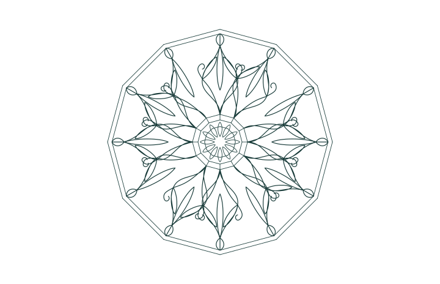
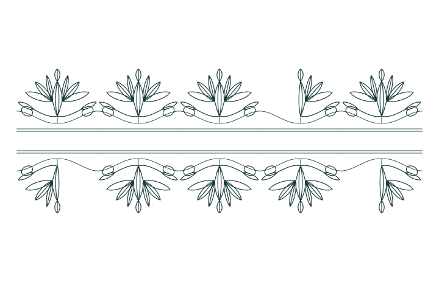
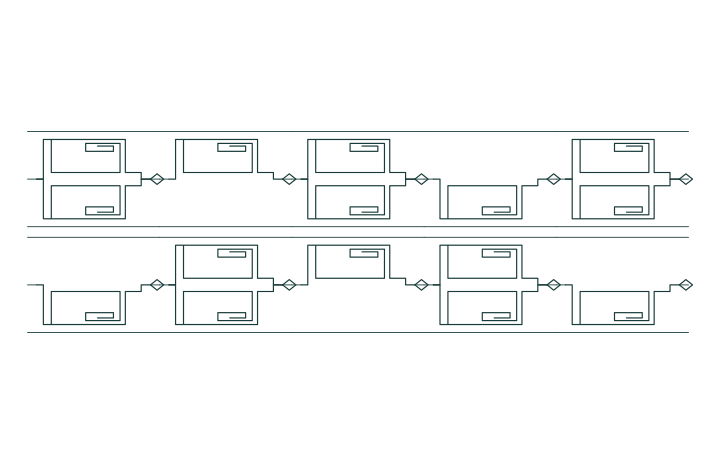
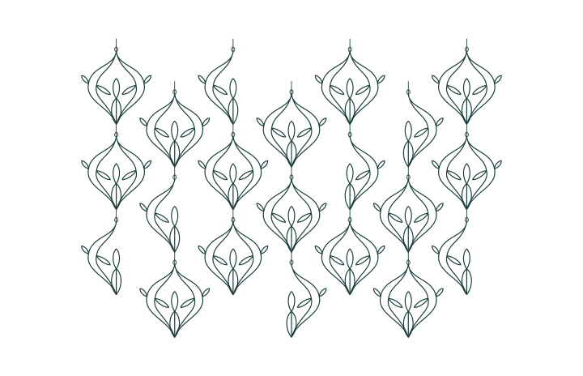
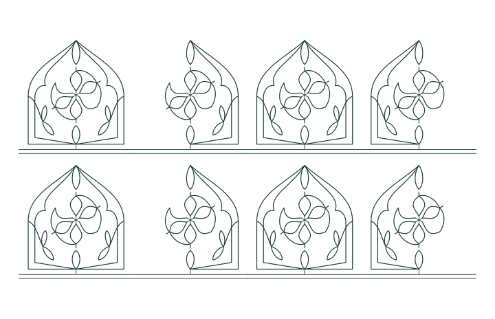

# Ornament workshop

Imagine a line-drawing press with two independently driven pen arms. Both start at the same fork. They can follow different engraved paths to a shared eye, where a third tool can add a closing mark or start another press. A punched drum changes which arms participate on the next repeat. [Open the live workshop](https://gojo.inklingai.ca/encoding/explorer/?layer=37)

The workshop opens on the finished drawing. **Next pass** starts at the first cell and shows the ground, branch strokes and finish in order. **Next repeat** completes a cell including its inner work. **One repeat** enlarges the current cell, and **Show joints** marks the actual fork and eye. Hover over a stroke to highlight its tool in the encoding panel. The plates below are full-size vector drawings from the same settled runs.

## I · Compass rosette

Start with a twelve-sided rim. Repeat a lance around its centre, bow its two flanks in opposite directions, and curl them back toward the same outer eye. A small crown closes each successful arrival. Try **First only** to see how much of the radial construction remains legible with one flank missing. [Work on the rosette](https://gojo.inklingai.ca/encoding/explorer/?layer=37&plate=1) · [Full-size SVG](data/ornament-plates/plate-1.svg)

## II · Palmette and volute

A running stem dips under each fan. Leaves branch from a common shoulder, a small scroll turns back at each side, and a spear grows above the meeting point. The second course reflects the first vertically while the repeat drum keeps its phase across the row break. Compare **Original timing** and **Earned timing**. The same two-beat programs that tested the border plotters now decide where the second half-fan is printed. [Work on the palmette](https://gojo.inklingai.ca/encoding/explorer/?layer=37&plate=2) · [Full-size SVG](data/ornament-plates/plate-2.svg)

## III · Double-return fret

Run two rectilinear bands between ruled edges. Each permitted course steps out from the fork, turns back four times inside its hook and meets the returning course at a diamond clasp. Click **Pair steps**. The long horizontal and vertical strokes then commit together, folding the right-angle hook into a zigzag. Its tip lands at the same place using the same eight signed movements. Pairing the steps reduces the plate from 320 line segments to 260. [Work on the fret](https://gojo.inklingai.ca/encoding/explorer/?layer=37&plate=3) · [Right-angle proof](data/ornament-plates/plate-3.svg) · [Paired-axis proof](data/ornament-plates/paired-hooks.svg)

## IV · Half-drop ogee

Print a pair of curved ribs around a seed pod. Shift each neighboring column by half the vertical repeat so the points of one column face the waist of the next. The rhythm decides which ribs and leaflets appear. Try **Which arm?**. After two settled repeats the press reaches a punch that guarantees one arm should draw but leaves its identity unresolved. The ground at that position is visible and the drum waits. [Work on the ogee](https://gojo.inklingai.ca/encoding/explorer/?layer=37&plate=4) · [Full-size SVG](data/ornament-plates/plate-4.svg)

## V · Rose-window arcade

Raise two cusped ribs from a sill to the crown of a window. The finishing tool at the crown has an outlet connected to a smaller press at the window’s centre. That press draws six petal sectors on its own rhythm. Change **Either arrives** to **Both arrive**. The number of windows stays at eight, but only four crowns can now start a flower. **Exactly one arrives** puts four flowers in the complementary windows. The last two drawings use the same number of strokes, in different places. [Work on the arcade](https://gojo.inklingai.ca/encoding/explorer/?layer=37&plate=5) · [Full-size SVG](data/ornament-plates/plate-5.svg)

## What connects to what

| Physical connection | Encoded rule | Visible consequence |
| --- | --- | --- |
| Drum → two pen guards | From low to high, the four bits admit neither, first, second and both. Neighboring phases occupy successive nibbles. | Field `8` means both arms are selected. Field `6` allows first alone or second alone. |
| Guard → arm passage | First arm reads mask `A` hex, second reads `C`. Each arm owns a single activation. Its present and absent passages use local rows `[0,4,1]` and `[0,4,2]`. | A settled guard chooses the ink or pen-lift exit. Unresolved guards hold their activation. |
| Arm exits → continuation | Unconditional rows `[1,4,3]` and `[2,4,3]` rejoin at that arm’s completion site. An arrival is sampled before convergence. | Either settled route can finish a repeat. Only the ink exit witnesses that arm’s mark. |
| Two arrival reads → finishing tool | One truth bit per pair. OR is `E` hex, AND is `8`, and exclusive OR is `6`. The finishing tool has a separate activation. | Two arrivals produce at most one finishing impression. No pen activation is copied between arms. |
| Tool → stroke sites | Each tool owns line rows `[start,end]` and cubic rows `[start,handle,handle,end]`, with local eight-bit site addresses. Both arm tables have a directed route between the same fork and eye references. | Reflected flanks can join at a known landmark. Overlapping strokes and coincident coordinates elsewhere carry only a drawing-level correspondence. |
| Finish → flower | The arcade binds its finisher to one site and a six-sector child press. The child has its own phase strip and a both-arrive finishing law. | Finishing a parent crown inserts eighteen child passes into the timeline before the next window. |
| Completion → next print position | The drum advances by an ordinary passage around a reference cycle once all local tools resolve. Equal contour parts set the radial frame. The other frames use column spacing, half-drop and row reflection. | A partial impression persists at the open cell. Changing a control starts a fresh run. |

A useful uncertainty case is **Which arm?** with **Either arrives**. The paired input can predict an OR result of ON. Neither pen yet has a resolved route, so neither can witness arrival and the finishing tool holds. With **One pending**, the first arm actually reaches the eye. OR can print the finishing mark, while AND still waits for the second arrival. In either case the drum waits for all local tools before moving on.

The motifs, cubic handles, spacing and pen-scale calibration are authored. The gate decisions, strokes admitted, feedback phases and child starts are computed from their connections. The workshop borrows the retained pulse shift from the previous experiment. Across two beats the original contact words select first alone, then both. The learned shift selects both, then first alone. The new use is to turn a tested timing difference into an ornamental accent. [Timing bench and its evidence](TimingSocket.md)

## Construction sources and verification

The public Core4 archive labels its pattern demonstration **Core2 Patterns**. In that lineage, the Crossbar Lattice, Square Wave, Zigzag and Interlock recipes are particularly pertinent. The fret experiment borrows the distinction between committing successive motions separately and committing them together. [Archived pattern demo](https://gojo.inklingai.ca/core4/patterns/) · [Earlier frieze catalog](https://github.com/It3rate/ResoEngine/blob/d14f058775f9488de90c815b0930205553ceec6e/Applied/Geometry/Frieze/FriezeCatalog.cs)

Lewis Foreman Day’s *The Anatomy of Pattern* explains why a half-drop can interrupt unintended horizontal stripes. His diagrams also distinguish the ornament one sees from the scaffold on which it repeats. The ogee plate uses that half-drop rule. Franz Sales Meyer’s 1895 handbook groups meanders, rosette bands and palmette bands in plates 81–84, 91 and 92. The five original Gojo drawings use these historical construction ideas. [Day, “The Drop Pattern,” pp. 34–36](https://upload.wikimedia.org/wikipedia/commons/3/34/The_anatomy_of_pattern_%28IA_anatomyofpattern00dayl%29.pdf) · [Meyer, digitized handbook](https://digital.ub.uni-paderborn.de/ihd/content/structure/7730456)

The print survey covers the five plates plus the paired-axis fret, eleven drum settings and three finishing laws, for **198 runs**. The independent gate test checks all 16 joint support masks against all 16 binary truth tables. The SVGs use the same stroke rows and placements as the live drawing. The count includes each stored line or cubic, even when two impressions coincide on paper. [Download the 198 print runs](data/ornament-plates/press-runs.csv)

~~~text
dotnet run --project experiments/PrimitiveMeasure -c Release -- --ornament-plates experiments/PrimitiveMeasure/data/ornament-plates
~~~
