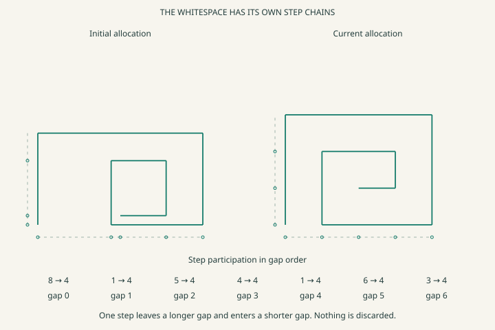
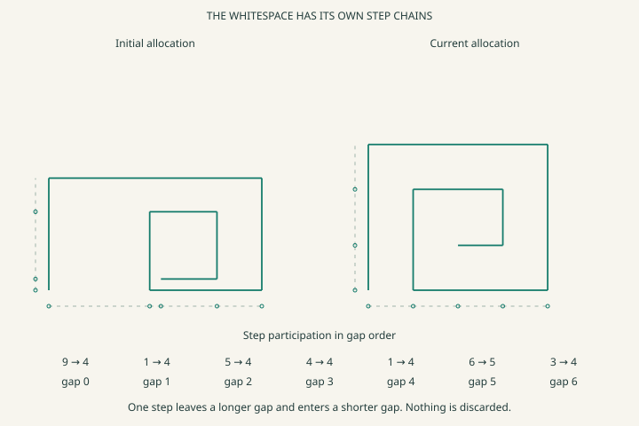
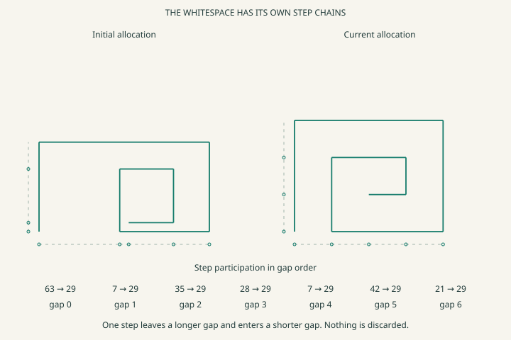
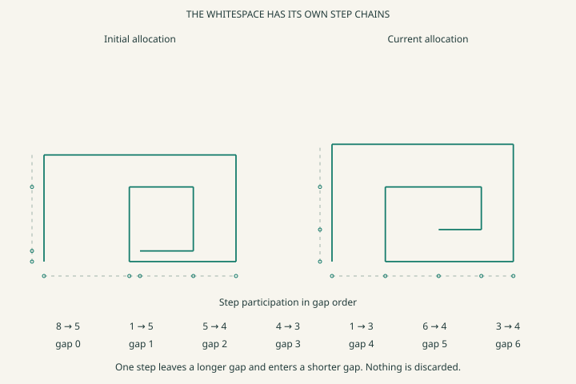
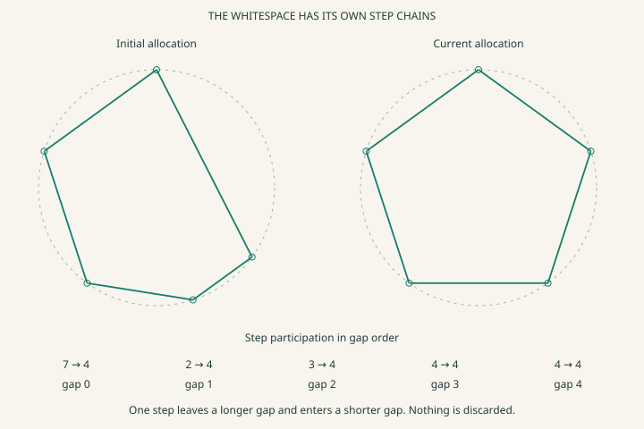

# Let the gaps settle

The drawing now gives the spaces between its construction lines their own participation. A gap holds a chain of equal, unmeasured steps. Connected gaps can transfer a step from a longer chain to a shorter one, retaining all the available space. The resulting drawing reads those chains instead of choosing arbitrary gap sizes.

The intended local structure is

~~~text
landmark A -> gap chain -> landmark B
each occupied slot -> one shared, uncalibrated step unit
gap i -> comparison / passage surface -> gap j
shifted pair of slot reads -> excess guard -> whole-step handoff
handoff -> next comparison site -> return to start of scan
~~~

The comparison looks for a participating donor slot one position beyond an empty receiver slot. In packed prefix chains, that witnesses at least two excess steps. The donor's last occupied slot can then hand off to the receiver's first empty slot through the existing conservative passage law. Equalization is a declared local goal. It is not a geometry optimizer inferred from pixels.

This adds a unary resolution beneath the earlier pre-numeric description. There are still no measured lengths or pixel positions in the structure. Counting the participating steps does expose more relative magnitude information than a single nonzero bit.

[Open the whitespace experiment](https://gojo.inklingai.ca/encoding/explorer/?layer=38&view=whitespace)

Press **One comparison** to visit the next connected pair. Press **Settle** to continue until a full scan produces no transfer. The left drawing keeps the original allocation. The right drawing reads the current gap chains. **Reset** starts the same experiment again.

## The fret's spaces are participants

The existing fret has five across landmarks and four rise landmarks. There are four adjacent gaps across and three upwards. Each gap now attaches to the corresponding pair of landmarks and has its own unary step chain.

| Gap | Attached surface | Initial steps | Settled steps |
| --- | --- | --- | --- |
| 0 | Across landmarks 0 → 1 | 8 | 4 |
| 1 | Across landmarks 1 → 2 | 1 | 4 |
| 2 | Across landmarks 2 → 3 | 5 | 4 |
| 3 | Across landmarks 3 → 4 | 4 | 4 |
| 4 | Rise landmarks 0 → 1 | 1 | 4 |
| 5 | Rise landmarks 1 → 2 | 6 | 4 |
| 6 | Rise landmarks 2 → 3 | 3 | 4 |

The seven chains share one step basis. A step of space means the same amount on either rail. With every pair connected, eleven transfers settle this example to four steps per gap. Forty-two pair visits include the final scan that confirms nothing else will move.

The original corner attachments, path order and right-angle construction remain unchanged. The renderer obtains each landmark's position by accumulating the intervening gap steps. It uses one screen scale for both rails. It never assigns an average gap as a shortcut.

This particular goal allows width and height to exchange participation. Across starts with eighteen steps and rise with ten. They finish at sixteen and twelve. Their combined budget stays twenty-eight. Holding both extents independently would require separate budgets and could prevent equal gaps across both directions.

These gaps belong to the fret's construction rails. They are not a complete model of all empty regions between finite ink strokes. Stroke thickness, nearest-point distance, collision clearance and curved corridors would need further surfaces and constraints.

## What the bits actually do

A chain is a packed prefix of ones followed by unused storage slots. For example, `111110000` supplies five steps of gap participation. The zero slots are spare storage, not additional spatial distance. The array's position fixes orientation and direction. Every active slot shares the local step unit.

A bare V=1 still means only nonzero participation. The equal-step binding supplies additional information. Without a common unit promise, counting occupied slots would not justify comparing the lengths of two gaps. The executor refuses that comparison when the unit references differ.

For two chains A and B, a comparison row reads `A[k+1]` and `B[k]`. If the first is one and the second is zero, A has at least two more steps than B. OR-combining these little witnesses requests an A-to-B handoff. The reverse rows test B-to-A.

| Stored surface | Contents | Consequence |
| --- | --- | --- |
| Gap attachment rows | `[rail, earlier landmark, later landmark, gap]` | Gap changes alter the corresponding spacing read |
| Step-unit rows | `[gap, unit]` | Only chains with the same unit reference are compared |
| Pair rows | `[gap A, gap B]` | Only an existing pair can exchange participation |
| Shifted comparison rows | `[A[k+1], B[k]]` | One-position offset detects a two-step excess |
| Excess truth bitmap | `02` | Of the four input pairs, only `(1,0)` requests transfer |
| OR truth bitmap | `0E` | Any such witness can request the handoff |
| Derived passage row | `[last occupied donor slot, guard, first empty receiver slot]` | Specializes the existing pair route to the current tips |
| Whole-step passage law | Existing eight-byte transition bitmap | Clears the donor slot and fills the receiver slot atomically |
| Scan cycle and stop circuit | Pair cursor, observed change bit, terminal site | A complete scan with no transfer stops this run |

For the first comparison, gap 0 has eight steps and gap 1 has one. The next state has seven and two. An equal amount leaves one gap and enters the other. Every subsequent handoff obeys that same local rule. No pair asks for a global mean, chooses the globally largest gap, or consults the drawing.

The occupied and empty tips are derived addresses on the declared chains. Their passage rows are execution witnesses of existing gap-pair connections. Creating those rows is not learning a new route. The goal, comparisons and routes were supplied as the experiment's structure.

## A remainder that cannot be hidden

Select **One extra step**. The fret now has twenty-nine steps for seven gaps. At this resolution exact equality is impossible. Settlement retains all twenty-nine steps, leaving six gaps of four and one gap of five.

The remaining difference is a known mismatch with the equality goal. It is not missing material, a random error bar, or an uncertain stored bit. Moving a step between chains that differ by one would merely exchange which chain is longer, so the law holds there. The scan order can influence where an indivisible remainder finishes.

Select **Finer extra step** to run the same parent allocation in a finer declared basis. Each parent step corresponds to seven equal child steps. The new run has 203 child steps and settles to twenty-nine per gap. All seven gaps are then exactly equal at that finer resolution.

The calibration is explicit. Parent unit 0 binds to run 2, whose ordered members all reference fine unit 1. The parent allocation remains available as participation chains. The finer experiment begins with the corresponding allocation in its own pool. This demonstrates a calibrated rung, not an implemented live material split of an already running coarse pool.

The finer fret needs 89 transfers and 147 pair visits, compared with ten transfers and forty-two visits for the coarse extra-step case. Additional resolution has a visible cost. The current comparison circuit is deliberately expanded into shifted slot rows. The data reports selected packed payload sizes. It does not count host object allocations or all controller wiring. Compact repeated scans are a later encoding optimization.

## Quiet can still be uneven

**Neighbors only** connects adjacent gap chains. The default fret then stops at `5,5,4,3,3,4,4`. Every connected pair differs by at most one, yet the whole collection has a two-step spread. There is no legal improving move along those particular routes.

The page therefore reports local quiet and the spacing read separately. It does not call the result globally even. A simple three-gap counterexample makes the same point. `1,2,3` cannot improve under just `0↔1` and `1↔2`, but adding `0↔2` lets it become `2,2,2`.

**First gap isolated** keeps the first chain outside the transfer network. Its participation remains untouched while the other gaps settle. **First gap unseen** hides that chain from the comparison reads. It also cannot transfer, but now the observer cannot establish the whole collection's spacing. The UI shows the owner's actual chains for inspection. Those hidden values do not feed the comparison circuit.

## Change the number of points

The same gap pool also binds to arc parts around the existing closed radial construction. Choose **Triangle**, **Square**, **Pentagon**, **Hexagon** or **Octagon**. Every arc has an independent positive chain. Initially their sizes differ. When their step counts settle equally in the common basis, the marked points become equally spaced and their joined chords form a regular polygon.

The part references remain distinct. Equal current values do not merge the arc identities or replace them with one shared reference. This is equality reached in the current allocation, whereas the earlier circle example declared a shared equal-part constraint at construction.

Arc spacing concerns one common circular traversal. It does not establish a general clearance measure between arbitrary polygon edges. Drawing the current shares uses their proportion of the whole, after the local handoffs have happened.

## Is this still pre-numeric?

The coarse description remains qualitative, with order, participation, shared sites and closure. The added rung distinguishes amounts by repeated participation in a common unit. That is unary quantity information. It is more informative than a single present/absent bit, even though no external ruler or pixel length is specified.

Tension need not begin as a precise scalar. A mismatch can first expose a direction of pressure. Here the shifted comparisons are the mismatch read, and the attached passage is the explicit response. This is a small discrete settlement law. It does not claim to be a continuous geometric force solver or the kernel's general signed-carrier tension engine.

Whitespace is a positive subject of measurement here. A participating gap has space available in its own basis. Its uncertainty, if any, is a separate read. The absence of an ink mark alone would not tell us the size, boundary or ownership of that space.

## Checks and limits

The tests exhaust 381 small starting allocations across three or four gaps with all pairs connected. They verify conservation, positive gap participation, intact prefix chains and a strict reduction in the sum of squared step counts after every transfer. That decreasing quantity is an after-the-fact check, not a value the controller computes or follows.

At fixed total step participation, the least uneven integer allocations have every count within one of every other count. A complete pair graph permits a transfer whenever that condition fails. Each transfer from counts `a` to `b`, with `a ≥ b+2`, lowers `a²+b²` by `2(a-b-1)`. Positivity and a finite budget make that descent terminate. This proof applies to the complete readable common-unit case. It does not upgrade a disconnected, hidden or differently calibrated case into a solved one.

The exported survey contains **72 runs** across six shapes, three step bases and four connection settings. Additional tests cover unknown reads, incompatible units, the neighbor plateau, parent/fine budget correspondence, and the UI's live state changes.

This remains a specified local equalization goal. The system does not yet discover the whitespace regions, decide whether even spacing is aesthetically useful, invent the comparison connections, or balance competing goals such as fixed outer dimensions and stroke clearance.

[Download the 72 settlement runs](data/whitespace/settlements.csv) · [Initial fret](data/whitespace/fret-before.svg) · [Triangle](data/whitespace/triangle.svg) · [Octagon](data/whitespace/octagon.svg) · [Unseen-gap example](data/whitespace/unseen.svg)

~~~powershell
dotnet run --project experiments/PrimitiveMeasure -c Release -- --whitespace experiments/PrimitiveMeasure/data/whitespace
dotnet test Tests/PrimitiveMeasure.Tests -c Release --filter FullyQualifiedName~GapSettlementTests
~~~
