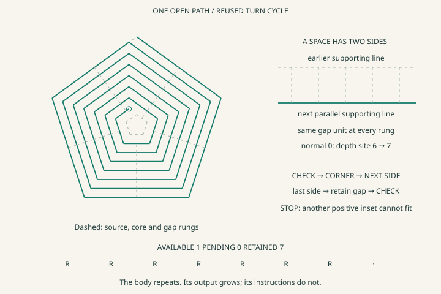
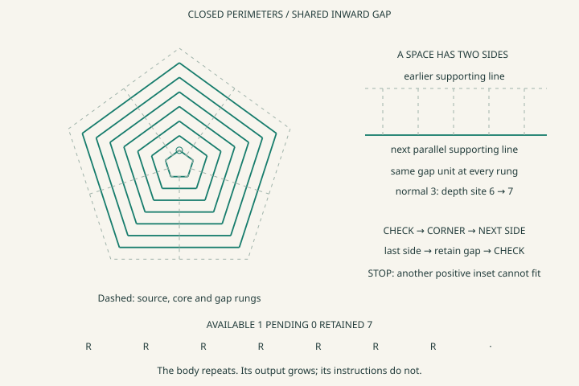
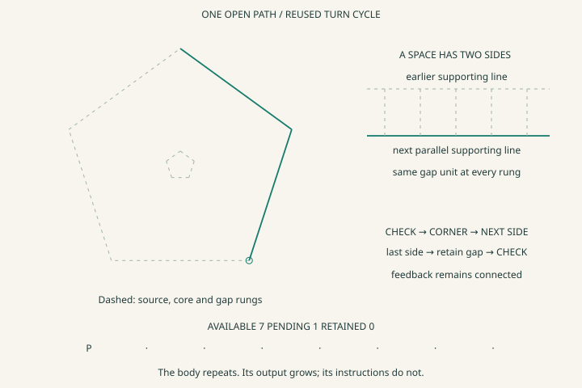

# Whitespace becomes a path

This experiment builds a winding path by reserving the space between its turns. It repeats one small body: check that an inward gap fits, construct the next corner, advance to the next side, and return to the check. A triangle, square or pentagon changes the direction cycle. It does not require a new set of instructions for every turn of the spiral.

The spaces are explicit connections between parallel supporting lines. Their common width is one equal, unmeasured step. Each supporting line has its own local normal direction; there is no global X/Y grid in the encoding. The renderer supplies coordinates only after the structure has made its decisions.

[Open the interactive experiment](https://gojo.inklingai.ca/encoding/explorer/?layer=39)

Start with **Pentagon / Spiral / 8 steps / Known**. Press **Next side** a few times, then **Run to stop**. Change **Form** to **Perimeters** to see the other seam connection. Change **Depth chain** to get more or fewer passes from the same body.

## What is being added

The earlier [gap experiment](WhitespaceSettlement.md) redistributed step participation between supplied gaps. This experiment uses a shared gap as the width of a strip, connects the strip to a second supporting line, and joins successive lines through shared corner sites. It executes a declared geometric construction. It does not discover the desired gap or optimize a drawing after the fact.

The proposed structure was written as:

~~~text
closed contour -> equal parts -> local normal directions
supporting line -> (normal direction, depth site)
earlier line -> shared gap width -> next parallel line
incoming supporting line -> shared corner -> outgoing supporting line
check -> construct one side -> next direction -> check
last direction -> retain the pending gap -> feedback
~~~

The width relation can be imagined as a little ladder. Every rung has the same length and goes normally across the strip. The repeated correspondence is represented once by the shared normal and adjacent depth references; no dense ladder of sampled rungs is stored. Its boundaries can be read as lines, and its width can be read as space.

This is a selected regular convex planar construction. Equal positive contour parts establish the direction cycle. A shared centre and normal-depth basis establish the supporting lines. Their adjacent intersections establish the corners. These premises are supplied structure, not discoveries made from the picture.

## Two seams, two results

**Spiral:** most side roles use the current depth. The last side meets the first normal one step inward. That corner is the actual starting site of the next pass. There is one continuous open ink path and no connecting diagonal added by the renderer.

**Perimeters:** every side in the body uses the next inward depth. The last side returns to the actual starting corner of that perimeter. A separate non-inking relocation connects to the beginning of the next inner perimeter. Returning to a shared site is closure; drawing two nearby endpoints would not be.

The source boundary is shown dashed. It supplies the original regular outline. Generated ink is solid. The small dashed central polygon marks the protected positive core. It is a declared boundary of this construction, not a discovered medial shape or an assertion that every white region has been found.

## The actual stop condition

An eight-step normal-depth chain starts as eight available one-bit participants. The gap itself is one step of that same basis. Before a new pass, the read circuit asks whether two consecutive available slots remain. One can be reserved for the gap; the other witnesses strictly positive depth inside it.

The gap moves through three banks using existing conservative passage laws:

~~~text
available -> pending -> retained
~~~

At the start of a pass, one step moves from available to pending. At its final corner, that same step moves from pending to retained. At all times:

~~~text
initial depth = available depth + pending depth + retained depth
~~~

The last positive slot has no outgoing transfer. When it is the only available slot, the false fit read routes the activation to the terminal site. No repeat count tells the program when to finish.

For the default pentagon, seven passes produce thirty-five ink segments; the next check stops. The result has one available step, no pending step and seven retained steps. These numbers are observations of execution, not stored commands to draw thirty-five lines.

This is a **conservative stop at the boundary of the declared construction**. It does not search for every shorter final continuation, draw a zero-sized perimeter, or force the endpoint onto the centre. The central space and an unfinished possible continuation are distinct from a lost amount. The spiral can stop at a seam before drawing around the remaining core.

## A pending pass is real state

After drawing one or two sides, choose **Gap hidden** or **Corner open**, then press **Run to stop**. The path holds. Its existing ink, phase and pending gap remain. Restore **Known** to resume the same construction. The Read control changes the observation; it does not rebuild the path.

Hidden gap evidence admits both absent and present. An open corner supplies no observation. Neither authorizes a new corner. **Units differ** instead builds a separate fixture whose gap and depth bindings are incompatible. That case cannot justify a spacing comparison. Changing the shape, form, depth inventory or unit fixture starts a new run; hiding and restoring observations does not.

## Concrete encoding chart

For a pentagonal spiral, the body is five rows. Line roles 0 through 4 use the current depth; role 5 uses normal 0 at the next depth.

| Table | Example contents | Meaning |
| --- | --- | --- |
| Equal-part contour | Five ordered arcs sharing part reference 32, plus an explicit return | One regular direction cycle |
| Normal bindings | `[phase site, contour ray site]` | The clock phase selects a geometric normal |
| Frame bindings | `[0,0,0] … [4,4,0]`, `[5,0,1]` | `[line role, normal, current/next depth role]` |
| Body connections | `[0,1] [1,2] [2,3] [3,4] [4,5]` | The last corner continues inward |
| Perimeter alternative | Frames 0–4 use depth role 1; last body row is `[4,0]` | The end returns to this pass's beginning |
| Supporting-line instances | `[normal reference, depth-site reference]` | Normal identity plus ordered depth, without coordinates |
| Whitespace strips | `[earlier line, next line, width reference]` | Same normal, adjacent depth sites, shared width |
| Shared corner sites | `[incoming line, outgoing line]` | Both incident ink segments refer to this actual joint row |
| Retained ink | `[start joint, end joint, supporting line]` | Generated connected path |
| Non-inking relocation | `[previous joint, next starting joint]` | Restart a closed perimeter without drawing a connector |
| Depth passage | `[source slot, guard, destination slot]` | Reserve or retain exactly one existing participant |
| Control routes | Check → commit, check → done, commit → check | True continues, false stops, unresolved holds |
| Phase routes | Last phase → first phase | Reuse the body without unrolling more instructions |

Template references use four bits. The whole turn construction and phase correspondence use their existing six-bit local references. Generated output references use a width sufficient for this owner's bounded inventory. Array position supplies identity; there are no per-edge global IDs or operation strings.

The continuation and stop routes reuse the existing eight-byte passage laws: the bitmap lists permitted complete before/after states of source, control and destination. It is not eight bytes per emitted line.

The pentagonal spiral's body is five bytes; its six frame rows are nine bytes. These are **selected payloads**, not total memory usage. The phase/control circuits, depth inventory, geometry bindings and retained output also occupy storage. Increasing depth from four to twenty-four leaves the body, frame bindings and controller routes unchanged, while output grows from fifteen to 115 edges. The returned path is intentionally retained; compact instructions do not imply free output storage.

## Why the corners are legal in this first construction

Valid parallel strips alone do not prove that their finite edges can join forwards. This experiment uses a narrow sufficient law: a regular convex cycle of three, four or five normals, a shared unit inset, and strictly positive inner depth. It leaves unequal turns and other outlines unresolved instead of applying this law to them.

For an after-the-fact geometric check, let consecutive unit normals be separated by `δ`, and let the preceding, current and following supporting lines have centre distances `a`, `b`, `c`. The signed forward length between their intersections is:

~~~text
(a + c - 2b cos δ) / sin δ
~~~

This expression is explanatory mathematics, not a floating-point stop calculation in the runtime. For a regular triangle, square or pentagon, `sin δ > 0` and `cos δ < 1/2`. Equal-depth corners have positive traversal. At the spiral seam the numerator becomes `2h(1-cos δ)-g`, with `h ≥ 2g`; it remains positive. At the next pass's first corner, the extra term has the opposite sign and also preserves positive traversal. Perimeter corners use one common positive inner depth.

Thus the supplied turn construction and ordinal depth guard justify this local corner rule without calculating a cosine for every decision. The coordinate adapter subsequently intersects the specified supporting lines to draw a numerical witness. It never sends those pixels back as fit evidence.

The tests additionally inspect numerical witnesses in several rotated frames for forward order, shared sites, normal spacing and clearance between nonincident emitted segments. These checks support this bounded family; they are not a general collision detector embedded in the controller.

## Limits and the next extension

The whitespace rows describe spacing between supporting lines. Finite ink endpoints, seam openings and corner regions remain available through their separate joints and paths. The experiment does not compute total white area, discover nearest neighbors, form rounded offset corners or model arbitrary curved corridors.

Width is an observed geometric quantity reused across the construction. It is not area substance copied once per side. The conserved banks account for normal-depth intervals. They do not claim that summed widths equal the polygon's area.

The next extension would expose actual local clearance and corner-admission reads for less restricted turns, replacing this sufficient regular-family rule while preserving the same check/continue/hold/stop circuit. A finer depth rung could admit smaller final continuations; that would require an explicit refinement and a new clearance read, not silently consuming the protected core.

The [triangle spiral](data/strips/3-spiral.svg), [square spiral](data/strips/4-spiral.svg), [triangle perimeters](data/strips/3-perimeters.svg) and [square perimeters](data/strips/4-perimeters.svg) use the same mechanism. [Download all 186 runs](data/strips/strip-runs.csv).

~~~powershell
dotnet run --project experiments/PrimitiveMeasure -c Release -- --strips experiments/PrimitiveMeasure/data/strips
dotnet test Tests/PrimitiveMeasure.Tests -c Release --filter FullyQualifiedName~StripWalkTests
~~~
