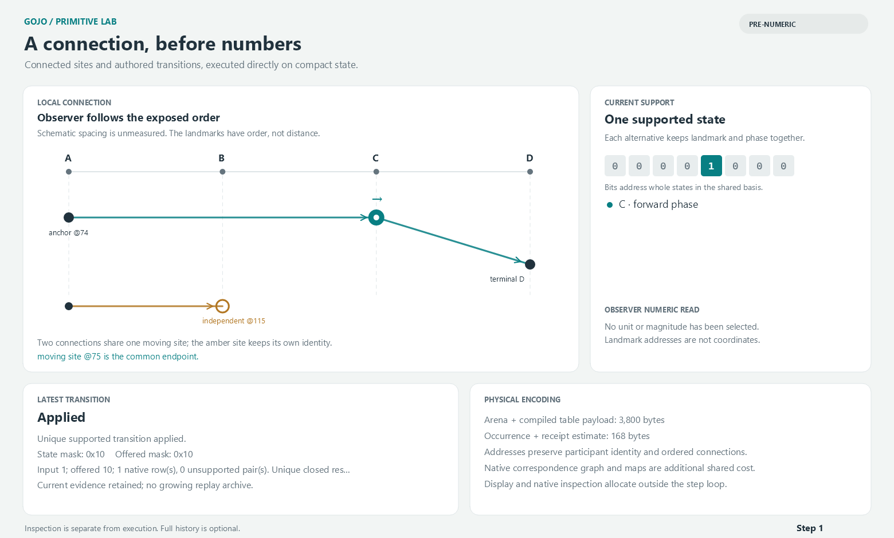

# First compact primitive execution findings

30 October 2026. This checkpoint demonstrates direct, persistent execution of a
selected pre-numeric law, with an optional native numeric observer. It does not
yet implement compact Gojo carrier settlement. See the [design and layout](README.md)
and [all 22 Level-one inventory rows](Coverage.md).

## Result and computation boundary

The motion definition contains relations and placeholders only. Its finite law,
application guard, ordered landmarks, shared endpoint, independent endpoint and
later-input feedback all survive capture into physical records. Eight support
bits address whole landmark/heading tuples. The same state advances through an
authored pulse cycle without text conversion or graph reconstruction.

The existing native finite-law reader derives the result tables. The native
structural matcher and `ApplyUnique` derive the application permission table.
Neither the renderer nor a second hardcoded direction table supplies the motion.
Missing, contradictory, open and ambiguous inputs keep the binding and current
evidence. Source validation is explicit; hot updates execute an owned snapshot.

Native calibration separately attaches A/B/C/D to 0/3/8/12 and observes them at a
chosen quantum. It does not change the pre-numeric law. Reversing the observer
does not reverse travel, and the reversed coarse read preserves signed
source-basis remainder. Schematic line rendering supplies no interpolation law.

## Measurements

One Release diagnostic on .NET 10.0.12, Windows x64. The direct loop was warmed
with 20,000 steps, then measured for 1,000,000 pulses. Native guarded interpretation
was measured for 2,048 pulses with its own warm-up. Both started at B-forward;
their checksums over the same 2,048-step prefix were **65,280**. The full compact
run checksum was 31,875,000. Inputs were prepared outside timing.

| Operation | Time per operation | Managed allocation per operation |
| --- | ---: | ---: |
| Native definition construction | 15.71 µs | 13,920 B |
| Arena capture + native-derived compilation | 5.396 ms | 2,917,781 B |
| Explicit unchanged-source validation | 21.78 µs | 0 B |
| Direct compact step with current receipt | **19.04 ns** | **0 B** |
| Native finite-law + application guard + native evidence | 157.44 µs | 90,376 B |
| Current presentation observation | 2.14 µs | 824 B |
| Calibrated presentation observation | 5.34 µs | 2,984 B |
| Independent native structural inspection | 140.76 µs | 150,032 B |

These are diagnostic timings, not stable benchmark guarantees. The repository's
existing qualitative test suite was also running on the machine. Native and
compact application semantics agree, but the reference constructs full native
evidence while the direct loop keeps a fixed compact receipt. The table must not
be described as eliminating the cost of equivalent full witnesses for free.
Native inspection and numeric projection remain separately measurable work.

The source/guard interpretation and its temporary objects dominate compilation
allocation. Capture is not paid again per update. Rebuilding a changed definition
currently means recapture; automatic local invalidation and migration were not
implemented or benchmarked. Rendering was checked through headless PNGs and is
excluded from compute timing. Persistence/serialization is not part of this
checkpoint. [Raw measurements](results/benchmark.json) retain the full figures.

## Retained state

| Component | Size |
| --- | ---: |
| Arena: 210 records plus address-zero sentinel | 3,376 B |
| Derived result/permission/domain/proof tables | 424 B |
| Physical definition payload | **3,800 B** |
| Source correspondence reference array payload, additional | 1,688 B |
| Entire retained definition, approximate managed heap delta | **30,031 B** |
| Mutable state + event ordinal + current receipt | 128 B |
| One occurrence including metadata, plan reference and CLR object overhead | **168 B** |
| Occurrence plus owner-array reference and amortized full definition at 10,000 occurrences | about **179 B** |

The 30 KB figure is a full-GC heap delta averaged across 64 retained plans. It
includes the native source graph, dictionaries and array/object overhead. It is
an approximate process measurement, not a claim that the 3,800-byte payload is
the whole working set. Compilation allocation is a different quantity and must
not be used as retained state. The 168-byte occurrence size was independently
confirmed by allocation across 10,000 occurrences sharing one plan.

The live occurrence has no growing history collection. The allocation test runs
100,000 updates after warm-up and observes zero per-step allocation, while the
diagnostic confirms the same over one million updates. The current receipt is
included. Callers can retain copied receipts or independent native inspections;
that optional retention has additional cost and does not recover forgotten past
states.

## Verification and visual inspection

`dotnet test Gojo.slnx` passed **5,581 tests across 14 test projects**, with zero
failures and zero skipped tests. The final receipt-validation refinement was
also rechecked with all 25 focused tests. Existing analyzer warnings appeared
in other projects; the new focused build and viewer build had no warnings.
The [verification summary](results/verification.json) records the project counts.

All 25 focused tests pass. They include all 2,048 combinations of the motion
fixture's closed state/command supports, generic native/compact application
conformance, correlated alternatives, duplicate proof routes, missing rows,
closed empty versus open, invalid encodings, shared aliases, placeholder dual
faces, occurrence separation, frozen inspection and explicit source invalidation.
Numeric tests reconstruct the source through both observer directions and check
the retained projection basis. The latest receipt validation also refuses a
fabricated stale state on a plan that has never been invalidated.

The viewer builds and renders successfully. Initial, moved, alternative, open,
blocked, and reversed calibrated states were visually inspected. The retained
preview shows one moved shared site at C and the independently bound site at B:

## What this establishes next

The representation can compute directly on encoded pre-numeric support while
preserving the selected native laws and useful unresolved states. That is a
credible first layer for further numerical encoding. It is not evidence for a
universal ISA, inferred motion laws, emergent arithmetic, a geometric engine or
compact carrier settlement.

The next slice should add explicit carrier/tick identity and a stable unit
promise, then execute one selected signed-tension settlement law against the
native reference. Its physical values, outstanding tension and accounting need
their own compact lanes and tests. The authored qualitative states and optional
calibration should remain valid beneath that addition.
