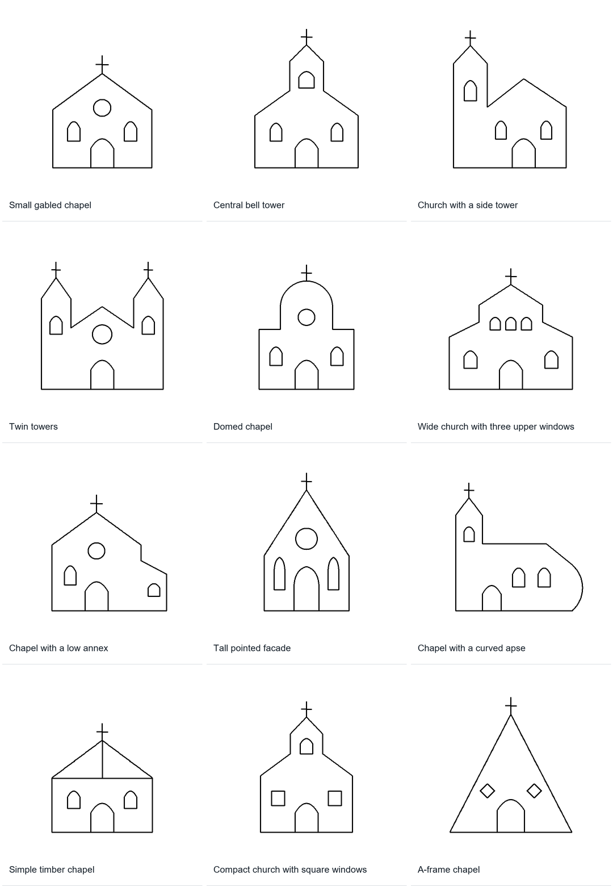
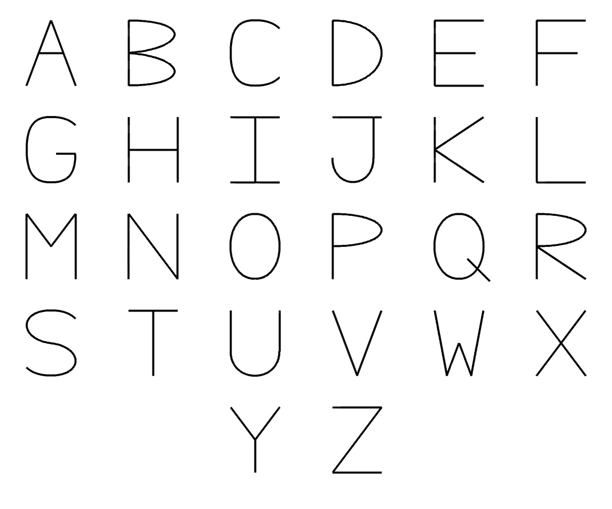

# Annotated line-art controls and native inspection

Status: exploratory checkpoint, 23 October 2026. Authored fixtures, bounded SVG
import, native archive restoration and interactive inspection are implemented.
No model is trained in this checkpoint. Recognition of intention in Quick Draw
and reconstruction from qualitative hints remain later work.

The local entry point is `D:\_quickDraw\gojo-line-art\review.html`. It is an
offline, self-contained page. Select a drawing, hover a line or marker, and click
to retain the read in the side panel. Layers expose joints, boundary regions,
correspondences, contacts, object membership and endpoints. The lists expose
template/detail groups and the exact scope of every declared correspondence.
An embedded copy is retained at [results/line-art/review.html](results/line-art/review.html);
its drawing inspector is portable, while links to full native archives refer
to the local data folder.

The website category is [Quick Draw](https://gojo.inklingai.ca/quickdraw/), with
this study at [line art evidence](https://gojo.inklingai.ca/quickdraw/line-art/#diagnostic-alphabet).
The category catalogue admits additional studies at stable child routes.
The public inspector packages all seventeen native archives as compressed
downloads, retains source licences, and omits machine-local paths.

## Why keep clean controls alongside imperfect observations?

The hand-drawn source remains the reconstruction target in the earlier
[faithful reconstruction experiment](Reconstruction.md). These new drawings
supply an additional, deliberately constructed source where the relationships
are known. They help distinguish three questions:

1. Can we store and recover a relationship that we explicitly supplied?
2. Can a calculated read verify the supplied relationship, or expose a false one?
3. Can a future observer propose that relationship from imperfect evidence?

This checkpoint addresses the first two. A clean church is not an assertion
about what a particular Quick Draw participant intended. These controls were
not added to the learned profile model, used to replace observations, or used
as ideal targets for the existing held-out reconstruction comparisons.

## Sources and retained artefacts

The authored set contains **12 churches and three diagnostic scenes**. The
churches vary in construction: a small chapel, central/side/twin towers, a dome,
a wide facade with repeated windows, an annex, a pointed facade, a curved apse,
a timber roof, square windows and an A-frame. They are plain black vector paths,
without coloured regions or raster tracing.



The active diagnostics separate:

- all **26 uppercase letters on one inspection sheet**, with separate object
  scopes and a per-letter comparison table;
- two projected crossing lines from a shared-site four-arm joint;
- L/I/T/Y/X/K local ray arrangements and a closed O contour with smooth seams.



The alphabet replaces the rope-and-branch scene in the active collection. Its
26 letter forms contain 118 sites and 100 spans: 72 straight and 28 curved.
Every letter is a separate connected scope. Eight independent counter cycles
belong to A, B (two), D, O, P, Q and R; eighteen exact correspondences comprise
eleven mirrors and seven translations. The inspector derives the comparison
table from restored object members, incident sites, boundary walks and maps.
Labels A–Z name these authored forms; they are not an OCR result.

Letter names and local joint codes describe different things. This B, K and R
each contain a K-shaped local junction. Q's explicitly joined tail reads as X;
O's four smooth seams read as I. The letter O also has a closed counter boundary.
These are properties of the supplied monoline constructions, not universal
claims about every typographic or handwritten version of those letters.

The references contain one church icon from each of three official collections:

| Collection | Licence | Use in this checkpoint |
| --- | --- | --- |
| [Lucide](https://github.com/lucide-icons/lucide/blob/7faf87628a1ad6175975bc595344337ce14a7db4/icons/church.svg) | ISC; full source licence retained | Bounded centreline import and native inspection |
| [Tabler](https://github.com/tabler/tabler-icons/blob/a4ce1404bc6d24d3c365afe7b258d6bf6f48d62d/icons/outline/building-church.svg) | MIT; full source licence retained | Bounded centreline import and native inspection |
| [OpenMoji](https://github.com/hfg-gmuend/openmoji) | CC BY-SA 4.0; attribution/licence retained | Original reference only; filled-outline semantics are not imported |

The pinned source revisions, URLs, original bytes, licence files and SHA-256
hashes are retained under `references`. This is three individual icons, not a
discovered pack of twenty different church designs. The authored set supplies
the larger controlled collection. `official-church-references.zip` packages
the references and their attribution together.

The strict SVG reader accepts the path subset used by Lucide/Tabler:
M/L/H/V/A/Z, no fill, no transforms and no unsupported elements. Elliptical
arcs become cubic pieces of at most a quarter-turn; coordinates and controls
are quantized to a 512-unit drawing frame. Both approximations are declared.
Native parity proves preservation of that bounded import, not exact equality
to original SVG paint or stroke area. The arc conversion follows the
[SVG endpoint-arc algorithm](https://www.w3.org/TR/SVG/implnote.html#ArcImplementationNotes).

Only explicit path continuity and closing commands establish shared sites.
Equal endpoints in different subpaths remain different sites. Imported object
memberships, region roles, template groups, depth order and correspondences
are empty, not invented from the icon's category name.

## Storage: adapter, connected native structure, read surface

Each source scene has a JSON adapter containing a declared 512-square frame,
integer coordinates, explicit sites, ordered finite curves, ordered traversal
scopes, object memberships, boundary walks, focus groups, correspondences,
crossings and contacts. Source identifiers make authoring and auditing possible.
They are not native semantic tags.

`AnnotatedLineArt.Import` constructs a native relation graph with:

- a declared measured X/Y and order frame;
- fresh site identities attached to coordinate reads;
- actual native line/quadratic/cubic interpolation structures using those sites;
- ordered traversal scopes referencing the actual edge relations;
- object and template/detail scopes referencing actual members;
- oriented region walks referencing the actual edge and endpoint identities;
- mirror/translation correspondences, their basis and native affine equations;
- explicit crossing selections, open or authored over-order, and site contacts;
- a shared author event attached as provenance for supplied claims.

The local structural contract is described in
[AnnotatedLineArt.cs](AnnotatedLineArt.cs). Scope position and connected members
carry the meaning. There is no native string field that names a church, T joint,
window or biological/man-made family. Titles and convenient display names stay
in the external envelope; they do not drive geometric reads.

The CLI saves the graph using `GojoStructureCompactJson`, restores an independent
graph, and reads that restored graph to produce `inspector.ndjson`. The inspector
then renders those reads. It does not paint annotations directly from the source
authoring JSON. Native archives preserve identity sharing and separation, ordered
frames, membership, geometry and authored provenance across that boundary.

This is still measured geometry. Retaining precise controls is useful for
checking the transport and for later selective publication. It does not establish
qualitative-only reconstruction or solve the separate resolution dial.

For the fifteen current authored fixtures, the source adapters occupy 165,951 bytes;
the full native JSON archives occupy 6,311,724 bytes (458,198 bytes when each is
gzip-compressed), and the restored inspector reads occupy 304,396 bytes. These
are measured fixture costs, not a corpus-scale storage estimate. Native archives
are the inspectable structural record; SVG and inspector JSON are derived read
surfaces. Future storage optimization must preserve distinct identities and
explicit sharing instead of deduplicating sites merely because coordinates match.

## What the visible metadata means

| Read | Supplied structure | Calculated check / limit |
| --- | --- | --- |
| Joint letters | Site incidence and finite curves | Endpoint tangent ray arrangement; duplicate/cooriented or degenerate rays remain unresolved |
| Straight / curved | Curve control structure | Collinearity; horizontal/vertical within the selected frame |
| Smooth continuation | Two incident endpoint tangents | Opposed rays; no curvature-continuity or physical smoothness claim |
| Perpendicular directions | Incident endpoint tangents | Exact drawing-frame dot product; not Gojo's general meaning of orthogonal |
| O / closed region | Ordered boundary walk | Closure uses actual shared-site identity, not coordinate equality |
| Figure / void | Authored role and optional parent region | A role declaration; simple interior, containment, fill and hidden depth are not proved |
| Mirror / repetition | Explicit edge correspondence and transform basis | Exact control agreement and consistent site correspondence within the selected scope |
| Template / detail | Authored focus membership | A stored relationship, not learned importance or a mandatory decomposition |
| Same / different object | Explicit object memberships | Membership overlap; missing membership remains unknown |
| Join / cross | Shared incidence or selected projected crossing | Exact line hit where supported; curved-interior contact can remain unknown |
| Contact appearance | Explicit contact between distinct sites | Coincidence and aggregate tangent rays; sites are never welded |

Letter conventions: L has two nonopposed, noncooriented rays; I has two opposed
rays; T has three rays with one opposed pair; Y has three without an opposed
pair; X has four with two opposed pairs; K has four with one opposed pair. K is
an explicit display convention for this experiment, not a previously established
universal Gojo junction class. O denotes closure, not a degree-two joint. A T
appearance does not itself establish occlusion or mechanical attachment.

The retained historical rope regression illustrates the difference: branch and rope keep independent
sites and object memberships. The contact relation selects their coincident
sites; the aggregate incident rays read as T. The inspector calls this a
**contact appearance**, distinct from a single shared-site T joint. This fixture
is no longer in the active inspector or website. No
load-bearing constraint or physical coupling law is supplied by the contact.

Region tint is an optional display aid. Only verified closed walks receive a
fill overlay. An open or disconnected boundary is displayed as separate edge
segments without a synthetic bridge; its unproved role remains unselected.

## Evidence strength, order and future priors

The three useful statuses here are **authored**, **calculated**, and **open**.
An authored declaration is not learned confidence. Exact correspondence checks
are not probabilities. No artificial percentage or support rung is assigned to
make a clean fixture look like a learned interpretation.

Later, observed span/joint candidates can publish through the existing Gojo
evidence surfaces with separate support, opposition, dependency and provenance.
A straightness default should remain visible alongside residual curvature.
A gap-closing hypothesis should retain both observed endpoints and the proposed
bridge. Shared causes must not become several independent supporting votes.

Biological, man-made, natural and abstract/geometric prior families remain
future considerations. They are not encoded now. Basic geometric defaults can
be introduced earlier, provided their frame and basis are explicit: horizontal,
vertical, continuation, tangency, perpendicular directions, parallelism, curved
profiles and simple closed constructions. A drawing-frame vertical does not
establish gravity; an arbitrary horizontal edge does not establish a horizon.
Circularity, depth/occlusion and broad shape intention are not inferred in this
checkpoint.

The authored scenes introduce their declared construction sites before edges.
Traversal scopes retain their authored order; imported SVGs retain document and
subpath order. Neither is represented as observed human pen timing. The original
Quick Draw acquisition pipeline continues to preserve real stroke order and
pen lifts separately. Future relative hints must refer to previously introduced
sites or explicitly earlier construction scaffolds.

## Reproduction

The alphabet checkpoint passes **5,362 .NET tests across twelve projects**,
including nineteen native annotation cases, and **68 Python tests**.
The independent authored parity audit checks 9,894 assertions across fifteen
fixtures. The two imported icons separately preserve all 45 sites, 33 edges
and twelve subpath orders. Browser inspection passes on all seventeen scenes,
including pointer hover, pinning, layer controls, mobile layout and an injected
open/unselected boundary that must not become a filled figure.

The combined inspector contains **533 sites, 509 spans, 69 declared closed
boundary walks and 42 verified scoped correspondences**. These counts describe
the fixture, not recognition accuracy on unknown drawings. See the retained
[alphabet analysis](results/line-art/alphabet-analysis.json), the historical
[first-checkpoint summary](results/line-art/checkpoint-summary.json), and the detailed
source-parity and browser reports beside it. The current
[alphabet publication summary](results/line-art/alphabet-publication-summary.json)
records the full test run, live browser/download checks and preservation of the
previous website content.

From the repository root, with the existing Python/Pillow and .NET environment:

```powershell
python experiments/quickDraw/tools/authored_line_art.py --output D:\_quickDraw\gojo-line-art
python experiments/quickDraw/tools/fetch_line_art_references.py --output D:\_quickDraw\gojo-line-art\references
python experiments/quickDraw/tools/import_line_art_svg.py --references D:\_quickDraw\gojo-line-art\references
dotnet run --project experiments/quickDraw -- --annotate --input D:\_quickDraw\gojo-line-art\scenes.ndjson --output D:\_quickDraw\gojo-line-art\native
dotnet run --project experiments/quickDraw -- --annotate --input D:\_quickDraw\gojo-line-art\references\imported-scenes.ndjson --output D:\_quickDraw\gojo-line-art\references\native
python experiments/quickDraw/tools/inspect_line_art.py --input D:\_quickDraw\gojo-line-art\native D:\_quickDraw\gojo-line-art\references\native --references D:\_quickDraw\gojo-line-art\references\manifest.json --default-scene diagnostic-alphabet --output D:\_quickDraw\gojo-line-art\review.html
python experiments/quickDraw/tools/verify_authored_line_art.py --root D:\_quickDraw\gojo-line-art
python -m unittest discover -s experiments/quickDraw/tools -p "test_*.py"
dotnet test Gojo.slnx
```

Full sources, native archives and local review outputs remain in the authorized
data folder. Compact manifests, verification summaries and overview images live
under `results/line-art` in the repository.

Prepare the portable website selection and its category without rerunning ML:

```powershell
python experiments/quickDraw/tools/inspect_line_art.py --input D:\_quickDraw\gojo-line-art\native D:\_quickDraw\gojo-line-art\references\native --references D:\_quickDraw\gojo-line-art\references\manifest.json --default-scene diagnostic-alphabet --public --output experiments/quickDraw/results/line-art/public/index.html
node Visualizations/Gojo.Demos.Web/tools/build-quickdraw.mjs
node Visualizations/Gojo.Demos.Web/tools/build-quickdraw.mjs --check
```

`public/public-files.json` explicitly selects the published HTML and compressed
native downloads. `Visualizations/Gojo.Demos.Web/tools/quickdraw-studies.json`
selects category entries. Follow the [website publication workflow](../../Visualizations/Gojo.Demos.Web/README.md)
to preserve the existing applications and all other categories in the complete
deployment. Publishing only the Quick Draw directory would remove other routes.

The download button saves a native `.gojo.json` file. Compressed bytes remain
stored on the website; the button handles both ordinary static hosting and
Azure's automatic gzip HTTP decoding, checks the JSON, and preserves the decoded
archive bytes. Browser verification checks the saved filename and full contents.

## Next bounded experiment

Keep these clean controls separate, then create measured perturbations with
known provenance: split a continuous edge, remove a short span, offset a joint,
dash a contour, wobble a line and alter construction order. Retain an exact map
from every changed span to its source. Publish progressively coarser hints and
display what the receiver actually receives.

For each candidate interpretation, show the observed evidence, any proposed
bridge or regularization, the supporting/contradicting reads, and the remaining
residue. Compare candidates against the damaged drawing first, with the clean
control used only to evaluate recovery separately. Only after these distinctions
survive the controlled cases should they be proposed for messy Quick Draw
drawings where intention is unknown. That is the next step toward learned
priors without quietly replacing the imperfect source.

Synthetic perturbations test mechanisms; their chosen distributions are not
measurements of human skill, handedness or drawing error. Those priors require
separate empirical work on real observations, with category/template families
held out and competing interpretations retained. A useful early comparison is
the same imperfect source at several publication resolutions, measuring source
fidelity, topology preserved, claims left open, and detail introduced by a prior.
