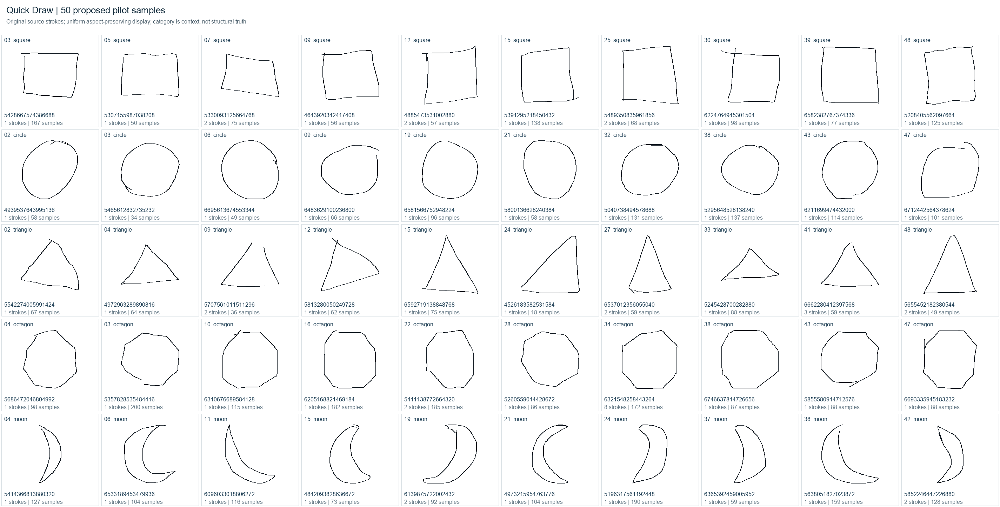
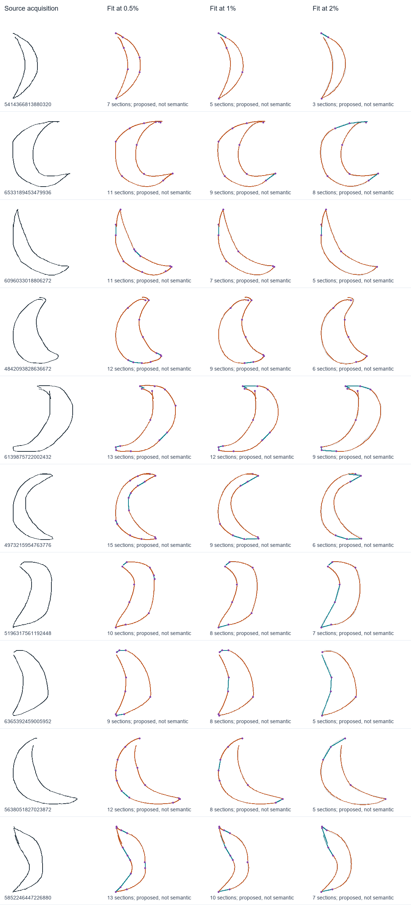

# Quick Draw acquisition and conversion pilot

Status: exploratory experiment, 23 October 2026. Start with the historical
[handoff](handoff.md); this document records the new acquisition work. The
[canonical Gojo prompt](../../Gojo/docs/GojoSystemPrompt.md) remains authoritative.

The next checkpoint is [faithful reconstruction from budgeted evidence](Reconstruction.md):
an actually trained local prior, native sequential hints and generated curves,
four compression levels, restored-output reviews, and five additional categories.

[Encoding strategy](EncodingStrategy.md) distinguishes the current measured
packet from the proposed qualitative resolution dial, describes contextual
priors and variable-length claims, and adds the frozen church transfer fixture.

[Annotated line art](LineArt.md) adds twelve clean authored churches, three
topology diagnostics, two licensed SVG imports, a native relation round trip,
and an offline hover inspector. Broad biological/man-made/natural prior families
remain deferred. Authored annotations are kept separate from calculated checks
and from future interpretation of imperfect Quick Draw observations.
The active diagnostics now include all 26 capital letters on one sheet in place
of the earlier rope example. The [Quick Draw website category](https://gojo.inklingai.ca/quickdraw/)
hosts the inspector and provides a catalogue for subsequent studies.

[Construction ladders](ConstructionLadders.md) now add executable rough-to-detailed
drawing programs: four families, twelve parameterized runs, retained guides,
causal site references and explicit failed conditions. Compact native programs
replay after restoration; their authored transitions prepare a later training
interface without claiming learned intention or nonnumeric reconstruction.

The [church and alphabet construction series](ConstructionSeries.md) extends
that mechanism to all fourteen churches, 26 individual letters and one alphabet
atlas. The combined local review contains 53 programs and 245 steps, using
reusable primitive builders, unconstrained rough guides and source-verified
final controls. Its subsequent resolution study supplies the current website
construction review.

[Positional resolution](ConstructionResolution.md) adds a separate five-setting
dial for those 41 selections: measured, 64, 32, 16 and 8 divisions. The 205 native
programs retain scoped symmetry/repetition, identity, count and relative order
while proportions may change. Necessary finer exceptions remain visible; this
is still numeric calibration, before learned or pre-numeric completion.
The resolution review is now published at
[drawing steps and resolution](https://gojo.inklingai.ca/quickdraw/construction/).

[Interpreting acquired church drawings](QuickDrawConstruction.md) applies that
construction mechanism to the five existing Quick Draw churches. A measured
envelope and rough outline precede the acquired strokes, with three strengths
of geometric interpretation, retained source intervals and native correspondence
witnesses. The new hand-drawing study remains a local review and GitHub checkpoint.

[Joint and line annotations](QuickDrawAnnotations.md) add source-supported
line roles, ray arrangements, local and broader symmetry, and geometric
relations. The existing three modes now also widen interpretive allowances,
with measured gaps and angular residuals retained. These reads mark the drawing
without generating or repairing its geometry.

The first useful result is an **exact native sample-acquisition boundary plus an
inspectable measured fitting experiment**. The full acquisition-to-concept
converter is not complete. No prior was trained in this initial acquisition
checkpoint; the linked reconstruction checkpoint adds that work.

## What the handoff establishes, and what it does not

The handoff describes several reusable mechanisms, rather than one existing
sketch recognizer. This matters when deciding what to reuse:

| Existing mechanism | What we can reuse | What Quick Draw still has to supply |
| --- | --- | --- |
| `QualitativeRecognitionObservation` | Fresh sites, ordered passages, coarse headings, advertised encounter information | What the sites and passages represent, and which contacts are merely proposed |
| `JointShapeDescription` | Anonymous joint/ray contracts and candidate connectivity | Blind landmark discovery and a defensible segmentation |
| `StructuralEvidenceStreams` | Separate observations, hypotheses, defaults, goals, and dependencies | Claims with an acquisition source and declared read resolution |
| `CurveEvidenceScene` / `CurveRefinementMessage` | Native finite curves, detached selected tangent/bend/profile reports | Fitted candidate sections and endpoint scaffolds; the existing publisher assumes these are supplied |
| `StatisticalEvidence` / `EvidenceSupport` | Explicit alternatives, factors, dependencies and supporting acquisitions | Learned or otherwise justified priors and reporting likelihoods |
| `OrnamentLearningMemory` | Retained route/fragment memory and structural matching | Composition of unfamiliar wholes from noisy independent samples |

The important architectural gap is therefore **sample span → candidate primitive
→ proposed landmark/contact → detached conceptual claim**. It cannot be filled
by assigning the category name to a native shape, or by passing the whole input
polyline to a receiver and calling its replay reconstruction.

The handoff's historical findings remain valuable warnings: candidate consensus
can be wrong when the construction repertoire lacks the source; improved
reranking can introduce more hard conflicts; equal feature reports need not
determine equal silhouettes. Those larger experiments were not rerun here.

## Local data and curation

The existing `D:\_quickDraw\quickdraw` directory contains 351 NDJSON files,
197,002,029,098 bytes. The requested files are already present. Some other files
have `full_raw_` aliases; file count is not a count of independent categories or
drawings. No additional data or packages were downloaded.

The inspected category records contain raw `x/y/t` strokes, including fractional
coordinates. The official simplified format is a different input: it removes
time and applies translation, uniform scaling, resampling and simplification.
`word` is the drawing prompt; `recognized` records the game's response. Neither
certifies geometric truth. See the
[official dataset specification](https://github.com/googlecreativelab/quickdraw-dataset).

The selector reads only the first 2,000 records of each requested category,
orders encoding-valid records by SHA-256 of `20261023:key_id`, and retains 48
candidates per category for visual review. It does not filter by `recognized`.
The 10,000-record inspection found:

- 2,399 records with fractional coordinates;
- 7,477 consecutive repeated XY samples;
- four backward within-stroke timestamp steps;
- no malformed records in this bounded prefix.

These counts describe the inspected prefixes, not the full corpus. Timing
irregularities remain evidence; the importer never sorts samples to repair time.

Ten drawings per category were selected by visual inspection independently of
fitting success. The fixed set has **50 drawings, 68 recorded strokes and 4,785
sample events**. Thirteen records use fractional coordinates. One visually
triangle-like example has `recognized=false`. All selected records were checked
against their source byte offsets and SHA-256 hashes. The combined file hash is
`f8cc429bfbcc0558aee60de3d2363a53ff365a2c6a14a765b3a65f82ba9419cf`.

This is a curated engineering fixture, not a statistically representative sample
or a learning benchmark. It includes skew, bowing, retracing, overshoot, pen lifts
and modest gaps. The moons are plain crescents, without cratered disks, landers,
faces or surrounding objects. Two incomplete octagons and a circle missing a
large arc are retained separately as completion challenges. The proposed
selection was accepted by the user on 23 October 2026. Acceptance of these
examples does not turn proposed structural interpretations into ground truth.



Images are aspect-preserving displays of original Quick Draw strokes. Source:
Google Creative Lab's [Quick, Draw! dataset](https://github.com/googlecreativelab/quickdraw-dataset),
[CC BY 4.0](https://creativecommons.org/licenses/by/4.0/). Curation and fitted
overlays are this experiment's derived work.

Local review files:

- `D:\_quickDraw\gojo-pilot\review.html`: all samples, larger category sheets,
  candidate sheets, source IDs, selection notes and separate challenges.
- `selected.ndjson`: unchanged source record bytes, including source line endings.
- `selection-manifest.json`: source offsets, hashes, acquisition measurements and
  the reason each sample was selected.
- `selection-v1`: the 240 candidate records and sheets, including rejected cases.

The reusable selection decisions live in
[tools/pilot_selection.json](tools/pilot_selection.json). Changes to the fixture
must change that manifest and regenerate downstream results.

## Three products, with different promises

### 1. Exact acquisition: implemented

[QuickDrawRecord.cs](QuickDrawRecord.cs) streams raw or simplified NDJSON. It
retains the original JSON, string identity, decimal lexemes, optional metadata,
stroke ordering and timing. Unequal array lengths, ambiguous duplicate record
properties and mixed raw/simplified stroke arity are rejected explicitly. Empty
and singleton strokes are valid acquisition states. Missing time is open rather
than an invented zero.

JSON numbers first have exact reduced rational reads. Native numeric locations
use Int64 numerator and positive denominator; a value outside that range is
refused without rounding. Parsing itself has a declared 1,000-digit/exponent
capacity. These are pilot resource bounds, not laws about the data.

[NativeAcquisition.cs](NativeAcquisition.cs) then constructs ordinary Gojo
relations. The notation is a local encoding contract:

```text
basis = (S(X,0,1) -> S(Y,0,1)) -> (S(time,0,1) -> S(index,0,1))
scalar(C,n/d) = L(C,n) -> P(C,d)
sample = event -> (L(index,i) -> ((scalarX -> scalarY) -> timeScope))
span = strokeEvent -> ((fromEvent -> toEvent) -> Closed(actual sample rows))
stroke = event -> (L(index,s) -> (Closed(samples) -> Closed(adjacent spans)))
acquisition = (sourceEvent -> basis) -> Closed(strokes)
```

`X` and `Y` are distinct carriers with a common input-coordinate unit. Their
ordered spans declare the selected coordinate basis; they do not discover a
geometric metric from the sketch. Coordinates are grounded locations, not
direct carrier value assignments. The rational surface is a contextual
coordinate read, not a new reciprocal-unit law.

Every recorded sample has its own event identity. Consecutive spans share the
actual intervening sample; equal coordinates elsewhere do not share identity.
A return to the starting coordinate therefore does not create a closed semantic
contour. `Closed(...)` above means an exhaustive inventory, not geometric closure.
An exact reader validates the shape, indices, rational bases and span aliases.
The CLI restores each serialized acquisition and compares every coordinate and
time against the input.

There is also a detached `QualitativeRecognitionObservation` using fresh sites,
sampled adjacency and coarse sign-of-displacement headings. It intentionally
retains **acquisition history** through traversal. Source coordinates, timestamps,
labels and source identities are absent. The source/public correspondence and
explicit screen-axis mapping remain in a separate audit archive. Crossing and
continuation scopes are open: uninspected does not mean absent.

This packet is acquisition evidence, not a discovered semantic stroke graph.
It is not the history-blind condition proposed for later learning.

### 2. Measured interpretation proposals: implemented adapter experiment

[tools/fit_pilot.py](tools/fit_pilot.py) takes only `drawing`; category, recognition
status and source ID cannot affect its fitting function. Its evaluator envelope
contains IDs and categories for review and must not be handed to a blind learner.

The adapter selects a uniform scale and translation using the longest bounding
box extent, preserving aspect and the supplied screen orientation. It keeps
normalization correspondence. This measured read uses binary64 arithmetic;
exact input remains in the acquisition product.

Consecutive repeated coordinates are collapsed only in this fitting view. Their
source indices and correspondence remain explicit. Each stroke receives six
alternatives: straight-only and line/quadratic/cubic grammars at 0.5%, 1% and 2%
of the longest extent. Endpoint-fixed polynomial least squares uses chord-length
parameters; recursive splitting retains ordered source spans. This is a small
baseline, without robust outlier fitting, global optimization, temporal weighting
or learned parameters.

Each section retains controls, source indices, sampled residuals and its metric.
Line residual is distance to the bounded segment; polynomial residual is distance
at the selected sample parameter. These are different criteria, not comparable
probabilities. Neither is a certified global Hausdorff bound or a statement about
the intended contour. Line fits also retain projected backward progress so a
collinear retrace cannot vanish behind zero geometric error.

Endpoint proximity is a separate proposal using a declared 3% threshold. No
endpoint is snapped, welded or closed. Interior crossings, endpoint-to-interior
contacts and semantic component discovery are not implemented.

The fitting JSON is a diagnostic adapter output, **not canonical Gojo meaning**.
The fit-to-native-witness bridge remains to be built. It would be misleading to
claim that fitted controls already constitute the handoff's detached qualitative
curve message.

### 3. Conceptual claims and generated realizations: next work

The public semantic product should contain selected claims about proposed
sections, corners, possible contacts, relative layout and curve profiles, with
common acquisition dependencies and explicit unresolved alternatives. A receiver
must not traverse back to private coordinates, fitting handles or category labels.

Faithful, conceptual, idealized and completion outputs are distinct contracts.
This checkpoint renders fitted source approximations; it does **not** yet produce
idealized native shapes from sparse hints or train a generation prior.

## Measured results and what they mean

All 50 records convert and restore exactly. The complete raw source is less than
90 KB, while expanded native acquisition, publication and audit artifacts occupy
about 49 MiB. This is a valuable fidelity fixture but an unsuitable per-row
training format. Keep original acquisition once, compact derived features for
batch work, and full native audits for selected cases. Graph serialization size
is not conceptual complexity.

The fitting experiment runs 300 conditions: 50 drawings × two grammars × three
resolutions. At a 1% threshold, mean fitted section counts per drawing are:

| Review category | Straight-only | Line + quadratic + cubic |
| --- | ---: | ---: |
| Square | 11.8 | 7.4 |
| Circle | 20.9 | 8.6 |
| Triangle | 10.3 | 5.7 |
| Octagon | 13.8 | 9.6 |
| Crescent moon | 19.5 | 8.5 |

These counts measure a fitted representation, not recovered sides or concept
accuracy. A square need not have four fitted pieces: an overshoot, gap or bowed
side may account for several. Conversely, a polynomial can absorb a local corner
within tolerance. The different residual criteria also prevent interpreting
fewer pieces as a clean model-quality advantage.

The useful finding is the gap between **primitive compression and conceptual
grouping**. Crescents retain 5–12 fitted sections at 1%; the intended two major
boundary roles are not automatically found. Polygons also retain more pieces than
their ideal side count. A coarser fit reduces pieces but can erase an intentional
notch, exactly as the synthetic control demonstrates.



Gray is the supplied path; teal is a line proposal; orange is a polynomial
proposal; purple dots are section boundaries. The source's gaps remain gaps.
Changing tolerance alone cannot decide which irregularity is meaningful.

Machine-readable measurements are retained in [results](results). Detailed
per-sample fit JSON and all five category comparisons remain under
`D:\_quickDraw\gojo-pilot\fits`. The figures are source fits, not independent
semantic reconstructions.

## Representation and inference strategy

Separate questions rather than forcing one final segmentation:

1. **Acquisition:** what samples and pen transitions were actually recorded?
2. **Primitive support:** which line/curve explanations account for each span at
   the declared resolution, and what deviations remain?
3. **Conceptual grouping:** which consecutive or separated sections may belong
   to one side, arc, tip, contour or repeated relation?
4. **Contact:** is a location a near miss, apparent crossing, possible junction,
   actual constructed shared site, or unobserved continuation?
5. **Purpose:** which properties should a reconstruction preserve or idealize?

The five groups offer useful intended families, with qualifications:

| Family | Structural target | What must remain an additional premise |
| --- | --- | --- |
| Square | Four principal side regions, equivalent extent and quarter-turn constraints | Exact equality, perpendicularity and repaired closure are not observations just because the prompt says square |
| Circle | A smooth loop-like contour; common radial support under a selected metric | Exact circle versus ellipse, true closure, and exact circular construction versus finite polynomial approximation |
| Triangle | Three side regions and three corner regions | Equilateral or isosceles is optional idealization, not implied by triangle |
| Octagon | Eight side regions in an ordered contour | Regularity and equal sides/angles require separate evidence or defaults |
| Crescent | Two tip regions, an outer and an inner boundary, and an oriented concave/convex relationship | Two exact circular arcs, symmetry, perfect tip sharing and completed closure |

A circle with a separate interior arc is a valuable crescent counterexample.
Its silhouette may suggest the same broad arrangement while its component and
boundary interpretation differ. Similarly, seven- and nine-sided contours test
whether an octagon prior is hiding a failed observation.

Do not assign every extra stroke to decoration. Main-contour focus, apparent
detail, acquisition jitter and unaccounted support need separate hypotheses.
Retain the complement of a selected focus so later questions can recover a
notch, crater, letter or branch that an earlier question did not need. The current
clean fixture does not demonstrate decoration filtering; add rejected candidates
and controlled extra strokes in a subsequent condition.

## How to learn useful pressures

Begin with proposal selection and ranking, not an unrestricted image generator.
Candidate learning targets are segmentation boundaries, grouping several fitted
pieces, contact versus continuation, the next informative query, and whether to
retain alternatives or abstain. Keep structural choices separate from metric
parameters and stylistic variability.

A first construction bank should include multiple explanations: square as a
turning route, as parallel side pairs, and as a partitioned contour; crescent as
two finite curved routes and as a separately justified circular construction.
These may satisfy the same visible goal but have different transformation
affordances. They are not necessarily mutually exclusive hypotheses.

Useful local mismatches include departure from straight support, inconsistent
turns, unequal intended extents, incompatible endpoint tangents, an unexplained
gap, and excess structure outside a selected focus. They are initially **read
residuals**, not carrier tension. To turn one into a pressure, connect a response
policy to the parameter or structural port allowed to change, introduce the
accepted signed delta, settle locally, and preserve the before/after witness and
unaccepted remainder. No claim residual identifies the wrong participant by
itself.

Likewise, fit quality, compactness, default preference and evidence strength need
separate reads. Several reports from one fitted span share an acquisition cause.
Do not multiply them as independent observations. Never let a favorable style
score compensate for a forbidden join or missing required side.

Compare four baselines under the same candidate scope and search budget:
uniform proposal weight, exposure frequency, authored compactness, and learned
prior. Report candidate coverage separately from the quality of ranking among
available candidates. A learned prior cannot recover an absent construction.

Relevant primary research offers useful comparisons without replacing Gojo:

- [SketchRNN](https://arxiv.org/abs/1704.03477) is a later stroke-sequence generation
  baseline; its sequence objective does not directly certify structural identity.
- [Learning to Infer Graphics Programs from Hand-Drawn Images](https://papers.nips.cc/paper_files/paper/2018/hash/6788076842014c83cedadbe6b0ba0314-Abstract.html)
  separates primitive proposals from reusable program synthesis.
- [DreamCoder](https://arxiv.org/abs/2006.08381) distinguishes a reusable program
  library from the learned policy searching it, useful when considering later
  fragment composition and structural priors.

No need to install these runtimes to test the acquisition contract.

## Evaluation and next checkpoints

The current tests cover exact decimals and source identity, raw/simplified input,
malformed arrays, absent versus zero time, timestamp reversal, repeated-coordinate
identities, native restoration, public/private separation, source-span aliases,
aspect-preserving normalization, near closure, independent crossing strokes,
multiple pen lifts, duplicate samples, collinear retracing and notch loss with
coarsening. They establish adapter behavior, not recognition performance.

Recorded verification: the solution run passed 5,325 tests with no failures or
skips. The final exact-reader hardening (opposite placeholder faces and copied
sample rows) was then verified by 21 focused importer tests in Debug and Release;
the earlier solution run contained 17 importer cases. All 15 Python fitting
checks pass. All 50 final acquisitions restore exactly, and the source-byte/hash
checks pass for the 50 selected and three challenge records.

Next checkpoints, in order:

1. **Native fit witnesses.** Connect fitted candidate sections, source spans,
   basis, residual and competing segmentation. Publish a detached semantic
   packet; test that coordinates, controls and category labels cannot leak.
2. **Manual structural annotation.** Review the 50 samples and mark principal
   side/arc regions, tips, gaps, optional details and ambiguous readings. Retain
   multiple valid annotations where needed. Add rounded-corner, near-straight,
   T/near-miss, seven/eight/nine-side and decorated-parent controls.
3. **Bounded reconstruction.** Generate several conservative and idealized native
   constructions from those packets. Independently read executed output. Record
   required/forbidden claims, defaults used, unexplained support, false joins and
   withheld-question outcomes. Compare acquisition-aware and history-blind input.
4. **Small learned policy.** Reserve fresh untouched data before tuning. Use
   source-ID and near-duplicate groups for splits; all augmentations of one source
   stay together. Hold out synthetic construction families separately. Compare
   learned ranking with the fixed baselines; include abstention and coverage.
5. **Scale only after useful failures are visible.** Stream broader reservoirs,
   add clutter and alternative categories, and expand the proposal grammar where
   coverage fails. Measure parse/proposal/execution/readback/archive costs
   separately. Preserve sampled audits rather than expanding every training row.

The 50 curated cases are development fixtures. They cannot substantiate calibrated
likelihoods, robust decoration filtering or broad generalization. Final evaluation
needs unseen sources, independent human judgments, and conditions that cannot be
passed merely by satisfying the generator's own critic.

## Reproduce locally

Run from the repository root. Python 3.10 and Pillow were already available;
the fitter itself uses only the standard library. Rendering currently uses the
Windows Arial font for the fit sheets. The C# project uses the repository's
.NET 10 dependencies.

```powershell
python experiments/quickDraw/tools/select_samples.py candidates
python experiments/quickDraw/tools/select_samples.py select --review experiments/quickDraw/tools/pilot_selection.json --combined-output D:\_quickDraw\gojo-pilot
python experiments/quickDraw/tools/fit_pilot.py --input D:\_quickDraw\gojo-pilot\selected.ndjson --output D:\_quickDraw\gojo-pilot\fits
dotnet run --project experiments/quickDraw -- --input D:\_quickDraw\gojo-pilot\selected.ndjson --output D:\_quickDraw\gojo-pilot\native
python -m unittest discover -s experiments/quickDraw/tools -p test_fit_pilot.py -v
dotnet test Tests/QualitativeExecution.Tests --filter FullyQualifiedName~QuickDrawAcquisitionTests
dotnet test Gojo.slnx
```

Use explicit alternate paths for another machine. Source corpora and expanded
archives stay outside the repository; retained results and selection manifests
make this checkpoint reviewable without committing the full corpus.
